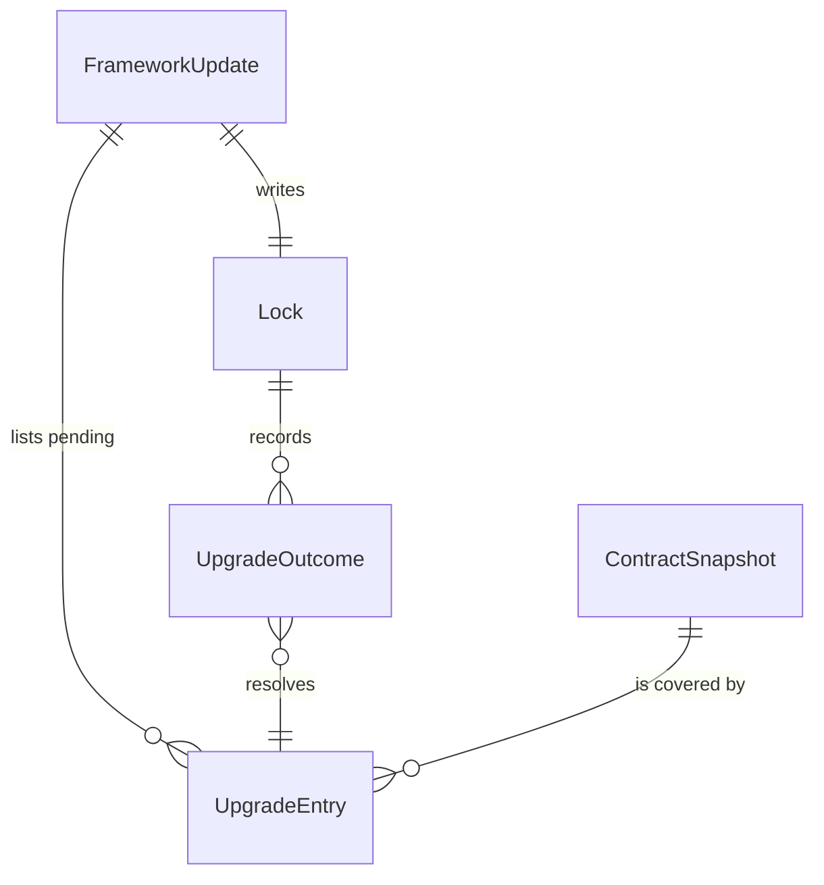

# Framework Update and Upgrade Entries — Feature Spec

> **Tech-free Feature Spec.** One doc per module-level capability. Technical identifiers live only in frontmatter and the Section 8 hidden carriers.

## Sections

1. [Overview](#1-overview)
2. [Glossary](#2-glossary)
3. [User Stories & Acceptance Criteria](#3-user-stories--acceptance-criteria)
4. [Business Rules](#4-business-rules)
5. [Domain Model](#5-domain-model)
6. [Process Flows](#6-process-flows)
7. [Permissions & Roles](#7-permissions--roles)
8. [Test Specifications](#8-test-specifications)

---

## 1. Overview

A project that adopted the framework takes newer framework versions through an update that merges the new version into the project's copy, keeping the project's own skills, settings and edits. Merging files is not enough on its own: some framework changes need the project to do something, such as filling a new setting, setting up a baseline or deciding whether to turn on a new check.

Each such change ships an **upgrade entry**: an **action** with steps the project's assistant runs, asking the user first where a step needs consent, or a **notice** the assistant passes on to the user. Every update ends with the list of entries this project has not resolved yet, in the order to run them, including any left unfinished last time. The assistant records each outcome, so the next update asks only about what is still open.

Upstream, the framework maintainers cannot forget an entry: a check fails when a consumer-facing part of the framework changes and no entry, or recorded waiver, answers for that exact change. The check runs only in the framework's own repository, never in an adopting project.

The capability exists because an adopting project otherwise receives new files with no instruction. A new setting stays empty, a new check is never set up, and nobody notices until the feature it serves misbehaves.

---

## 2. Glossary

| Term | Definition | Context |
| --- | --- | --- |
| Framework update | Taking a newer framework version into a project by merging it with the project's own changes | The user asks for it; the assistant runs it |
| Lock | The project's record of the framework version it holds and the upgrade entries it resolved | Written by every update |
| Base | The framework version the project held before this update | Decides what is new |
| Upgrade entry | One action or notice shipped with a framework change | Listed after an update until resolved |
| Action | An entry with steps to run, a level (required, recommended, optional) and optional checks | The assistant runs it with consent where asked |
| Notice | An entry with information only | The assistant tells the user |
| Outcome | done, not applicable, declined or failed, with a reason for all but done | Recorded in the lock |
| Pending entry | An entry of the target version with no resolving outcome | What the list shows |
| Done check | A check that tells whether an action's work already exists | Stops a second run from redoing it |
| Applicability check | A check that tells whether an action concerns this project | Records it not applicable when it does not |
| Merge note | What an entry says to keep in a framework file that may conflict in projects that edited it | Shown only for conflicted files |
| Consumer-facing surface | A part of the framework an adopting project depends on: a configuration section, a workflow, a hook registration, a reference-document target, the set of skills | Guarded upstream |
| Contract snapshot | The upstream record of each surface's accepted fingerprint and what accepted it | Read by the upstream check |
| Waiver | An upstream-only record that a surface change needs nothing from adopting projects, with its reason | Never shown to adopting projects |

---

## 3. User Stories & Acceptance Criteria

### US-FWU-01: Learn what each framework change needs after an update

**As a** developer whose project takes a framework update
**I want** the update to end with every action and notice my project still has to handle
**So that** a new setting or check is set up rather than silently missing

**Acceptance Criteria:**

- **AC-FWU-01** — **Given** an update that brings entries this project has not resolved **When** the update finishes **Then** it lists each one with its kind, level, title and where to read it, in the order to run them, and says how to record each outcome
- **AC-FWU-02** — **Given** the project runs an older copy of the update guidance **When** it updates **Then** the list still appears, because the updater of the new version prints it
- **AC-FWU-03** — **Given** an entry that cannot be read **When** the list is built **Then** the entry is still listed, marked as unreadable with the reason

### US-FWU-02: Never lose an unfinished action

**As a** developer who stopped after the merge
**I want** unfinished actions listed again at the next update, and resolved ones never again
**So that** nothing is dropped and nothing is asked twice

**Acceptance Criteria:**

- **AC-FWU-04** — **Given** an action left unresolved **When** a later update runs, whether it merges, records a hand sync, takes an unpublished version or finds the project already current **Then** the action is listed with the new entries
- **AC-FWU-05** — **Given** an entry recorded done, not applicable or declined **When** any later update runs **Then** it is not listed
- **AC-FWU-06** — **Given** an action recorded failed with a reason **When** the next update runs **Then** it is listed again with that reason

### US-FWU-03: Start correctly on a project that never recorded a version

**As a** developer whose project was copied by hand
**I want** the first update to treat entries my copied version already had as settled
**So that** I am not asked to repeat setup the copied version already included

**Acceptance Criteria:**

- **AC-FWU-07** — **Given** a project with no lock **When** its first update runs from the detected or named base **Then** entries present at the base are recorded not applicable, and only later entries are listed
- **AC-FWU-08** — **Given** a project with no lock that was synced by hand **When** the developer records the new version without merging **Then** the update requires the version held before the hand sync and refuses automatic detection, which would match the new version and skip every entry

### US-FWU-04: Resolve conflicts with the guidance they need

**As a** developer whose update stopped on conflicts
**I want** to see what each relevant entry says about the conflicted files, and the full list once the files are final
**So that** I keep what a framework change depends on and handle entries against a finished merge

**Acceptance Criteria:**

- **AC-FWU-09** — **Given** an update that stopped on conflicts **When** it reports **Then** it names how many entries are pending, the merge notes of each conflicted file, and the command that lists the entries once the conflicts are resolved
- **AC-FWU-10** — **Given** the conflicts are resolved **When** the developer lists the entries **Then** the full list appears

### US-FWU-05: Run actions safely and in order

**As a** developer
**I want** actions that respect my consent, run in their declared order and never redo finished work
**So that** an update cannot install tools or overwrite state behind my back

**Acceptance Criteria:**

- **AC-FWU-11** — **Given** an action whose work already exists **When** its done check passes after the update **Then** it is recorded done and not listed
- **AC-FWU-12** — **Given** an action that does not concern this project **When** its applicability check answers that it does not apply **Then** it is recorded not applicable with the reason; a check that crashes or cannot run records nothing
- **AC-FWU-13** — **Given** an action that runs after another **When** the list is ordered **Then** it follows its prerequisite, and it waits while the prerequisite is unresolved or failed
- **AC-FWU-14** — **Given** a step that installs, chooses a tool or changes a project-owned file **When** the assistant reaches it **Then** it asks the user first, and runs entries only inside an update the user asked for

### US-FWU-06: Make guidance impossible to forget upstream

**As a** framework maintainer
**I want** a check that fails when a consumer-facing surface changes without an entry or waiver for that exact change
**So that** every adopting project receives the guidance it needs

**Acceptance Criteria:**

- **AC-FWU-15** — **Given** a changed, new or removed consumer-facing surface **When** nothing covers its new fingerprint **Then** the check fails, naming the surface, why it matters and how to fix it
- **AC-FWU-16** — **Given** a covering entry or waiver **When** the maintainer refreshes the snapshot **Then** the change is recorded and the check passes; reworded prose alone is not a change
- **AC-FWU-17** — **Given** an uncovered change **When** the maintainer refreshes the snapshot or edits a fingerprint into it by hand **Then** the refresh is refused and the hand edit fails the check
- **AC-FWU-18** — **Given** an adopting project with its own skills and hooks **When** its tests run **Then** the upstream check skips

---

## 4. Business Rules

### Rule Catalog

| Rule ID | Name | Category | Enforcement |
| --- | --- | --- | --- |
| BR-FWU-01 | Pending means not yet resolved, on every path | Delivery | [HARD] |
| BR-FWU-02 | Every outcome is recorded; only failed stays pending | Bookkeeping | [HARD] |
| BR-FWU-03 | A first update settles what its base already had | Delivery | [HARD] |
| BR-FWU-04 | The updater prints the list; conflicts defer it | Delivery | [HARD] |
| BR-FWU-05 | Consent and scope bound every action | Authority | [HARD] |
| BR-FWU-06 | Work that writes state is never redone | Safety | [HARD] |
| BR-FWU-07 | Actions run in declared order | Ordering | [HARD] |
| BR-FWU-08 | Every consumer-facing change is covered upstream | Contract | [HARD] |
| BR-FWU-09 | Only covered fingerprints enter the snapshot | Contract | [HARD] |
| BR-FWU-10 | The upstream check never runs in adopting projects | Portability | [HARD] |
| BR-FWU-11 | Actions are kept; notices may retire | Retention | [SOFT] |

### BR-FWU-01: Pending means not yet resolved, on every path [HARD]

**Statement:** The pending entries are the entries of the version being taken minus those the lock records as done, not applicable or declined. The rule does not depend on the base, so a merge, a recorded hand sync, an unpublished version and an already current project list the same entries.

### BR-FWU-02: Every outcome is recorded; only failed stays pending [HARD]

**Statement:** Each entry ends as done, not applicable, declined or failed. Every outcome but done carries a reason. A failed entry keeps its reason and is listed again until another outcome replaces it.

```
IF an outcome other than done has no reason
  → REJECT: "Say why, so the next update shows it"
```

### BR-FWU-03: A first update settles what its base already had [HARD]

**Statement:** Without a lock, entries present at the base are recorded not applicable, because that version was installed with them. Recording a hand sync without a lock needs the version held before the sync, named explicitly.

### BR-FWU-04: The updater prints the list; conflicts defer it [HARD]

**Statement:** The updater of the version being taken prints the list at the end of every update, so older guidance still relays it. When conflicts stop the update, it prints only the pending count, the merge notes of conflicted files and the command that lists the entries later.

### BR-FWU-05: Consent and scope bound every action [HARD]

**Statement:** Entries run only inside an update the user asked for. A step that installs, chooses a tool or changes a project-owned file asks first, and changes such a file only through the guidance that owns it. Done and applicability checks run without asking, so they only read.

### BR-FWU-06: Work that writes state is never redone [HARD]

**Statement:** An action that writes state declares a done check; when the check passes, the action is recorded done instead of being run again. An applicability check settles an action as not applicable only with its reserved "does not apply" answer; a check that crashes or cannot run settles nothing, so a broken check never drops a required action.

### BR-FWU-07: Actions run in declared order [HARD]

**Statement:** An action follows every pending entry it names as a prerequisite; a resolved prerequisite releases it, a failed one holds it. Its checks run only once it is released. Otherwise older entries come first.

### BR-FWU-08: Every consumer-facing change is covered upstream [HARD]

**Statement:** When a surface's fingerprint differs from the snapshot, an action, notice or waiver must name that surface and its new fingerprint. A removed surface is covered as absent. Prose wording is not part of the fingerprint.

### BR-FWU-09: Only covered fingerprints enter the snapshot [HARD]

**Statement:** The snapshot refresh records only covered changes and refuses while any is uncovered. Each recorded fingerprint must trace to the baseline, a covering entry or a waiver with a reason; any other fingerprint fails the check.

### BR-FWU-10: The upstream check never runs in adopting projects [HARD]

**Statement:** The check runs only in the framework's own repository. An adopting project carries it but skips it, whatever its own skills, hooks or snapshot hold.

### BR-FWU-11: Actions are kept; notices may retire [SOFT]

**Statement:** An action is never deleted, so a project that updates rarely still receives it. A notice may be deleted 180 days after it was added; when it was the recorded cover of a surface, a waiver naming it takes its place.

---

## 5. Domain Model

### Relationships (overview)



### Entity: UpgradeEntry

| Property | Type | Required | Constraints | Business Meaning |
| --- | --- | --- | --- | --- |
| identifier | text | Yes | unique, never reused | Which entry |
| kind | enum | Yes | action or notice | Run steps or tell the user |
| title | text | Yes | one line | Shown in the list |
| added | date | Yes | — | Orders entries; starts a notice's retention |
| level | enum | Actions | required, recommended, optional | How strongly to recommend it |
| prerequisites | list | No | identifiers of other entries | Runs after them |
| steps | list | Actions | each names what to run and whether consent is needed | What the assistant does |
| done check / applicability check | check | No | portable; a writing action needs a done check | Settles it without asking |
| covers | list | No | surface and fingerprint | Which upstream change it answers for |
| merge notes | list | No | framework file and what to keep | Shown for conflicted files |

### Entity: UpgradeOutcome

| Property | Type | Required | Constraints | Business Meaning |
| --- | --- | --- | --- | --- |
| status | enum | Yes | done, not applicable, declined, failed | What happened |
| reason | text | All but done | — | Why |
| date | date | Yes | — | When |

### Entity: ContractSnapshot

| Property | Type | Required | Constraints | Business Meaning |
| --- | --- | --- | --- | --- |
| baseline | map | Yes | written once | Fingerprints accepted when the check began |
| accepted surfaces | map | Yes | each with what accepted it | Current accepted fingerprints |
| waivers | list | No | each with covers and a reason | Changes nobody needs to act on |

### Domain Events (business occurrences)

| Event | When | Effect |
| --- | --- | --- |
| Update applied | The merged files are written | Checks run; the list is printed |
| Update stopped on conflicts | Conflicts remain | Only the count and merge notes are printed |
| Outcome recorded | The assistant records an entry | The entry leaves the list unless it failed |
| Surface changed upstream | A consumer-facing fingerprint differs | The check fails until covered and refreshed |

---

## 6. Process Flows

No user interface: this capability changes how a framework update ends and how framework changes are checked upstream. Interaction surface sections are skipped for that reason.

### Flow: Update and handle the entries

| Step | Actor | Action | System Response | Next |
| --- | --- | --- | --- | --- |
| 1 | Developer | Asks to update the framework | Assistant previews the update, including pending entries | 2 |
| 2 | Assistant | Applies the update | Files merged, checks run, list printed; or conflicts reported with merge notes | 3 or 4 |
| 3 | Assistant | Resolves conflicts, then lists the entries | Full list | 4 |
| 4 | Assistant | For each entry in order, asks where needed, runs the steps or relays the notice | Work done or declined | 5 |
| 5 | Assistant | Records each outcome | Lock updated; failed entries stay listed | 6 |
| 6 | Assistant | Reports the outcomes with the update | — | — |

### Flow: Ship a consumer-facing change upstream

| Step | Actor | Action | System Response | Next |
| --- | --- | --- | --- | --- |
| 1 | Maintainer | Changes a surface | Check fails, naming the surface, new fingerprint and fix | 2 |
| 2 | Maintainer | Adds an action or notice that covers it, or a waiver with a reason | Check reports the change as covered but not recorded | 3 |
| 3 | Maintainer | Refreshes the snapshot | Check passes | — |

---

## 7. Permissions & Roles

This capability enforces no permission boundary of its own beyond asking. Repository access follows the project's normal rules.

| Role | Starts an update | Approves consent steps | Records outcomes | Changes the snapshot |
| --- | :---: | :---: | :---: | :---: |
| Developer | yes | yes | through the assistant | no |
| Assistant | only when asked | no | yes | no |
| Framework maintainer | yes | yes | yes | through a covered refresh |

---

## 8. Test Specifications

### Test Summary

| Priority | Count | Automated | Manual |
| --- | --- | --- | --- |
| P0 | 7 | 7 | 0 |
| P1 | 6 | 6 | 0 |
| **Total** | **13** | **13** | **0** |

Every `[HARD]` rule is guarded by a case with a property block: the input domain, the invariant that holds across it and the boundary counter-case. The cases run against throwaway upstream and project repositories, so they hold on any operating system.

### Delivery Tests

#### TC-FWU-001: The updater lists pending entries, even for older guidance [P0]

**Objective:** Every update ends with the pending entries, whichever guidance started it.

**Business Intent / Invariant Guarded:** BR-FWU-04 / AC-FWU-01, AC-FWU-02.

**Preconditions:** A framework version with one entry the project has not resolved.

**Real-World Reachability:** The first update that brings entries runs with the project's older guidance.

```gherkin
Given a project whose own update guidance predates upgrade entries
When it updates to a version that ships an entry
Then the output ends with the entry's kind, title and file, and how to record its outcome
```

**Expected Result:**

| Dimension | Expectation |
| --- | --- |
| **UI** | Not applicable — the observable surface is the update's output |
| **System behavior** | The list is printed by the version being taken |
| **Business data state** | The lock records the new version |
| **Data shown on UI** | Not applicable |

**Acceptance Criteria:**

- ✅ The updater copied alone, as the update runs it, prints the list.
- ❌ An update that ends without the list fails the case.

**Test Data:** An upstream with one notice; a project with an older guidance copy.

```yaml
inputDomain: 'updates started by any guidance version, with the updater taken from the version being installed'
invariant: 'for ALL such updates the output ends with the pending list or the statement that none is pending'
boundaryCounterCase: 'a version with no entries prints that none is pending; it never omits the line'
```

**Edge Cases (boundary counter-case):** No entries at all still prints the "none pending" line.

<!-- machine-only carrier — ignore when reading as BA/QA -->

> **Evidence:** `[Source: operation/framework-update/next-block]`
> **Related Behaviors:** `operation/framework-update/list-upgrades`
> **CoveredBy:** `.claude/scripts/tests/framework-update-upgrades.test.mjs::TC-FWU-001` · `.claude/scripts/tests/framework-update-upstream.test.mjs::TC-FWU-001` · **Status:** Tested

#### TC-FWU-002: Unfinished entries carry forward; resolved ones never return [P0]

**Objective:** Nothing is dropped and nothing is asked twice across updates.

**Business Intent / Invariant Guarded:** BR-FWU-01, BR-FWU-02 / AC-FWU-04, AC-FWU-05.

**Preconditions:** Two actions after the first update; one recorded done.

**Real-World Reachability:** A developer stops after the merge and updates again months later.

```gherkin
Given one action recorded done and one left open
When the next update brings a third action
Then the open action and the new one are listed, and the done one is not
```

**Expected Result:**

| Dimension | Expectation |
| --- | --- |
| **UI** | Not applicable |
| **System behavior** | Pending = target entries minus resolved ones |
| **Business data state** | The lock keeps the done outcome |
| **Data shown on UI** | Not applicable |

**Acceptance Criteria:**

- ✅ The open action is listed with the new one.
- ❌ Listing the done action, or dropping the open one, fails the case.

**Test Data:** Three actions across two updates.

```yaml
inputDomain: 'any sequence of updates and recorded outcomes'
invariant: 'for ALL updates an entry is listed exactly when the target ships it and the lock holds no resolving outcome'
boundaryCounterCase: 'an entry recorded failed is not resolved and is listed again'
```

**Edge Cases (boundary counter-case):** A failed entry stays listed (TC-FWU-007).

<!-- machine-only carrier — ignore when reading as BA/QA -->

> **Evidence:** `[Source: rule/framework-update/pending-entries]`
> **Related Behaviors:** `operation/framework-update/mark`
> **CoveredBy:** `.claude/scripts/tests/framework-update-upgrades.test.mjs::TC-FWU-002` · **Status:** Tested

#### TC-FWU-003: Every lock-writing path lists the same entries [P0]

**Objective:** A hand sync, an unpublished version and an already current project lose no entry.

**Business Intent / Invariant Guarded:** BR-FWU-01 / AC-FWU-04.

**Preconditions:** A project with an open entry.

**Real-World Reachability:** Teams sync by hand, test unpublished versions, or rerun an update with nothing new.

```gherkin
Given an entry left open
When the project records a hand sync, takes an unpublished version, or updates while already current
Then the open entry is listed each time, and earlier decisions stay recorded
```

**Expected Result:**

| Dimension | Expectation |
| --- | --- |
| **UI** | Not applicable |
| **System behavior** | Same pending rule on every path |
| **Business data state** | Outcomes carried in every new lock |
| **Data shown on UI** | Not applicable |

**Acceptance Criteria:**

- ✅ Each path lists the open entry and keeps the declined one recorded.
- ❌ Any path that drops the outcomes or the open entry fails the case.

**Test Data:** A declined action and a later notice.

```yaml
inputDomain: 'merge, hand-sync record, unpublished version and already-current updates'
invariant: 'for ALL paths the pending list and the recorded outcomes are identical'
boundaryCounterCase: 'an already-current update merges nothing yet still lists the open entry'
```

**Edge Cases (boundary counter-case):** Nothing to merge still lists the open entry.

<!-- machine-only carrier — ignore when reading as BA/QA -->

> **Evidence:** `[Source: rule/framework-update/pending-entries]`
> **Related Behaviors:** `operation/framework-update/record-only`
> **CoveredBy:** `.claude/scripts/tests/framework-update-upgrades.test.mjs::TC-FWU-003` · **Status:** Tested

#### TC-FWU-004: A first update settles the entries its base already had [P0]

**Objective:** A hand-copied project is not asked to repeat setup its version included.

**Business Intent / Invariant Guarded:** BR-FWU-03 / AC-FWU-07.

**Preconditions:** A project copied from a version that had two entries; no lock.

**Real-World Reachability:** Every project installed by copying has no lock until its first update.

```gherkin
Given a project copied from a version with two entries, without a lock
When its first update takes a version that adds a third entry
Then only the third entry is listed, and the two older ones are recorded not applicable as predating the base
```

**Expected Result:**

| Dimension | Expectation |
| --- | --- |
| **UI** | Not applicable |
| **System behavior** | Base entries settled, newer ones pending |
| **Business data state** | Not-applicable outcomes with the base named |
| **Data shown on UI** | Not applicable |

**Acceptance Criteria:**

- ✅ Only the newer entry is pending.
- ❌ Listing a base entry, or settling a newer one, fails the case.

**Test Data:** An action and a notice at the base; an action after it.

```yaml
inputDomain: 'first updates from any detected or named base'
invariant: 'for ALL such updates an entry is settled exactly when the base version already shipped it'
boundaryCounterCase: 'an entry added in the very next version after the base is pending'
```

**Edge Cases (boundary counter-case):** The entry right after the base stays pending.

<!-- machine-only carrier — ignore when reading as BA/QA -->

> **Evidence:** `[Source: rule/framework-update/first-update-base]`
> **Related Behaviors:** `operation/framework-update/detect-base`
> **CoveredBy:** `.claude/scripts/tests/framework-update-upgrades.test.mjs::TC-FWU-004` · **Status:** Tested

#### TC-FWU-005: Recording a hand sync without a lock needs the earlier version [P1]

**Objective:** A hand sync never skips the entries it brought.

**Business Intent / Invariant Guarded:** BR-FWU-03 / AC-FWU-08.

**Preconditions:** A project synced by hand to a version with a new entry; no lock.

**Real-World Reachability:** A team syncs by hand, then records the version.

```gherkin
Given a hand-synced project without a lock
When the developer records the version without naming the version held before
Then the update refuses and says which version to name, and automatic detection is refused too
When the earlier version is named
Then the entries added since then are listed
```

**Expected Result:**

| Dimension | Expectation |
| --- | --- |
| **UI** | Not applicable |
| **System behavior** | Refusal names the missing input |
| **Business data state** | No lock written on refusal |
| **Data shown on UI** | Not applicable |

**Acceptance Criteria:**

- ✅ The refusal writes nothing; the named version lists the newer entry.
- ❌ Recording without the earlier version fails the case.

**Test Data:** A notice at the earlier version, an action after it.

```yaml
inputDomain: 'hand-sync records without a lock'
invariant: 'for ALL such records the earlier version is named explicitly before anything is written'
boundaryCounterCase: 'automatic detection is refused, because it would find the new version itself'
```

**Edge Cases (boundary counter-case):** Automatic detection is refused.

<!-- machine-only carrier — ignore when reading as BA/QA -->

> **Evidence:** `[Source: rule/framework-update/record-only-base]`
> **Related Behaviors:** `operation/framework-update/record-only`
> **CoveredBy:** `.claude/scripts/tests/framework-update-upgrades.test.mjs::TC-FWU-005` · **Status:** Tested

#### TC-FWU-006: Conflicts defer the list and show merge notes [P0]

**Objective:** Entries are handled against finished files, with what to keep shown during conflict resolution.

**Business Intent / Invariant Guarded:** BR-FWU-04 / AC-FWU-09, AC-FWU-10.

**Preconditions:** An update that conflicts on a file an entry has a merge note for.

**Real-World Reachability:** Projects that edited framework files conflict on updates that change them.

```gherkin
Given an update that stops on a conflict in a file an entry notes
When it reports
Then it shows the merge note for that file, the pending count and the command to list the entries later, but not the list
When the conflict is resolved and the developer lists the entries
Then the full list appears
```

**Expected Result:**

| Dimension | Expectation |
| --- | --- |
| **UI** | Not applicable |
| **System behavior** | Deferred pointer, then the full list |
| **Business data state** | Outcomes carried in the lock written by the stopped update |
| **Data shown on UI** | Not applicable |

**Acceptance Criteria:**

- ✅ The merge note names the conflicted file and the entry.
- ❌ Printing the full list before the conflicts are resolved fails the case.

**Test Data:** A conflicting framework file, an action with a merge note, a notice.

```yaml
inputDomain: 'updates stopped by conflicts'
invariant: 'for ALL such updates merge notes appear only for conflicted files and the list waits'
boundaryCounterCase: 'a note whose pattern matches no conflicted file is not shown'
```

**Edge Cases (boundary counter-case):** Notes for files that did not conflict stay hidden.

<!-- machine-only carrier — ignore when reading as BA/QA -->

> **Evidence:** `[Source: rule/framework-update/deferred-list]`
> **Related Behaviors:** `operation/framework-update/list-upgrades`
> **CoveredBy:** `.claude/scripts/tests/framework-update-upgrades.test.mjs::TC-FWU-006` · **Status:** Tested

#### TC-FWU-007: Checks and outcomes settle entries safely [P0]

**Objective:** Finished work is never redone, irrelevant actions are skipped, and failures stay visible.

**Business Intent / Invariant Guarded:** BR-FWU-02, BR-FWU-06 / AC-FWU-06, AC-FWU-11, AC-FWU-12.

**Preconditions:** An action whose work exists, one that does not concern the project, one that fails.

**Real-World Reachability:** Re-runs after a lost lock, projects without a setting the action fills, transient install failures.

```gherkin
Given an action whose done check passes, one whose applicability check answers that it does not apply, one whose check crashes, and one that fails
When the update applies and the failure is recorded with its reason
Then the first is recorded done, the second not applicable, and the third is listed again with its reason
And a decline without a reason is refused
```

**Expected Result:**

| Dimension | Expectation |
| --- | --- |
| **UI** | Not applicable |
| **System behavior** | Checks settle; failed stays pending |
| **Business data state** | The state the done check found is untouched |
| **Data shown on UI** | Not applicable |

**Acceptance Criteria:**

- ✅ A lock that lost its outcomes lists only the action without a done check.
- ❌ Rerunning an action whose done check passes fails the case.

**Test Data:** Actions with done and applicability checks; a lock without outcomes.

```yaml
inputDomain: 'actions with and without checks, after any update or listing'
invariant: 'for ALL actions a passing done check means recorded done and never rerun'
boundaryCounterCase: 'a check that crashes or cannot run settles nothing and the action stays listed; only the reserved does-not-apply answer records not applicable'
```

**Edge Cases (boundary counter-case):** A check that crashes or cannot run leaves the action pending.

<!-- machine-only carrier — ignore when reading as BA/QA -->

> **Evidence:** `[Source: rule/framework-update/upgrade-checks]`
> **Related Behaviors:** `operation/framework-update/mark`
> **CoveredBy:** `.claude/scripts/tests/framework-update-upgrades.test.mjs::TC-FWU-007` · **Status:** Tested

#### TC-FWU-008: Actions run in declared order [P1]

**Objective:** A dependent action never runs before what it needs.

**Business Intent / Invariant Guarded:** BR-FWU-07 / AC-FWU-13.

**Preconditions:** An action that runs after another.

**Real-World Reachability:** A baseline needs the commands that a prior action fills.

```gherkin
Given an action that runs after another, and an older notice
When the list is ordered
Then the notice comes first, then the prerequisite, then the dependent
And a failed prerequisite holds the dependent, while a resolved one releases it
```

**Expected Result:**

| Dimension | Expectation |
| --- | --- |
| **UI** | Not applicable |
| **System behavior** | Prerequisites first, oldest first otherwise |
| **Business data state** | Unchanged |
| **Data shown on UI** | Not applicable |

**Acceptance Criteria:**

- ✅ The dependent is listed after its prerequisite and marked as waiting.
- ❌ A dependent listed first fails the case.

**Test Data:** Two actions with a prerequisite link; a cycle.

```yaml
inputDomain: 'any set of pending entries with prerequisite links'
invariant: 'for ALL orderings an entry follows every pending prerequisite it names'
boundaryCounterCase: 'a cycle cannot be ordered; its entries come last and are marked. A waiting action is not checked until its prerequisite is resolved'
```

**Edge Cases (boundary counter-case):** A cycle is marked rather than silently ordered.

<!-- machine-only carrier — ignore when reading as BA/QA -->

> **Evidence:** `[Source: rule/framework-update/upgrade-order]`
> **Related Behaviors:** `operation/framework-update/next-block`
> **CoveredBy:** `.claude/scripts/tests/framework-update-upgrades.test.mjs::TC-FWU-008` · **Status:** Tested

#### TC-FWU-009: An entry that would leave the assistant guessing is rejected or flagged [P1]

**Objective:** Every entry says what to run and whether to ask first; a broken one is never dropped.

**Business Intent / Invariant Guarded:** BR-FWU-05, BR-FWU-06 / AC-FWU-03, AC-FWU-14.

**Preconditions:** Entries with missing or wrong fields.

**Real-World Reachability:** A maintainer writes a new entry by hand.

```gherkin
Given an entry whose step does not say whether it needs consent, or a writing action without a done check
When it is read
Then it is rejected with a message naming the field and the fix
And during an update an unreadable entry is still listed, marked unreadable
```

**Expected Result:**

| Dimension | Expectation |
| --- | --- |
| **UI** | Not applicable |
| **System behavior** | Field-level rejection; unreadable entries listed |
| **Business data state** | Unchanged |
| **Data shown on UI** | Not applicable |

**Acceptance Criteria:**

- ✅ Each malformed case names its field.
- ❌ A silently dropped entry fails the case.

**Test Data:** Fourteen malformed variants.

```yaml
inputDomain: 'any entry text'
invariant: 'for ALL entries either every field is valid and every step states consent, or the entry is rejected with the field named'
boundaryCounterCase: 'a check that starts with a program other than the two every update already needs is rejected, because it may not run on every operating system'
```

**Edge Cases (boundary counter-case):** Checks are limited to portable programs.

<!-- machine-only carrier — ignore when reading as BA/QA -->

> **Evidence:** `[Source: rule/framework-update/entry-format]`
> **Related Behaviors:** `operation/framework-update/next-block`
> **CoveredBy:** `.claude/scripts/tests/framework-update-upgrades.test.mjs::TC-FWU-009` · **Status:** Tested

#### TC-FWU-010: The update guidance requires consent and recorded outcomes [P1]

**Objective:** The assistant's guidance carries the consent and scope rule for entries.

**Business Intent / Invariant Guarded:** BR-FWU-05 / AC-FWU-14.

**Preconditions:** The update guidance as shipped.

**Real-World Reachability:** Every update the assistant runs.

```gherkin
Given the update guidance and its entry reference
When an assistant follows them
Then they require asking before each consent step, running entries only inside a requested update, and recording every outcome
```

**Expected Result:**

| Dimension | Expectation |
| --- | --- |
| **UI** | Not applicable — the observable surface is guidance |
| **System behavior** | Guidance states the rule |
| **Business data state** | Unchanged |
| **Data shown on UI** | Not applicable |

**Acceptance Criteria:**

- ✅ The guidance has the entries step and the reference states the consent rule.
- ❌ Guidance without the step fails the case.

**Test Data:** The shipped guidance.

```yaml
inputDomain: 'the update guidance and its entry reference'
invariant: 'for ALL shipped versions the consent, scope and recording rules are present'
boundaryCounterCase: 'an already current project is still sent to the entries step'
```

**Edge Cases (boundary counter-case):** An already current project still lists open entries.

<!-- machine-only carrier — ignore when reading as BA/QA -->

> **Evidence:** `[Source: constraint/skills/framework-update-upgrade-step]`
> **Related Behaviors:** `constraint/skills/framework-update-upgrade-step`
> **CoveredBy:** `.claude/scripts/tests/framework-update-upgrades.test.mjs::TC-FWU-010` · **Status:** Tested

### Upstream Contract Tests

#### TC-FWU-011: An uncovered consumer-facing change fails upstream [P0]

**Objective:** No consumer-facing change lands without guidance.

**Business Intent / Invariant Guarded:** BR-FWU-08 / AC-FWU-15, AC-FWU-16.

**Preconditions:** A snapshot of the current surfaces.

**Real-World Reachability:** Every framework change to settings, workflows, hooks, reference-document targets or skills.

```gherkin
Given a new allowed value in a configuration setting
When the check runs
Then it fails, naming the surface, its new fingerprint, why it matters and how to fix it
When a notice covers that fingerprint and the snapshot is refreshed
Then the check passes, and a later default change fails again
And reworded prose changes no fingerprint
```

**Expected Result:**

| Dimension | Expectation |
| --- | --- |
| **UI** | Not applicable |
| **System behavior** | Fingerprint-bound covers |
| **Business data state** | The snapshot records the covering entry |
| **Data shown on UI** | Not applicable |

**Acceptance Criteria:**

- ✅ Each surface kind fails when changed and passes when covered; the framework's own repository passes.
- ❌ A cover for an older fingerprint passing a newer change fails the case.

**Test Data:** A small framework repository with each surface kind; the framework repository itself.

```yaml
inputDomain: 'changes to any consumer-facing surface, including additions and removals'
invariant: 'for ALL changes the check passes only when an entry or waiver names the surface and its new fingerprint'
boundaryCounterCase: 'a reworded description is not a change; a removed surface is covered only as absent'
```

**Edge Cases (boundary counter-case):** Prose edits pass; removals need their own cover.

<!-- machine-only carrier — ignore when reading as BA/QA -->

> **Evidence:** `[Source: rule/framework-update/upgrade-contract]`
> **Related Behaviors:** `operation/framework-update/contract-check`
> **CoveredBy:** `.claude/scripts/tests/upgrade-contract.test.mjs::TC-FWU-011` · **Status:** Tested

#### TC-FWU-012: The snapshot cannot be turned green without a cover [P0]

**Objective:** Neither a refresh nor a hand edit bypasses the check.

**Business Intent / Invariant Guarded:** BR-FWU-09 / AC-FWU-17.

**Preconditions:** An uncovered change.

**Real-World Reachability:** A maintainer, or an assistant, tries to make a red check green quickly.

```gherkin
Given an uncovered change
When the snapshot is refreshed
Then the refresh is refused and the snapshot is unchanged
When the new fingerprint is typed into the snapshot by hand
Then the check fails, saying the fingerprint has no baseline or cover
And a waiver without a reason is rejected
```

**Expected Result:**

| Dimension | Expectation |
| --- | --- |
| **UI** | Not applicable |
| **System behavior** | Refusal and provenance check |
| **Business data state** | Snapshot unchanged on refusal |
| **Data shown on UI** | Not applicable |

**Acceptance Criteria:**

- ✅ A waiver with a reason is accepted and recorded as such.
- ❌ Any green check without a cover fails the case.

**Test Data:** A new skill; a hand-edited snapshot; waivers with and without a reason.

```yaml
inputDomain: 'snapshot refreshes and edits'
invariant: 'for ALL recorded fingerprints the source is the baseline, a covering entry or a waiver with a reason'
boundaryCounterCase: 'a record naming an entry that does not cover the fingerprint fails like a hand edit; a retired notice is replaced by a waiver that names it, and the refresh moves the record to the waiver'
```

**Edge Cases (boundary counter-case):** A made-up accepting entry fails.

<!-- machine-only carrier — ignore when reading as BA/QA -->

> **Evidence:** `[Source: rule/framework-update/snapshot-provenance]`
> **Related Behaviors:** `operation/framework-update/contract-refresh`
> **CoveredBy:** `.claude/scripts/tests/upgrade-contract.test.mjs::TC-FWU-012` · **Status:** Tested

#### TC-FWU-013: Adopting projects never run the upstream check [P1]

**Objective:** An adopting project's own skills and hooks never fail its update.

**Business Intent / Invariant Guarded:** BR-FWU-10 / AC-FWU-18.

**Preconditions:** An adopting project with its own skills, hooks and the shipped snapshot.

**Real-World Reachability:** Every adopting project runs the framework's tests at the end of an update.

```gherkin
Given an adopting project with its own skills and hooks
When the check runs there
Then it reports that it skipped and passes, and writes nothing
```

**Expected Result:**

| Dimension | Expectation |
| --- | --- |
| **UI** | Not applicable |
| **System behavior** | Skip with a reason |
| **Business data state** | Nothing written |
| **Data shown on UI** | Not applicable |

**Acceptance Criteria:**

- ✅ The skip names why.
- ❌ A failure in an adopting project fails the case.

**Test Data:** A project whose package is not the framework's.

```yaml
inputDomain: 'any repository that is not the framework repository'
invariant: 'for ALL such repositories the check skips and writes nothing'
boundaryCounterCase: 'a project that vendors the framework and names its own package as the framework package in its configuration still skips: only the upstream package name runs the check'
```

**Edge Cases (boundary counter-case):** A vendoring project with a configured package name still skips.

<!-- machine-only carrier — ignore when reading as BA/QA -->

> **Evidence:** `[Source: rule/framework-update/upstream-only]`
> **Related Behaviors:** `operation/framework-update/contract-check`
> **CoveredBy:** `.claude/scripts/tests/upgrade-contract.test.mjs::TC-FWU-013` · **Status:** Tested
