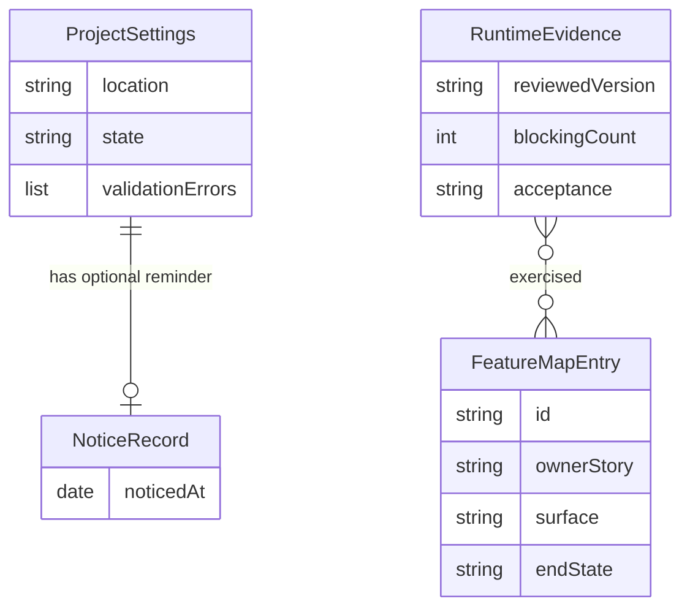

# Project Context Intake — Feature Spec

## Related Documentation

| Type | Link | Description |
|---|---|---|
| Spec index | [Context Delivery](INDEX.md) | Derived navigation; refresh via `spec [mode=index]` |
| Integration evidence | `.claude/hooks/tests/suites/init-prompt-gate.test.cjs` | Executable case mapping |
| Related capability | [Protocol Delivery](README.ProtocolDelivery.md) | Independent framework instruction delivery |
| Integration evidence | `.claude/scripts/tests/feature-map.test.cjs`, `.claude/scripts/tests/experience-verification.test.cjs` | Feature map and runtime evidence cases |

## 1. Overview

A project can use the assistant without recording project settings. Ordinary work then proceeds using repository evidence, with an occasional optional invitation to record those facts. If the project author records settings that cannot be accepted, ordinary work proceeds with a warning; the assistant treats their facts as unverified and derives needed facts from independent repository evidence. An explicitly requested repair remains available. This capability owns that intake choice, including relocated settings, and the boundary before optional project-context setup guidance.

It also owns two pieces of project context that a runtime review produces and a reviewer reads. A **feature map** tells the assistant where each feature lives and how to drive it; when the project has feature specs, each entry is linked to a spec story and holds only the facts a spec does not carry, so the two never disagree about what a feature means or how a user reaches it. **Runtime evidence** carries what a runtime review actually exercised into the pull-request description as text, so the human reviewer sees it; screenshots and recordings leave the developer's machine only after the developer says yes for that pull request. Run commands the assistant had to work out are kept only when the developer agrees.

## 2. Glossary

| Term | Meaning |
|---|---|
| Project settings | Project facts the author elects to record at the configured location |
| Missing | No recorded settings exist at that location |
| Invalid | Recorded settings exist but cannot be read or do not meet the declared requirements |
| Repair action | An offered action to re-evaluate project context, initialize it through its alias, or repair recorded settings |
| Optional setup | Guidance to generate missing root instructions, refresh old references, or build optional project knowledge |
| Notice record | The time the optional missing-settings reminder was last issued or dismissed |
| Feature map | A project reference listing, per feature, where it lives and how to drive it |
| Driver facts | What a driver needs and a spec does not hold: the surface, the entry address or command, the fixture or role, the observable end state and driving notes |
| Story-linked entry | A feature-map entry named after the spec story that owns the feature; the story keeps the meaning and the user path |
| Standalone entry | A feature-map entry with its own stable map id, used when the project has no feature specs |
| Runtime evidence | The surfaces, observed states, judgments, blocking count and acceptance status of a runtime review, written as text for a reviewer |
| Reviewed version | The exact content version a runtime review exercised; evidence counts only for the same version the pull request publishes |
| Capture | A screenshot, recording, trace or log kept by a runtime review on the developer's machine |

## 3. User Stories & Acceptance Criteria

### US-PCI-01: Work without mandatory project setup

As a developer adopting the assistant, I want ordinary work to proceed with or without recorded project settings, so I can decide when to record project facts.

- **AC-PCI-01:** Given settings are missing, when I submit ordinary work, then work proceeds using repository evidence; failure to find settings does not trigger automatic optional setup. **BR-PCI-01**.
- **AC-PCI-02:** Given settings were relocated, when I submit work, then the configured location determines whether settings are missing, invalid or accepted; an unrelated default location does not change that result. **BR-PCI-01, BR-PCI-02**.
- **AC-PCI-03:** Given missing settings and a reminder within the last day, when I submit more work, then no reminder repeats; once a day has elapsed a reminder may appear again. **BR-PCI-03**.
- **AC-PCI-04:** Given accepted settings and project content, when I submit ordinary work with missing root instructions, then existing optional setup guidance remains available. **BR-PCI-01**.

- **AC-PCI-07:** Given accepted settings and old project references, when I submit ordinary work, then refresh guidance offers available actions for all references or one selected reference; unavailable legacy actions are not suggested. **BR-PCI-04**.

### US-PCI-02: Continue work while rejected facts remain unverified

As a project maintainer, I want invalid recorded settings to be explained and repair actions to remain accessible, so the assistant does not work from rejected facts.

- **AC-PCI-05:** Given invalid settings, when I submit ordinary work, then work proceeds with guidance naming the settings location and available validation errors, excluding rejected facts and directing independent evidence discovery; dismissal of optional setup does not suppress this warning. **BR-PCI-02**.
- **AC-PCI-06:** Given invalid settings, when I explicitly invoke one offered repair action at the start of the request, then the repair proceeds without a redundant warning; incidental mentions and similar names retain the warning while ordinary work remains allowed. **BR-PCI-02**.

- **AC-PCI-08:** Given an optional work-tracking declaration uses a newer vocabulary, when project facts are read, then only that section's validation findings become warnings, unrelated valid facts remain available, and tracking stays unavailable; invalid findings outside that section still reject the facts view. **BR-PCI-05**.

### US-PCI-03: Find and drive a feature from a vague report

As a developer, I want a feature map that tells the assistant where a feature lives and how to drive it, linked to the spec that defines the feature, so a vague report reaches the right flow without two documents disagreeing.

- **AC-PCI-09:** Given the project has feature specs, when the map is written, then each entry names a spec story and holds only driver facts; a step of the story's user path copied into the map is reported. **BR-PCI-06**.
- **AC-PCI-10:** Given the project has no feature specs, when the map is written, then each entry carries a stable map id, and an entry without a stable id is reported. **BR-PCI-06**.
- **AC-PCI-11:** Given specs change, when the map is checked, then a user-facing story with no entry and an entry whose story no longer exists are both reported, and the map is flagged for refresh. **BR-PCI-06**.
- **AC-PCI-12:** Given a runtime review worked out run commands that the project had not recorded, when the run succeeded, then the assistant asks once before saving them; a decline is recorded and nothing is saved. **BR-PCI-09**.

### US-PCI-04: See runtime evidence when reviewing a pull request

As a pull-request reviewer, I want the description to show what a runtime review exercised and how it was judged, or why there is no such review, so I review evidence rather than trusting a claim.

- **AC-PCI-13:** Given a change to an observable surface and a runtime review of the same version, when the pull request is described, then the description lists the surfaces, statuses, judgments, blocking count, acceptance status and feature-map entries as text, without any link to the developer's local files. **BR-PCI-07**.
- **AC-PCI-14:** Given a change to an observable surface and no runtime review of that version, when the pull request is described, then the description says there is no runtime evidence and why; a change with no observable surface gets no such section; a final branch review reports missing or older evidence as a finding. **BR-PCI-07**.
- **AC-PCI-15:** Given captures that were inspected and redacted, when the pull request is described, then they are attached only after the developer says yes for that pull request; otherwise they stay local and the description says so. **BR-PCI-08**.

## 4. Business Rules

### BR-PCI-01: Missing settings never impose setup [HARD]

| Trigger | Rule | Failure outcome |
|---|---|---|
| Settings missing at their configured location | Use portable defaults and repository evidence; optional project-context setup guidance is not invoked | No settings-required block or automatic context-generation directive |
| Settings accepted and project contains content | Existing optional setup guidance may run | Guidance remains dismissible |

**Invariant:** For ALL ordinary requests in a project with missing settings, work proceeds without config-dependent optional setup directives, regardless of existing project content or leftover freshness notices.

[Source: rule/framework.contextdelivery/MissingSettings]

**Task-scoped discovery:** After accepting the entire recorded settings, a reader may request the discovery inputs and named sections needed for the task. The view preserves configured reference selection, including the difference between absent selection and an explicitly empty selection, and names other available sections. It never validates only the selected sections. Missing settings remain supported; rejected settings and unknown requested sections return an error without a misleading partial facts view. Editing settings requires the full source.

### BR-PCI-02: Rejected declared facts stay unverified while work proceeds [HARD]

| Trigger | Rule | Failure outcome |
|---|---|---|
| Settings exist but are rejected or cannot be verified | Allow work; name the location and first available validation errors, exclude rejected facts and derive needed facts from independent repository evidence | Warn and offer repair once, never as a precondition for work |
| A repair action is explicitly invoked first | Suppress redundant guidance for its exact name, ignoring letter case and leading whitespace, followed by end-of-request or whitespace before arguments | Different names and incidental mentions retain the warning; work still proceeds |
| Optional setup is dismissed | Continue warning that rejected facts cannot be relied on | Work proceeds using independent evidence |

**Invariant:** For ALL requests with invalid or unverifiable recorded settings, work proceeds without treating rejected sections as project facts. Only an explicit first-token invocation of an offered repair action suppresses the redundant warning; repair is never a precondition for ordinary work.

[Source: rule/framework.contextdelivery/ExactConfigRepair]

### BR-PCI-03: Missing-settings reminders are bounded [SOFT]

The optional invitation names the configured settings location, explains repository-evidence fallback and appears at most once during a one-day notice window. A notice/dismissal record less than one day old suppresses it; a record at least one day old does not. Failure to preserve notice state may cause repetition but must not block ordinary work. SOFT because repetition affects guidance volume, without corrupting facts or granting authority.

[Source: rule/framework.contextdelivery/MissingSettingsNotice]

### BR-PCI-04: Refresh guidance uses available actions [SOFT]

When old project references are reported before ordinary project work, offer both the available all-reference refresh action and the available single-reference refresh action with an explicit target. Preserve specific target suggestions supplied by the freshness assessment. Do not suggest unavailable legacy actions. A reference the project author declares not applicable is not assessed for freshness and is never reported as old. Guidance remains advisory and existing dismissal rules remain in effect. SOFT because this invitation guides context refresh without changing data or access rights.

[Source: rule/framework.contextdelivery/StaleReferenceGuidance]

### BR-PCI-05: Unknown optional tracking vocabulary does not invalidate unrelated facts [HARD]

For ALL recorded settings whose optional work-tracking vocabulary is a safe whole-number version newer than the supported one, defer only that section's validation findings to warnings. Unrelated valid project facts remain available, but the work tracker continues to refuse the unsupported declaration. Known, earlier or malformed versions retain normal validation, and every invalid finding outside the tracking section remains an error. This is a narrow forward-compatibility exception, never permission to use unsupported tracking facts.

[Source: rule/framework.contextdelivery/FutureTrackingAdmission]

### BR-PCI-06: The spec owns a feature's meaning; the map owns how to drive it [HARD]

| Trigger | Rule | Failure outcome |
|---|---|---|
| The project has feature specs | Each map entry names a spec story and holds only driver facts | An entry without a valid story, a story that is gone, or a copied user-path step is reported |
| The project has no feature specs | Each entry carries a stable map id that is never renumbered | An entry without a stable id is reported |
| A user-facing story has no entry | Report the gap for the map's owner | The gap is reported, never filled by guess |
| A large map is split into area documents | Check the index and every area document as one map | A duplicate, stale or copied entry in any area document is reported with its document |
| A value shaped like a credential appears in the map | Name the fixture or credential reference instead | The line is reported without repeating the value |

**Invariant:** For ALL map entries in a project with specs, the entry's story exists in the spec it names and no step of that story's user path is copied into the map.

[Source: rule/framework.contextdelivery/FeatureMapOwnership]

### BR-PCI-07: Runtime evidence reaches the reviewer as text, or its absence is stated [HARD]

A pull request whose change touches an observable surface carries a runtime-evidence section copied as text from a runtime review of the exact version it publishes. Evidence from another version, evidence that names no version and invalid records do not count: the section then states that there is no runtime evidence and why. The text never links the developer's local evidence files and never repeats a credential-shaped value. A change with no observable surface gets no section. A final branch review reports a behavior change on an observable surface with no runtime or test evidence, or with evidence older than the reviewed version, as a finding. Statuses are observations and judgments; acceptance stays pending until a person has accepted every exercised surface, and a section whose surfaces were all not applicable never reads as accepted. A review that ran with files the pull request does not publish (untracked or deliberately left out) covers a different version, so its evidence counts as older.

[Source: rule/framework.contextdelivery/RuntimeEvidenceForReviewers]

### BR-PCI-08: Captures leave the machine only after a yes for that pull request [HARD]

Screenshots and recordings are attached to a pull request only when they were inspected and redacted and the developer said yes for that pull request. There is no standing setting. A no, a host that cannot attach, or a failed upload leaves the captures local, and the description says so. Traces and logs are never attached.

[Source: rule/framework.contextdelivery/CaptureConsent]

### BR-PCI-09: Worked-out run commands are kept only with consent [SOFT]

When a runtime review had to work out how to start, check and stop a surface, and the run succeeded, the assistant asks once before recording those commands in the project settings. Only commands and credential references are recorded, never a secret value. A decline is recorded in the review report and the next review proposes the commands again. SOFT because a decline only repeats the derivation; nothing is lost or exposed.

[Source: rule/framework.contextdelivery/RunCommandPersistence]

## 5. Domain Model

| Concept | Facts | Ownership |
|---|---|---|
| Project settings | Configured location; missing, invalid or accepted state; available validation errors | Project author chooses facts and location; intake evaluates acceptance |
| Notice record | Time of the latest missing-settings notice or dismissal | Intake owns the one-day reminder window |
| Feature map entry | Story or map id, owning spec (story-linked only), surface, entry, fixture or role, end state, driving notes | The map's owner writes it; the spec story owns meaning and user path |
| Runtime evidence | Reviewed version, per-surface status and judgments, blocking count, acceptance status, captures with inspected and redacted flags | The runtime review records it; the pull request copies it as text |



[Source: component/framework.contextdelivery/ProjectContextIntake]

No additional entity invariants or business lifecycle transitions are introduced beyond BR-PCI-01, BR-PCI-02 and BR-PCI-06 to BR-PCI-08.

## 6. Process Flows

1. A developer submits a request.
2. Intake evaluates recorded settings at the configured location.
3. Missing settings: offer the bounded optional reminder, then allow the request using evidence.
4. Rejected or unverifiable settings: allow work, explain rejection and independent evidence fallback, and offer optional repair once. An explicit exact repair request proceeds without redundant guidance.
5. Accepted settings: allow the request and retain existing optional context-setup guidance where applicable.

Example: a developer adopts the assistant in a content-bearing project without recorded facts. The first request sees an optional reminder; a second request within a day proceeds quietly. Recording rejected facts changes the next ordinary request to a warning and independent-evidence outcome.

Feature map upkeep:

1. The map's owner seeds entries from spec stories (story-linked) or from routes and commands (standalone).
2. After specs, routes or commands change, the map is checked; gaps and stale entries go back to the owner.
3. A runtime review reads the entries it needs and reports an entry that proved wrong.

Runtime evidence for a pull request:

1. A runtime review records, per surface, the version it exercised, what it observed and judged, and the captures it kept.
2. When the pull request is described, the review of the same version is copied as text; otherwise the description states why there is none.
3. Inspected, redacted captures are offered for attachment once; they are attached only after a yes.
4. The final branch review reports missing or older evidence for an observable change.

No graphical view or navigation surface is owned here; outcomes appear in the assistant conversation and the pull-request description.

## 7. Permissions & Roles

| Role | Ordinary request with missing/accepted settings | Ordinary request with invalid settings | Exact repair request with invalid settings |
|---|---|---|---|
| Developer / project maintainer | Allowed | Allowed with warning | Allowed |
| Assistant | Follow evidence or accepted facts | Explain rejection; derive needed facts independently | Perform the explicitly requested repair |

| Role | Save worked-out run commands | Attach captures to a pull request | Accept runtime evidence |
|---|---|---|---|
| Developer / project maintainer | Decides, once per review | Decides, once per pull request | Allowed |
| Assistant | Only after a yes | Only after a yes, inspected and redacted captures only | Never; it records judgments only |
| Pull-request reviewer | — | — | Allowed |

## 8. Test Specifications

Test summary: 23 cases — 1 core preservation, 1 repair-access preservation, 4 validation/notice, 2 refresh workflow, 1 rejection boundary, 2 properties, 6 feature map, 6 runtime evidence. Property domains cover state-transition eligibility; arithmetic, conservation, inverse and commutativity classes are inapplicable to this read-only intake choice.

### Core preservation

#### TC-PCI-001: Accepted relocated settings preserve setup [P1]

**Objective:** Protect BR-PCI-01, BR-PCI-02 through the observable intake outcome.
**Business Intent / Invariant Guarded:** Work proceeds and existing optional root-setup guidance remains available.
**Preconditions:** Accepted relocated settings and missing root instructions.
**Real-World Reachability:** A maintainer records accepted facts at a relocated location; the default location is empty. These requests follow completed fixture preparation; no timing race or readiness delay is assumed.
**Demo Flow:** Arrange the stated project facts, submit the described request, and observe guidance or permission.

```gherkin
Given accepted relocated settings and missing root instructions
When the developer submits ordinary work
Then work proceeds and existing optional root-setup guidance remains available
```

**Expected Result:** The conversation shows the stated guidance or permission; recorded project facts are unchanged. Navigation is inapplicable because there is no graphical view.
**Acceptance Criteria:** Success is the stated outcome; failure is any contrary permission or setup guidance.
**Test Data:** valid configured location; no default settings.

**Task-scoped variant:** Accepted relocated settings return discovery inputs and requested sections without unrelated bodies. Explicitly empty reference selection stays empty; absent selection stays absent. Rejected facts in an unselected section and an unknown requested section produce errors rather than a partial accepted view; missing settings remain supported.

**Edge Cases:** An unrelated missing default location must not change acceptance.
**Evidence:** `[Source: rule/framework.contextdelivery/ValidConfiguredPath]`
**Related Behaviors:** `operation/framework.contextdelivery/ProjectContextIntake`, `test/framework.contextdelivery/ProjectContextIntake`
**CoveredBy:** `.claude/hooks/tests/suites/context-efficiency.test.cjs::TC-PCI-001`, `.claude/hooks/tests/suites/init-prompt-gate.test.cjs::[init-prompt-gate] TC-PCI-001 valid custom config preserves root setup`
**Status:** Tested

### Authorization / repair access

#### TC-PCI-021: Exact repair actions remain available [P1]

**Objective:** Protect BR-PCI-02 through the observable intake outcome.
**Business Intent / Invariant Guarded:** Repair proceeds without a settings-required block.
**Preconditions:** Invalid recorded settings.
**Real-World Reachability:** A maintainer records rejected facts, then explicitly selects a repair action in the next request. These requests follow completed fixture preparation; no timing race or readiness delay is assumed.
**Demo Flow:** Arrange the stated project facts, submit the described request, and observe guidance or permission.

```gherkin
Given invalid recorded settings
When the maintainer invokes an exact offered repair action first, with optional arguments
Then repair proceeds without a settings-required block
```

**Expected Result:** The conversation shows the stated guidance or permission; recorded project facts are unchanged. Navigation is inapplicable because there is no graphical view.
**Acceptance Criteria:** Success is the stated outcome; failure is any contrary permission or setup guidance.
**Test Data:** all three offered names; either supported invocation style; case and whitespace variations.

**Edge Cases:** End-of-request and whitespace argument boundaries remain accepted.
**Evidence:** `[Source: rule/framework.contextdelivery/ExactRepair]`
**Related Behaviors:** `operation/framework.contextdelivery/ProjectContextIntake`, `test/framework.contextdelivery/ProjectContextIntake`
**CoveredBy:** `.claude/hooks/tests/suites/init-prompt-gate.test.cjs::[init-prompt-gate] TC-PCI-021 invalid settings still permit explicit repair`
**Status:** Tested

### Validation and notices

#### TC-PCI-011: Missing settings remain optional [P1]

**Objective:** Protect BR-PCI-01 through the observable intake outcome.
**Business Intent / Invariant Guarded:** The first request receives only the portable-default invitation and the second proceeds quietly.
**Preconditions:** Missing settings at the default location.
**Real-World Reachability:** A developer adopts the assistant with source content and no recorded settings; no earlier intake notice exists. These requests follow completed fixture preparation; no timing race or readiness delay is assumed.
**Demo Flow:** Arrange the stated project facts, submit the described request, and observe guidance or permission.

```gherkin
Given missing settings at the default location
When the developer submits ordinary work twice within one day
Then the first request receives only the portable-default invitation and the second proceeds quietly
```

**Expected Result:** The conversation shows the stated guidance or permission; recorded project facts are unchanged. Navigation is inapplicable because there is no graphical view.
**Acceptance Criteria:** Success is the stated outcome; failure is any contrary permission or setup guidance.
**Test Data:** default settings location; content-bearing project with no recorded facts.

**Edge Cases:** Project content must not cause automatic setup.
**Evidence:** `[Source: rule/framework.contextdelivery/MissingSettings]`
**Related Behaviors:** `operation/framework.contextdelivery/ProjectContextIntake`, `test/framework.contextdelivery/ProjectContextIntake`
**CoveredBy:** `.claude/hooks/tests/suites/init-prompt-gate.test.cjs::[init-prompt-gate] TC-PCI-011 bare adopter works on portable defaults`
**Status:** Tested

#### TC-PCI-012: Reminder window expires [P1]

**Objective:** Protect BR-PCI-03 through the observable intake outcome.
**Business Intent / Invariant Guarded:** The portable-default optional invitation appears again without automatic setup.
**Preconditions:** Missing settings and a notice older than one day.
**Real-World Reachability:** A developer works without recorded settings, receives the invitation, and resumes ordinary work more than one day later. These requests follow completed fixture preparation; no timing race or readiness delay is assumed.
**Demo Flow:** Arrange the stated project facts, submit the described request, and observe guidance or permission.

```gherkin
Given missing settings and a notice older than one day
When the developer submits ordinary work
Then the portable-default optional invitation appears again without automatic setup
```

**Expected Result:** The conversation shows the stated guidance or permission; recorded project facts are unchanged. Navigation is inapplicable because there is no graphical view.
**Acceptance Criteria:** Success is the stated outcome; failure is any contrary permission or setup guidance.
**Test Data:** notice age greater than one day.

**Edge Cases:** Before one day, repeated requests remain quiet.
**Evidence:** `[Source: rule/framework.contextdelivery/MissingSettingsNotice]`
**Related Behaviors:** `operation/framework.contextdelivery/ProjectContextIntake`, `test/framework.contextdelivery/ProjectContextIntake`
**CoveredBy:** `.claude/hooks/tests/suites/init-prompt-gate.test.cjs::[init-prompt-gate] TC-PCI-012 missing-config notice expires after one day`
**Status:** Tested

#### TC-PCI-013: Invalid facts warn without blocking ordinary work [P1]

**Objective:** Protect BR-PCI-02 through the observable intake outcome.
**Business Intent / Invariant Guarded:** Work proceeds with the configured location and available validation errors, rejected facts excluded, independent evidence discovery and optional repair guidance.
**Preconditions:** Invalid recorded settings, including an unreadable or malformed record.
**Real-World Reachability:** A maintainer records incomplete or damaged settings and may previously have dismissed optional setup. These requests follow completed fixture preparation; no timing race or readiness delay is assumed.
**Demo Flow:** Arrange the stated project facts, submit the described request, and observe guidance or permission.

```gherkin
Given invalid recorded settings, including an unreadable or malformed record
When the developer requests ordinary work or dismisses optional setup
Then work proceeds with the configured location and available validation errors, rejected facts excluded, independent evidence discovery and optional repair guidance
```

**Expected Result:** The conversation shows the stated guidance or permission; recorded project facts are unchanged. Navigation is inapplicable because there is no graphical view.
**Acceptance Criteria:** Success is the stated outcome; failure is any contrary permission or setup guidance.
**Test Data:** empty project name; malformed settings; unreadable configured location; dismissal phrases/state.

**Edge Cases:** A relocated invalid record cannot be replaced by default facts.
**Evidence:** `[Source: rule/framework.contextdelivery/InvalidSettings]`
**Related Behaviors:** `operation/framework.contextdelivery/ProjectContextIntake`, `test/framework.contextdelivery/ProjectContextIntake`
**CoveredBy:** `.claude/hooks/tests/suites/init-prompt-gate.test.cjs::[init-prompt-gate] TC-PCI-013 invalid custom config warns with its path and schema errors without blocking`, `.claude/hooks/tests/suites/init-prompt-gate.test.cjs::[init-prompt-gate] TC-PCI-013 malformed or unreadable config warns without blocking`, `.claude/hooks/tests/suites/init-prompt-gate.test.cjs::[init-prompt-gate] TC-PCI-013 invalid config warning ignores setup dismissals`
**Status:** Tested

### Refresh workflow

#### TC-PCI-031: Old references offer usable refresh actions [P2]

**Objective:** Protect BR-PCI-04 so a developer can follow either refresh scope.
**Business Intent / Invariant Guarded:** Refresh guidance offers available all-reference and selected-reference actions.
**Preconditions:** Accepted settings, project content, root instructions and an existing old-reference notice.
**Real-World Reachability:** A project's recorded references age; a freshness assessment reports them before the developer resumes ordinary work. The next request follows that completed assessment.
**Demo Flow:** Resume project work after a freshness assessment and inspect the offered refresh choices.

```gherkin
Given accepted project settings and old references
When the developer submits ordinary work
Then guidance offers available all-reference and selected-reference refresh actions
And the specific assessed target is preserved
And the request remains allowed
```

**Expected Result:** The developer can choose either offered refresh scope without being directed to a removed action. No graphical navigation is owned here.
**Acceptance Criteria:** Both available actions appear; an unavailable legacy action is absent.
**Test Data:** One old structure reference with a specific offered refresh target.
**Edge Cases:** Optional graph activity is off; it must not alter refresh choices.
**Evidence:** `[Source: rule/framework.contextdelivery/StaleReferenceGuidance]`
**Related Behaviors:** `operation/framework.contextdelivery/ProjectContextIntake`, `test/framework.contextdelivery/StaleReferenceGuidance`
**CoveredBy:** `.claude/hooks/tests/suites/init-prompt-gate.test.cjs::[init-prompt-gate] TC-PCI-031 stale references name the supported single-document scan`
**Status:** Tested

#### TC-PCI-032: References declared not applicable are never reported as old [P2]

**Objective:** Protect BR-PCI-04 so refresh guidance never names a reference the project author told the assistant to skip.
**Business Intent / Invariant Guarded:** A reference declared not applicable is outside the freshness assessment.
**Preconditions:** Accepted settings that select old references, some of them declared not applicable.
**Real-World Reachability:** A project keeps a reference for a stack it does not use and declares it not applicable. Its recorded date ages like any other reference, and the next freshness assessment runs when a session starts.
**Demo Flow:** Declare one old reference not applicable, start a session, and inspect which references the assessment reports.

```gherkin
Given accepted project settings that select old references
And some are declared not applicable, by an explicit declaration or by a purpose that opens with or parenthesizes that statement
When freshness is assessed
Then only the references that apply are reported as old
And a purpose that only mentions the phrase in passing is still assessed
```

**Expected Result:** The assessment lists the applicable old references only, so no refresh guidance follows for a declared reference. No graphical navigation is owned here.
**Acceptance Criteria:** A declared reference is absent from the report in every supported declaration form; the root-context summary and the assessment agree on which references are declared.
**Test Data:** Five old references: three declared not applicable (parenthesized purpose, explicit declaration, purpose opening with the statement), one whose purpose mentions the phrase in passing, one ordinary.
**Edge Cases:** An explicit declaration on a built-in reference survives the merge with that reference's built-in defaults.
**Evidence:** `[Source: rule/framework.contextdelivery/StaleReferenceGuidance]`
**Related Behaviors:** `operation/framework.contextdelivery/ProjectContextIntake`, `test/framework.contextdelivery/StaleReferenceGuidance`
**CoveredBy:** `.claude/hooks/tests/suites/init-reference-docs.test.cjs::[init-reference-docs] TC-PCI-032 freshness never reports a reference the project declares not applicable`
**Status:** Tested

### Rejection boundaries

#### TC-PCI-051: Similar repair names do not suppress the warning [P1]

**Objective:** Protect BR-PCI-02 through the observable intake outcome.
**Business Intent / Invariant Guarded:** The warning remains and work proceeds using independent evidence.
**Preconditions:** Invalid recorded settings.
**Real-World Reachability:** A developer types a repair-like action name incorrectly, or mentions a repair while asking for unrelated work. These requests follow completed fixture preparation; no timing race or readiness delay is assumed.
**Demo Flow:** Arrange the stated project facts, submit the described request, and observe guidance or permission.

```gherkin
Given invalid recorded settings
When the developer invokes a similar but different name or mentions repair later in the request
Then the warning remains and work proceeds using independent evidence
```

**Expected Result:** The conversation shows the stated guidance or permission; recorded project facts are unchanged. Navigation is inapplicable because there is no graphical view.
**Acceptance Criteria:** Success is the stated outcome; failure is any contrary permission or setup guidance.
**Test Data:** suffixes punctuation, hyphen, underscore, slash or digit; incidental mentions.

**Edge Cases:** A complete repair name followed by whitespace suppresses the redundant warning instead.
**Evidence:** `[Source: rule/framework.contextdelivery/ExactConfigRepair]`
**Related Behaviors:** `operation/framework.contextdelivery/ProjectContextIntake`, `test/framework.contextdelivery/ProjectContextIntake`
**CoveredBy:** `.claude/hooks/tests/suites/init-prompt-gate.test.cjs::[init-prompt-gate] TC-PCI-051 repair prefixes and incidental mentions cannot suppress the invalid-config warning`
**Status:** Tested

### Invariant / Property

#### TC-PCI-071: All missing-settings ordinary requests avoid setup [P1]

**Objective:** Protect BR-PCI-01 through the observable intake outcome.
**Business Intent / Invariant Guarded:** Work proceeds without config-dependent setup guidance.
**Preconditions:** Any ordinary request with missing recorded settings.
**Real-World Reachability:** Projects adopt or remove recorded settings; content and prior freshness notices can remain when the next request is submitted. These requests follow completed fixture preparation; no timing race or readiness delay is assumed.
**Demo Flow:** Arrange the stated project facts, submit the described request, and observe guidance or permission.

```gherkin
Given any ordinary request with missing recorded settings
When the developer submits the request
Then work proceeds without config-dependent setup guidance
```

**Expected Result:** The conversation shows the stated guidance or permission; recorded project facts are unchanged. Navigation is inapplicable because there is no graphical view.
**Acceptance Criteria:** Success is the stated outcome; failure is any contrary permission or setup guidance.
**Test Data:** configured-location and leftover-state domain.

```yaml
inputDomain: "ordinary requests with missing settings, default or relocated location, content present and old freshness notice absent or present"
invariant: "for ALL inputs in this domain, work proceeds with no config-dependent optional setup directives"
boundaryCounterCase: "settings present but invalid → work proceeds with an invalid-facts warning instead of missing-settings guidance"
```

**Edge Cases:** Present invalid settings are outside this domain and receive invalid-facts guidance while work proceeds.
**Evidence:** `[Source: rule/framework.contextdelivery/MissingSettings]`
**Related Behaviors:** `operation/framework.contextdelivery/ProjectContextIntake`, `test/framework.contextdelivery/ProjectContextIntake`
**CoveredBy:** `.claude/hooks/tests/suites/init-prompt-gate.test.cjs::[init-prompt-gate] TC-PCI-071 missing config stays optional across paths and leftover state`
**Status:** Tested

#### TC-PCI-072: Only complete repair tokens suppress redundant warnings [P1]

**Objective:** Protect BR-PCI-02 through the observable intake outcome.
**Business Intent / Invariant Guarded:** Only the explicit exact first repair action suppresses the warning; all requests remain allowed.
**Preconditions:** Any request with invalid recorded settings.
**Real-World Reachability:** A maintainer records invalid settings; a developer selects or types an action in the next request. These requests follow completed fixture preparation; no timing race or readiness delay is assumed.
**Demo Flow:** Arrange the stated project facts, submit the described request, and observe guidance or permission.

```gherkin
Given any request with invalid recorded settings
When the developer submits either a complete offered repair action or another request
Then only the explicit exact first repair action suppresses the warning; all requests remain allowed
```

**Expected Result:** The conversation shows the stated guidance or permission; recorded project facts are unchanged. Navigation is inapplicable because there is no graphical view.
**Acceptance Criteria:** Success is the stated outcome; failure is any contrary permission or setup guidance.
**Test Data:** three repair names, two supported styles, case/whitespace/argument and nonrepair suffix domains.

```yaml
inputDomain: "requests with invalid settings spanning exact offered repair names and ordinary/different-token/incidental-mention requests"
invariant: "for ALL inputs in this domain, work proceeds and only an explicit first repair token ending at whitespace or request end suppresses the redundant warning"
boundaryCounterCase: "append a nonwhitespace suffix to a repair token → warning returns while work remains allowed"
```

**Edge Cases:** A single extra nonwhitespace character changes a repair name and must retain the warning.
**Evidence:** `[Source: rule/framework.contextdelivery/ExactConfigRepair]`
**Related Behaviors:** `operation/framework.contextdelivery/ProjectContextIntake`, `test/framework.contextdelivery/ProjectContextIntake`
**CoveredBy:** `.claude/hooks/tests/suites/init-prompt-gate.test.cjs::[init-prompt-gate] TC-PCI-072 exact slash and dollar repair commands remain available`
**Status:** Tested

#### TC-PCI-073: Newer optional tracking settings preserve unrelated valid project facts [P1]

**Objective:** Protect BR-PCI-05 without granting tracking authority.
**Business Intent / Invariant Guarded:** Only a newer optional tracking section is deferred; unrelated facts and strict tracking refusal retain their boundaries.
**Preconditions:** Recorded project settings contain a newer work-tracking vocabulary and otherwise valid facts.
**Real-World Reachability:** A project created by a newer framework is opened with an older copy.
**Demo Flow:** Read the recorded project facts, try to open the work tracker, then compare invalid unrelated facts and known or malformed tracking versions.

```gherkin
Given otherwise valid recorded settings with a newer optional tracking vocabulary
When project facts are read and tracking is requested
Then unrelated valid facts remain available with tracking warnings
And tracking remains unavailable while unrelated invalid facts and malformed or known tracking versions retain normal validation
```

**Expected Result:** Project facts load only within the narrow exception; tracking never treats the newer declaration as supported.
**Acceptance Criteria:** Both admission and refusal boundaries hold; no recorded facts are changed by discovery.
**Test Data:** Next whole-number vocabulary; known vocabulary with an unknown field; text, fractional and missing version markers; invalid project identity.
**Edge Cases:** An invalid finding outside tracking is never deferred.
**Evidence:** [Source: rule/framework.contextdelivery/FutureTrackingAdmission]
**Related Behaviors:** `operation/framework.contextdelivery/ProjectContextIntake`, `test/framework.contextdelivery/ProjectContextIntake`
**CoveredBy:** `.claude/hooks/tests/suites/task-tracking-vocabulary.test.cjs::TC-PCI-073: a task-tracking vocabulary newer than the framework is deferred to warnings so the rest of the configuration still loads`
**Status:** Tested

### Feature map


#### TC-PCI-074: A story-linked map holds driver facts only [P1]

**Objective:** Protect BR-PCI-06 for a project with specs.
**Business Intent / Invariant Guarded:** Every entry names its spec story; a copied user-path step is reported.
**Preconditions:** A project with a user-facing spec story and a map entry for it.
**Real-World Reachability:** A maintainer pastes the story's click path into the map while writing driver notes.
**Demo Flow:** Check the map, then copy one step of the story's user path into the entry and check again.

```gherkin
Given a spec story with a user path and a map entry naming that story
When the map is checked
Then it is clean
And a copied user-path step or a missing spec name is reported
```

**Expected Result:** The clean map passes; the copy and the missing spec name are each reported with the fix.
**Acceptance Criteria:** Success is the stated outcome; failure is any contrary outcome.
**Test Data:** One spec with two stories, one user-facing.
**Edge Cases:** Letter case and list markers do not hide a copy; a very short step is too generic to count.
**Evidence:** `[Source: rule/framework.contextdelivery/FeatureMapOwnership]`
**Related Behaviors:** `operation/framework.contextdelivery/ProjectContextIntake`, `test/framework.contextdelivery/ProjectContextIntake`
**CoveredBy:** `.claude/scripts/tests/feature-map.test.cjs::TC-PCI-074`
**Status:** Tested

#### TC-PCI-075: A project without specs uses stable map ids [P1]

**Objective:** Protect BR-PCI-06 for a project without specs.
**Business Intent / Invariant Guarded:** Entries carry stable map ids; an entry without one, or one naming a story with no spec, is reported.
**Preconditions:** No feature specs.
**Real-World Reachability:** A small project with no specs adopts the feature map.
**Demo Flow:** Check a map with one stable-id entry and one unnamed entry.

```gherkin
Given a project with no feature specs
When a map with a stable-id entry and an unnamed entry is checked
Then only the unnamed entry is reported
```

**Expected Result:** The stable-id entry passes; the unnamed entry and any story-named entry are reported.
**Acceptance Criteria:** Success is the stated outcome; failure is any contrary outcome.
**Test Data:** No spec files.
**Edge Cases:** A story-named entry without a spec is never trusted.
**Evidence:** `[Source: rule/framework.contextdelivery/FeatureMapOwnership]`
**Related Behaviors:** `operation/framework.contextdelivery/ProjectContextIntake`, `test/framework.contextdelivery/ProjectContextIntake`
**CoveredBy:** `.claude/scripts/tests/feature-map.test.cjs::TC-PCI-075`
**Status:** Tested

#### TC-PCI-076: Spec changes surface map gaps and stale entries [P1]

**Objective:** Protect BR-PCI-06 after spec change.
**Business Intent / Invariant Guarded:** A user-facing story without an entry and an entry whose story is gone are both reported.
**Preconditions:** A map whose entry names a story that was removed.
**Real-World Reachability:** A story is renamed or deleted while the map is not updated.
**Demo Flow:** Remove the story an entry names and check the map.

```gherkin
Given a map entry whose story no longer exists and a user-facing story with no entry
When the map is checked
Then both are reported, the gap as coverage work and the stale entry as an error
```

**Expected Result:** Two findings, each naming its fix; a story without a user path is not a gap.
**Acceptance Criteria:** Success is the stated outcome; failure is any contrary outcome.
**Test Data:** One user-facing and one background story.
**Edge Cases:** An entry naming a spec file that was removed is stale too.
**Evidence:** `[Source: rule/framework.contextdelivery/FeatureMapOwnership]`
**Related Behaviors:** `operation/framework.contextdelivery/ProjectContextIntake`, `test/framework.contextdelivery/ProjectContextIntake`
**CoveredBy:** `.claude/scripts/tests/feature-map.test.cjs::TC-PCI-076`
**Status:** Tested

#### TC-PCI-077: The map holds no secret values [P1]

**Objective:** Protect BR-PCI-06 against credential leaks.
**Business Intent / Invariant Guarded:** A credential-shaped value in the map is reported without repeating it.
**Preconditions:** A map entry whose notes hold a token.
**Real-World Reachability:** A maintainer writes a test account's token into driving notes.
**Demo Flow:** Check a map with a token in its notes.

```gherkin
Given a map entry whose notes hold a credential-shaped value
When the map is checked
Then the line is reported and the report does not contain the value
```

**Expected Result:** One finding naming the line; the value never appears in the output.
**Acceptance Criteria:** Success is the stated outcome; failure is any contrary outcome.
**Test Data:** A synthetic token.
**Edge Cases:** Credential references (names, not values) are allowed.
**Evidence:** `[Source: rule/framework.contextdelivery/FeatureMapOwnership]`
**Related Behaviors:** `operation/framework.contextdelivery/ProjectContextIntake`, `test/framework.contextdelivery/ProjectContextIntake`
**CoveredBy:** `.claude/scripts/tests/feature-map.test.cjs::TC-PCI-077`
**Status:** Tested

#### TC-PCI-082: A spec change flags the selected map for refresh [P1]

**Objective:** Protect BR-PCI-06 upkeep.
**Business Intent / Invariant Guarded:** A business spec change routes the selected map to its refresh owner; an unselected map is never routed.
**Preconditions:** The project selected the feature map.
**Real-World Reachability:** A spec story changes during ordinary work.
**Demo Flow:** Change a spec file and ask which project references need checking.

```gherkin
Given the feature map is selected
When a business spec changes
Then the map is flagged with its refresh owner
And an unselected map or a source-only change does not flag it
```

**Expected Result:** The map appears with its refresh owner only in the selected case.
**Acceptance Criteria:** Success is the stated outcome; failure is any contrary outcome.
**Test Data:** One spec path, one source path.
**Edge Cases:** Explicitly empty selection keeps the map out.
**Evidence:** `[Source: rule/framework.contextdelivery/FeatureMapOwnership]`
**Related Behaviors:** `operation/framework.contextdelivery/ProjectContextIntake`, `test/framework.contextdelivery/ProjectContextIntake`
**CoveredBy:** `.claude/hooks/tests/suites/doc-impact-map.test.cjs::[doc-impact-map] TC-PCI-082 spec changes route the selected feature map to its scan target`
**Status:** Tested

#### TC-PCI-083: The map is opt-in and has one refresh owner [P1]

**Objective:** Protect BR-PCI-06 selection.
**Business Intent / Invariant Guarded:** The map has its framework refresh owner and starter template and is never selected by evidence alone.
**Preconditions:** A project rich in other capabilities.
**Real-World Reachability:** A project adopts the framework and has not asked for a map.
**Demo Flow:** Resolve the default reference selection and the map's owner.

```gherkin
Given a project with specs and end-to-end tests but no map selection
When the reference selection is resolved
Then the map is not selected
And its owner and starter template are the framework ones
```

**Expected Result:** The map stays unselected; its owner cannot be replaced by a custom owner.
**Acceptance Criteria:** Success is the stated outcome; failure is any contrary outcome.
**Test Data:** Rich capability fixture.
**Edge Cases:** A custom owner on the built-in map is refused.
**Evidence:** `[Source: rule/framework.contextdelivery/FeatureMapOwnership]`
**Related Behaviors:** `operation/framework.contextdelivery/ProjectContextIntake`, `test/framework.contextdelivery/ProjectContextIntake`
**CoveredBy:** `.claude/hooks/tests/suites/init-reference-docs.test.cjs::[init-reference-docs] TC-PCI-083 feature map has a scan owner and a template and is never selected by default`
**Status:** Tested

### Runtime evidence


#### TC-PCI-078: Matching runtime evidence becomes text in the pull request [P1]

**Objective:** Protect BR-PCI-07.
**Business Intent / Invariant Guarded:** A review of the same version is copied as text with statuses, judgments, blocking count, acceptance status and map entries, and no local file link.
**Preconditions:** A runtime review of the exact version the pull request publishes, with kept captures.
**Real-World Reachability:** A developer opens a pull request after a runtime review of a page change.
**Demo Flow:** Describe the pull request from the review.

```gherkin
Given a runtime review of the same version with captures
When the pull request description is written
Then it lists the exercised surface, its status and judgments, the blocking count and the acceptance status as text
And it links no local file and offers only inspected, redacted images or recordings for attachment
```

**Expected Result:** The section shows pending acceptance; no local path appears; one capture is offered.
**Acceptance Criteria:** Success is the stated outcome; failure is any contrary outcome.
**Test Data:** One surface, four captures with mixed flags.
**Edge Cases:** Traces and logs are never offered.
**Evidence:** `[Source: rule/framework.contextdelivery/RuntimeEvidenceForReviewers]`
**Related Behaviors:** `operation/framework.contextdelivery/ProjectContextIntake`, `test/framework.contextdelivery/ProjectContextIntake`
**CoveredBy:** `.claude/scripts/tests/experience-verification.test.cjs::TC-PCI-078`
**Status:** Tested

#### TC-PCI-079: Missing or older runtime evidence is stated [P1]

**Objective:** Protect BR-PCI-07.
**Business Intent / Invariant Guarded:** Absent, older, version-less or invalid evidence yields an explicit "no runtime evidence" line with its reason.
**Preconditions:** A change to an observable surface.
**Real-World Reachability:** The review ran before the last fix, or the stack could not start.
**Demo Flow:** Describe the pull request with no review, an older review, and an invalid record.

```gherkin
Given a change to an observable surface
When the only runtime review is missing, older, version-less or invalid
Then the description says there is no runtime evidence and why
```

**Expected Result:** Each case names its reason; nothing is silently omitted.
**Acceptance Criteria:** Success is the stated outcome; failure is any contrary outcome.
**Test Data:** Two version ids; one invalid record.
**Edge Cases:** Older captures are never offered.
**Evidence:** `[Source: rule/framework.contextdelivery/RuntimeEvidenceForReviewers]`
**Related Behaviors:** `operation/framework.contextdelivery/ProjectContextIntake`, `test/framework.contextdelivery/ProjectContextIntake`
**CoveredBy:** `.claude/scripts/tests/experience-verification.test.cjs::TC-PCI-079`
**Status:** Tested

#### TC-PCI-080: A change without an observable surface gets no runtime section [P1]

**Objective:** Protect BR-PCI-07 scope.
**Business Intent / Invariant Guarded:** A documentation-only change gets no runtime-evidence section.
**Preconditions:** A change that touches no observable surface.
**Real-World Reachability:** A developer edits only documentation.
**Demo Flow:** Describe the pull request for a documentation-only change.

```gherkin
Given a change with no observable surface and no runtime review
When the pull request description is written
Then it has no runtime-evidence section
```

**Expected Result:** No section; a malformed request is refused rather than guessed.
**Acceptance Criteria:** Success is the stated outcome; failure is any contrary outcome.
**Test Data:** No records.
**Edge Cases:** The observable question must be answered explicitly.
**Evidence:** `[Source: rule/framework.contextdelivery/RuntimeEvidenceForReviewers]`
**Related Behaviors:** `operation/framework.contextdelivery/ProjectContextIntake`, `test/framework.contextdelivery/ProjectContextIntake`
**CoveredBy:** `.claude/scripts/tests/experience-verification.test.cjs::TC-PCI-080`
**Status:** Tested

#### TC-PCI-081: Captures are attached only after a yes [P1]

**Objective:** Protect BR-PCI-08.
**Business Intent / Invariant Guarded:** Without a yes no capture is attached; with a yes only inspected, redacted captures count; credential-shaped text never reaches the description.
**Preconditions:** A runtime review with captures and a credential-shaped value in its notes.
**Real-World Reachability:** A developer declines, then approves, attaching screenshots.
**Demo Flow:** Describe the pull request before and after the developer's answer.

```gherkin
Given inspected and uninspected captures
When the developer declines or approves attaching them
Then a decline keeps all captures local and an approval attaches only the inspected, redacted ones
And the description never contains the credential value
```

**Expected Result:** Declined: none attached. Approved: one attached, the rest local; older-version records are listed as omitted.
**Acceptance Criteria:** Success is the stated outcome; failure is any contrary outcome.
**Test Data:** Two surfaces on different versions; a synthetic key.
**Edge Cases:** An uninspected capture never counts as attached.
**Evidence:** `[Source: rule/framework.contextdelivery/CaptureConsent]`
**Related Behaviors:** `operation/framework.contextdelivery/ProjectContextIntake`, `test/framework.contextdelivery/ProjectContextIntake`
**CoveredBy:** `.claude/scripts/tests/experience-verification.test.cjs::TC-PCI-081`
**Status:** Tested

#### TC-PCI-084: The pull-request and final-review instructions carry the evidence rules [P1]

**Objective:** Protect BR-PCI-07 and BR-PCI-08 in the assistant's instructions.
**Business Intent / Invariant Guarded:** The pull-request instructions require the section or its stated absence, forbid local links, ask per pull request before attaching media; the final review reports missing or older evidence.
**Preconditions:** The shipped instructions.
**Real-World Reachability:** Any pull request the assistant opens.
**Demo Flow:** Read the pull-request and final-review instructions.

```gherkin
Given the shipped pull-request and final-review instructions
When they are read
Then they require the runtime-evidence section or its stated absence, a per-pull-request yes before attaching media, and a finding for missing or older evidence
```

**Expected Result:** Each rule is present; removing one fails the check.
**Acceptance Criteria:** Success is the stated outcome; failure is any contrary outcome.
**Test Data:** The shipped instruction files.
**Edge Cases:** No setting replaces the question.
**Evidence:** `[Source: rule/framework.contextdelivery/CaptureConsent]`
**Related Behaviors:** `operation/framework.contextdelivery/ProjectContextIntake`, `test/framework.contextdelivery/ProjectContextIntake`
**CoveredBy:** `.claude/hooks/tests/suites/pr-review-scope.test.cjs::TC-PCI-084 PR bodies carry runtime evidence as text, state its absence, attach media only on a per-PR yes, and pr-review flags missing or stale evidence`
**Status:** Tested

#### TC-PCI-085: Runtime review keeps run commands only on a yes and records its version [P1]

**Objective:** Protect BR-PCI-09 and the version link of BR-PCI-07.
**Business Intent / Invariant Guarded:** The runtime-review instructions ask once before saving worked-out run commands, never save a secret value, read the map, and record the version each record exercised.
**Preconditions:** The shipped instructions.
**Real-World Reachability:** A runtime review that had to work out how to start the app.
**Demo Flow:** Read the runtime-review, debugging and documentation-upkeep instructions.

```gherkin
Given the shipped runtime-review instructions
When they are read
Then saving worked-out run commands needs a yes, a decline is recorded, the map is read when selected
And each evidence record names the version it exercised
```

**Expected Result:** Each rule is present; removing one fails the check.
**Acceptance Criteria:** Success is the stated outcome; failure is any contrary outcome.
**Test Data:** The shipped instruction files.
**Edge Cases:** A record without its version never counts as current.
**Evidence:** `[Source: rule/framework.contextdelivery/RunCommandPersistence]`
**Related Behaviors:** `operation/framework.contextdelivery/ProjectContextIntake`, `test/framework.contextdelivery/ProjectContextIntake`
**CoveredBy:** `.claude/hooks/tests/suites/pr-review-scope.test.cjs::TC-PCI-085 runtime review keeps derived run commands only on a yes, reads the feature map and records the tree it exercised`
**Status:** Tested
