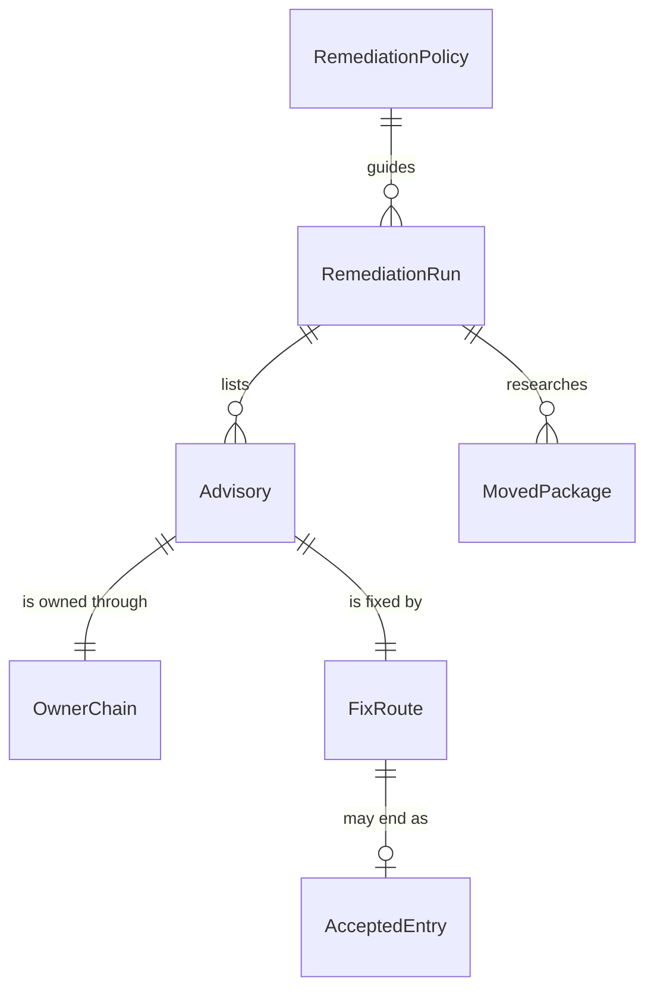

# Dependency Remediation — Feature Spec

> **Tech-free Feature Spec.** One doc per module-level capability. Technical identifiers live only in frontmatter and the Section 8 hidden carriers.

## Sections

1. [Overview](#1-overview)
2. [Glossary](#2-glossary)
3. [User Stories & Acceptance Criteria](#3-user-stories--acceptance-criteria)
4. [Business Rules](#4-business-rules)
5. [Domain Model](#5-domain-model)
6. [Process Flows](#6-process-flows)
7. [Permissions & Roles](#7-permissions--roles)
8. [Test Specifications](#8-test-specifications)

---

## 1. Overview

A project's dependency scan reports vulnerable packages: a scheduled scan fails, an alert arrives, an issue lists advisories or a developer pastes a report. The assistant takes that report and remediates it end to end in any package ecosystem.

1. It turns the report into one row per advisory.
2. For each advisory it traces which package actually owns the vulnerable version: the package itself when the project declares it, or the parent that pulls it in.
3. It picks the fix by a fixed order of preference: refresh within the ranges the project already declares, upgrade the owning parent, force the version temporarily and remove the force once resolved, and only as a last resort accept the advisory with a reason, an owner and an expiry.
4. Before any edit is approved it researches every package whose resolved version the change moves, including packages moved only indirectly, from cited release notes. It fixes code and tests for each breaking change it finds.
5. It proves the result with the project's own scanner: a re-scan must report only accepted entries.
6. It chooses tests by cost, running the tests that exercise moved packages first and the full test lane once.
7. It closes the loop only with the developer's authority for each external action. It also reports whether the project's remediation path is healthy: automatic security updates, an owner for the alert, and expiry of every forced version and accepted advisory.

The same capability plans ordinary dependency upgrades. A planned upgrade still studies the latest version, or the version the developer names, of each package it upgrades; it now also researches every package the change moves.

The capability exists because a detector without a remediation path turns red and stays red. A permanent forced version can itself become the vulnerable version, and a minor version moved indirectly can silently change behaviour.

---

## 2. Glossary

| Term | Definition | Context |
| --- | --- | --- |
| Advisory | One published vulnerability record against a range of versions of one package | Input; one row in the advisory table |
| Dependency scan | A tool run that matches the project's resolved packages against advisory data | The input source and the proof of done |
| Resolved tree | The exact package versions the project's lock records | What the scan reads and what a fix changes |
| Owner chain | The path from a package the project declares down to the vulnerable package | Decides where the fix belongs |
| Owning parent | The nearest package in the owner chain whose declared range, or whose release, decides the vulnerable version | Where the fix is made |
| Fix route | One of: refresh within range, parent upgrade, temporary force, accepted entry | Chosen per advisory, in order of preference |
| Temporary force | A project-level setting that forces one indirect package to a version, kept only until the resolved tree holds the fixed version without it | Removed before done |
| Accepted entry | An advisory the project accepts for now, with a reason, an owner and an expiry, recorded where the project's scanner reads it | The only way an advisory may remain |
| Moved package | Any package whose resolved version differs before and after the change, declared or not | Every one is researched |
| Remediation run | One end-to-end handling of a scan report | Produces the evidence report |
| Remediation policy | The project's optional declaration of its scanners, lock files, accepted-entry rules, deadlines and alert owner | Read when present; derived otherwise |
| Remediation path health | Whether automatic security updates, an alert owner and expiring forces and accepted entries exist | Reported at the end of every run |
| Re-scan | Running the project's scanner on the changed resolved tree | The proof of done |

---

## 3. User Stories & Acceptance Criteria

### US-DPR-01: Turn a scan report into one row per advisory

**As a** developer whose dependency scan failed
**I want** every reported advisory listed with what owns it and how it will be fixed
**So that** nothing is fixed by guesswork and nothing is silently dropped

**Acceptance Criteria:**

- **AC-DPR-01** — **Given** a scan report, an alert, an issue or a failed scan run **When** the assistant starts the remediation **Then** it lists every advisory with its identifier, severity, package and version, owner chain, the owning parent's declared range, the chosen fix route and any exploitability evidence, before it edits anything
- **AC-DPR-02** — **Given** no scan output and no declared scanner **When** the assistant starts **Then** it derives the scanner from the project's own files, asks only for what it cannot find, and never invents scan results

### US-DPR-02: Fix each advisory at the package that owns it

**As a** maintainer
**I want** each advisory fixed where the vulnerable version is decided
**So that** the project does not collect forced versions that nobody maintains

**Acceptance Criteria:**

- **AC-DPR-03** — **Given** an advisory **When** the assistant picks the fix **Then** it tries, in order: a refresh within the ranges the project already declares, an upgrade of the owning parent, a temporary force removed before done, and only then an accepted entry
- **AC-DPR-04** — **Given** a temporary force was needed to move an indirect package **When** the run finishes **Then** the force is removed and the resolved tree still holds the fixed version; a force that cannot be removed is reported as an accepted entry with reason, owner and expiry
- **AC-DPR-05** — **Given** an advisory with no fixed version, or one the project is not affected by **When** the assistant records it as accepted **Then** the entry carries a reason, an owner and an expiry date in the scanner's own suppression file, or beside it in the project's own record when the scanner has no such field
- **AC-DPR-06** — **Given** evidence that vulnerable code is not reachable **When** the assistant ranks the advisories **Then** that evidence lowers the advisory's priority only; it never closes or accepts the advisory on its own

### US-DPR-03: Research every package the change moves

**As a** reviewer of a dependency change
**I want** every moved package checked for breaking changes before the change is approved
**So that** a minor version moved indirectly cannot silently change behaviour

**Acceptance Criteria:**

- **AC-DPR-07** — **Given** a change to the resolved tree **When** the assistant prepares the approval **Then** it lists every package whose resolved version moved, derived from the lock difference rather than from the declared packages, each with a cited release note or changelog and a verdict
- **AC-DPR-08** — **Given** a moved package with a breaking change that reaches the project **When** the assistant fixes it **Then** it changes the code and adds a test that fails without the fix
- **AC-DPR-09** — **Given** a planned upgrade, not a vulnerability **When** the assistant plans it **Then** it still studies the latest or the named version of each upgraded package, and also researches every package the change moves

### US-DPR-04: Prove done with the project's own scanner

**As a** maintainer
**I want** the scanner, not the assistant's judgement, to say the advisories are gone
**So that** "fixed" means the same thing the alert means

**Acceptance Criteria:**

- **AC-DPR-10** — **Given** the change is applied **When** the assistant declares the run done **Then** a re-scan of the changed resolved tree with the project's scanner reports only accepted entries
- **AC-DPR-11** — **Given** the re-scan still reports an unaccepted advisory **When** the assistant reads it **Then** it returns to the owner chain for that advisory and never reports done

### US-DPR-05: Choose tests by cost

**As a** developer
**I want** the cheapest tests that can fail run first and the full lane run once
**So that** a change that reaches every test does not cost repeated full runs

**Acceptance Criteria:**

- **AC-DPR-12** — **Given** a change to the resolved tree **When** the assistant verifies it **Then** it runs the tests that exercise moved packages first, then the project's full test lane once, and records which ran
- **AC-DPR-13** — **Given** only targeted tests ran **When** the assistant reports **Then** it does not claim that all tests pass

### US-DPR-06: Act only with the developer's authority

**As a** developer
**I want** to approve edits and every external action
**So that** the assistant never publishes, closes or changes settings on my behalf unasked

**Acceptance Criteria:**

- **AC-DPR-14** — **Given** the advisory table, the chosen routes and the moved-package research **When** the assistant is about to edit the project's dependency declarations, lock or suppression files **Then** it asks for approval first, unless the developer already asked for the fix to be made
- **AC-DPR-15** — **Given** the run is ready to close **When** a scan should be re-run remotely, an alert or issue commented on or closed, or a repository setting changed **Then** each of those actions waits for the developer's explicit authority, and committing, pushing and pull requests stay with the existing commit and pull-request capabilities
- **AC-DPR-16** — **Given** any report or comment the run produces **When** it is written **Then** it carries package names, versions and advisory identifiers only, never credentials or copied log text

### US-DPR-07: Reach the capability from every entry point

**As a** developer
**I want** a failed scan to reach the remediation whichever way I ask
**So that** I do not have to know the capability's name

**Acceptance Criteria:**

- **AC-DPR-17** — **Given** a request about a failed dependency scan, a vulnerable-package issue or an alert **When** the assistant routes it **Then** it reaches the remediation directly, or through the CI-failure and issue repairs, the bug-fixing workflow's dependency-advisory kind, or the security audit's dependency dimension
- **AC-DPR-18** — **Given** the bug-fixing workflow handles a dependency advisory **When** it proves the fix **Then** its proof is the scanner reporting the advisory on the old resolved tree and not on the new one, plus a failing-then-passing test for each breaking change found
- **AC-DPR-19** — **Given** a planned upgrade request or a dependency audit request **When** the assistant routes it **Then** it keeps its own route; only remediation requests reach the remediation

### US-DPR-08: Declare scanner and policy once

**As a** maintainer
**I want** to state the project's scanners, accepted-entry rules, deadlines and alert owner once
**So that** every run uses the same policy without rediscovering it

**Acceptance Criteria:**

- **AC-DPR-20** — **Given** a project policy that is present and well formed **When** the assistant runs **Then** it uses the declared scanners, lock files, accepted-entry rules, deadlines and alert owner
- **AC-DPR-21** — **Given** a project policy that is present but malformed **When** the project settings load **Then** loading fails with a message naming the bad setting, as for every other declared section; an absent policy loads normally

### US-DPR-09: Report remediation path health

**As a** maintainer
**I want** each run to say whether the project can stay remediated
**So that** a red scan does not return because nobody owns it

**Acceptance Criteria:**

- **AC-DPR-22** — **Given** a finished run **When** the assistant reports **Then** it states whether automatic security updates are on (or that it could not read the setting), who owns the alert, and every forced version and accepted entry with its reason and expiry, naming expired ones
- **AC-DPR-23** — **Given** the assistant installs a dependency scanner for a project **When** it finishes the setup **Then** it names who responds when the scan fails and by when

---

## 4. Business Rules

### Rule Catalog

| Rule ID | Name | Category | Enforcement |
| --- | --- | --- | --- |
| BR-DPR-01 | One owner for the fix-at-owner rule | Ownership | [HARD] |
| BR-DPR-02 | Fix routes are tried in order | Remediation | [HARD] |
| BR-DPR-03 | Forces are temporary and accepted entries expire | Remediation | [HARD] |
| BR-DPR-04 | Reachability lowers priority only | Triage | [HARD] |
| BR-DPR-05 | Every moved package is researched | Research | [HARD] |
| BR-DPR-06 | Done means a clean re-scan | Proof | [HARD] |
| BR-DPR-07 | Edits wait for approval; external actions need authority | Authority | [HARD] |
| BR-DPR-08 | Targeted tests never stand in for the full lane | Proof | [HARD] |
| BR-DPR-09 | One cited table owns the ecosystem facts | Ownership | [HARD] |
| BR-DPR-10 | Evidence carries identifiers only | Privacy | [HARD] |
| BR-DPR-11 | A planned upgrade keeps its target version | Compatibility | [HARD] |
| BR-DPR-12 | Every entry point reaches the one remediation | Routing | [HARD] |
| BR-DPR-13 | A malformed policy fails closed | Configuration | [HARD] |
| BR-DPR-14 | Every run reports remediation path health | Operability | [HARD] |

### BR-DPR-01: One owner for the fix-at-owner rule [HARD]

**Statement:** The rule — fix at the owning package, try the routes in order, keep forces temporary, accept only with reason, owner and expiry, research every moved package, done means a clean re-scan — exists in one shared place. Every guidance that applies it points there.

```
IF a second copy of the fix-at-owner rule exists in guidance
  → REJECT: "The rule has one owner; point to it instead of copying it"
```

### BR-DPR-02: Fix routes are tried in order [HARD]

**Statement:** For each advisory the order is: refresh within declared ranges, upgrade the owning parent, temporary force, accepted entry. A later route is used only when every earlier route cannot deliver the fixed version.

### BR-DPR-03: Forces are temporary and accepted entries expire [HARD]

**Statement:** A force added during the run is removed before done when the resolved tree keeps the fixed version without it. An accepted entry carries a reason, an owner and an expiry, in the scanner's own suppression file, or beside it in the project's own record when the scanner has no such field. An entry without all three is not accepted.

### BR-DPR-04: Reachability lowers priority only [HARD]

**Statement:** Evidence that vulnerable code is not reached changes an advisory's priority. It never closes or accepts the advisory by itself. Not-affected entries still carry reason, owner and expiry.

### BR-DPR-05: Every moved package is researched [HARD]

**Statement:** The moved-package list comes from the difference between the lock before and after the change. Each moved package carries a cited release note or changelog and a verdict before approval; a package the real change moves that the research missed is researched and shown for approval again.

### BR-DPR-06: Done means a clean re-scan [HARD]

**Statement:** A run is done only when the project's scanner, run on the changed resolved tree, reports nothing but accepted entries. An alert service that sees only merged code is an input, never the re-scan of an unmerged change.

### BR-DPR-07: Edits wait for approval; external actions need authority [HARD]

**Statement:** Dependency declarations, lock and suppression files change only after approval or an explicit request to fix; research before approval resolves a throwaway copy, so the project's files stay unchanged. Re-running a remote scan, commenting on, closing or dismissing an alert or issue, and changing a repository setting each need explicit authority. Committing, pushing and pull requests stay with their own capabilities.

### BR-DPR-08: Targeted tests never stand in for the full lane [HARD]

**Statement:** The tests that exercise moved packages run first. The full lane runs once; when a calling workflow owns verification, it runs there, still once. A report claims "all tests pass" only after the full lane passed.

### BR-DPR-09: One cited table owns the ecosystem facts [HARD]

**Statement:** How each package manager shows an owner chain, refreshes within range and forces a version, and how each scanner reports and accepts advisories, live in one table. Every fact cites its official source with an access date. Adding an ecosystem is one row.

### BR-DPR-10: Evidence carries identifiers only [HARD]

**Statement:** Reports and comments name packages, versions and advisory identifiers. They never carry credentials or copied log text.

### BR-DPR-11: A planned upgrade keeps its target version [HARD]

**Statement:** Planning an upgrade studies the latest version, or the named version, of each upgraded package, as before. Researching moved packages is added; it does not replace the target.

### BR-DPR-12: Every entry point reaches the one remediation [HARD]

**Statement:** The capability's own trigger, the CI-failure and issue repairs, the bug-fixing workflow's dependency-advisory kind and the security audit's dependency dimension all lead to the one remediation. Planned upgrades and audits keep their own routes.

### BR-DPR-13: A malformed policy fails closed [HARD]

**Statement:** A declared remediation policy with a wrong type or unknown key stops the settings from loading, with the bad setting named. An absent policy is valid.

### BR-DPR-14: Every run reports remediation path health [HARD]

**Statement:** Each run ends with the state of automatic security updates (or "could not read"), the alert owner, and every force and accepted entry with reason and expiry, naming expired ones. Installing a scanner names who responds and by when.

---

## 5. Domain Model

### Relationships (overview)



### Entity: Advisory

| Property | Type | Required | Constraints | Business Meaning |
| --- | --- | --- | --- | --- |
| identifier | text | Yes | as published | Which vulnerability |
| severity | enum | Yes | as the scanner reports it | How urgent |
| package and version | text | Yes | from the resolved tree | What is vulnerable |
| exploitability evidence | text | No | lowers priority only | Why it may matter less |

### Entity: OwnerChain

| Property | Type | Required | Constraints | Business Meaning |
| --- | --- | --- | --- | --- |
| path | list | Yes | from a declared package to the vulnerable one | Who pulls it in |
| owning parent | text | Yes | nearest deciding package | Where the fix belongs |
| declared range | text | Yes | the owning parent's range | Whether a refresh suffices |

### Entity: FixRoute

| Property | Type | Required | Constraints | Business Meaning |
| --- | --- | --- | --- | --- |
| route | enum | Yes | refresh, parent upgrade, temporary force, accepted entry — in that order | How it is fixed |
| reason earlier routes failed | text | When not the first route | — | Why this route |

### Entity: AcceptedEntry

| Property | Type | Required | Constraints | Business Meaning |
| --- | --- | --- | --- | --- |
| reason | text | Yes | no fix, or not affected with evidence | Why it remains |
| owner | text | Yes | a person or team | Who revisits it |
| expiry | date | Yes | in the future when written | When it must be revisited |

### Entity: MovedPackage

| Property | Type | Required | Constraints | Business Meaning |
| --- | --- | --- | --- | --- |
| package | text | Yes | from the lock difference | What moved |
| from and to versions | text | Yes | — | How far |
| source | link | Yes | release note or changelog, cited | Evidence |
| verdict | enum | Yes | no impact, code fixed, test added | What it needed |

### Entity: RemediationRun

| Property | Type | Required | Constraints | Business Meaning |
| --- | --- | --- | --- | --- |
| scan before and after | text | Yes | the project's scanner, same configuration | Proof |
| tests run | text | Yes | targeted first, full lane once | Verification |
| health | text | Yes | updates, owner, forces, accepted entries | Will it stay fixed |

### Entity: RemediationPolicy

| Property | Type | Required | Constraints | Business Meaning |
| --- | --- | --- | --- | --- |
| scanners | list | No | each with how to run it and what it reads | Which tool decides |
| accepted-entry rules | object | No | required fields and longest expiry | Acceptance policy |
| deadlines | map | No | per severity | When a fix is due |
| alert owner | text | No | a person or team | Who responds |

### Domain Events (business occurrences)

| Event | When | Effect |
| --- | --- | --- |
| Scan failed | A scheduled or delivery scan reports advisories | A remediation run can start |
| Change approved | The developer approves the table, routes and research | Edits begin |
| Re-scan clean | Only accepted entries remain | The run may close |

---

## 6. Process Flows

No user interface: this capability changes how the assistant remediates dependencies, not a screen. Interaction surface sections are skipped for that reason.

### Flow: Remediate a failed dependency scan

| Step | Actor | Action | System Response | Next |
| --- | --- | --- | --- | --- |
| 1 | Developer | Hands over a report, alert, issue or failed run | Assistant reads it and the project policy, or derives the scanner | 2 |
| 2 | Assistant | Builds the advisory table with owner chains and routes | Table shown | 3 |
| 3 | Assistant | Researches every package the planned change moves | Moved-package list with sources and verdicts | 4 |
| 4 | Developer | Approves, or had already asked for the fix | Edits begin | 5 |
| 5 | Assistant | Applies the routes, removes temporary forces, fixes breaking changes with tests | Changed resolved tree | 6 |
| 6 | Assistant | Re-scans with the project's scanner | Only accepted entries, or back to step 2 for the rest | 7 |
| 7 | Assistant | Runs targeted tests, then the full lane once | Results recorded | 8 |
| 8 | Developer | Authorizes each close-out action | Scan re-run, alert closed, as authorized | 9 |
| 9 | Assistant | Reports the evidence and remediation path health | Report | — |

### Flow: Plan an upgrade

| Step | Actor | Action | System Response | Next |
| --- | --- | --- | --- | --- |
| 1 | Developer | Asks to plan upgrades | Assistant studies each upgraded package's latest or named version | 2 |
| 2 | Assistant | Lists every package the planned change would move | Moved-package research added to the plan | — |

---

## 7. Permissions & Roles

This capability enforces no permission boundary of its own beyond asking. It changes files only with approval and takes external actions only with authority; repository access follows the project's normal rules.

| Role | Hands over a scan | Approves edits | Authorizes close-out | Changes the policy |
| --- | :---: | :---: | :---: | :---: |
| Developer | yes | yes | yes | through normal repository access |
| Assistant | no | no | no | no |
| Framework maintainer | yes | yes | yes | through normal repository access |

---

## 8. Test Specifications

### Test Summary

| Priority | Count | Automated | Manual |
| --- | --- | --- | --- |
| P0 | 6 | 6 | 0 |
| P1 | 8 | 8 | 0 |
| **Total** | **14** | **14** | **0** |

Every rule in §4 is `[HARD]`, so each case carries a property block under its Test Data: the input domain, the invariant that holds across it and the boundary counter-case. The cases guard the shipped guidance and settings; the behavioural evaluation of the remediation on sample reports is recorded with the change that introduces it.

### Ownership and Remediation Tests

#### TC-DPR-001: One owner for the fix-at-owner rule [P0]

**Objective:** Keep the rule in one place so a rule change is one edit.

**Business Intent / Invariant Guarded:** BR-DPR-01 / AC-DPR-03 — every guidance that applies the rule points to its one owner.

**Preconditions:** The framework's guidance as shipped.

**Real-World Reachability:** Every remediation run and every security audit of dependencies reads the rule.

```gherkin
Given the shared rule owner and the guidance that applies it
When a maintainer follows each guidance to the rule
Then each points to the one owner, and the owner states every part of the rule
And no other guidance restates the route order as its own list
```

**Expected Result:**

| Dimension | Expectation |
| --- | --- |
| **UI** | Not applicable — the observable surface is guidance |
| **System behavior** | One rule owner, reached by pointer |
| **Business data state** | Exactly one copy of the rule body |
| **Data shown on UI** | Not applicable |

**Acceptance Criteria:**

- ✅ The owner holds the route order, temporary forces, expiring entries, reachability, moved-package research and the re-scan.
- ❌ A second guidance file with its own copy of the route order fails the case.

**Test Data:** The shared rule owner, the remediation guidance and the security audit's dependency dimension.

```yaml
inputDomain: 'any guidance that applies the fix-at-owner rule: the remediation, the security audit dependency dimension and any guidance added later'
invariant: 'for ALL such guidance the rule comes from the one owner, and the owner states all six parts'
boundaryCounterCase: 'a guidance naming one route in a sentence is not a copy; a guidance listing the four routes as its own ordered list is; the remediation procedure that applies the routes step by step, and the reminder digest generated from the owner, are the rule applied, not a copy'
```

**Edge Cases (boundary counter-case):** Naming a route in passing is not a copy; restating the ordered list is. The remediation procedure that carries out each route, and the generated reminder digest, are not copies.

<!-- machine-only carrier — ignore when reading as BA/QA -->

> **Evidence:** `[Source: constraint/skills/dependency-fix-at-owner]`
> **Related Behaviors:** `constraint/skills/dependency-fix-at-owner`
> **CoveredBy:** `.claude/hooks/tests/suites/dependency-remediation.test.cjs::TC-DPR-001` · **Status:** Tested

#### TC-DPR-002: Fix routes are tried in order [P0]

**Objective:** Stop leaf forces from replacing a parent fix.

**Business Intent / Invariant Guarded:** BR-DPR-02 / AC-DPR-03.

**Preconditions:** The remediation guidance as shipped.

**Real-World Reachability:** Every advisory on an indirect package.

```gherkin
Given an advisory on an indirect package whose owning parent's range already allows the fixed version
When the remediation picks the route
Then it refreshes within range before considering a parent upgrade, a force or an accepted entry
```

**Expected Result:**

| Dimension | Expectation |
| --- | --- |
| **UI** | Not applicable |
| **System behavior** | Routes tried in the stated order |
| **Business data state** | No force added when a refresh suffices |
| **Data shown on UI** | The chosen route per advisory |

**Acceptance Criteria:**

- ✅ The guidance orders refresh, parent upgrade, temporary force, accepted entry, and requires the reason a later route was needed.
- ❌ Guidance that allows a force or an accepted entry before trying the earlier routes fails the case.

**Test Data:** The shared rule owner and the remediation guidance.

```yaml
inputDomain: 'any advisory: direct or indirect, fix in range, fix only in a newer parent, no fix at all'
invariant: 'for ALL advisories a later route is chosen only after every earlier route cannot deliver the fixed version, with the reason recorded'
boundaryCounterCase: 'a direct dependency with a fixed release → the parent is the package itself, so the first route is its own update'
```

**Edge Cases (boundary counter-case):** For a declared package the owning parent is the package itself.

<!-- machine-only carrier — ignore when reading as BA/QA -->

> **Evidence:** `[Source: constraint/skills/dependency-fix-at-owner]`
> **Related Behaviors:** `operation/skills/package-upgrade-remediate`
> **CoveredBy:** `.claude/hooks/tests/suites/dependency-remediation.test.cjs::TC-DPR-002` · **Status:** Tested

#### TC-DPR-003: Forces are removed and accepted entries expire [P0]

**Objective:** Prevent permanent forces and suppress-forever entries.

**Business Intent / Invariant Guarded:** BR-DPR-03 / AC-DPR-04, AC-DPR-05.

**Preconditions:** The rule owner and the remediation guidance.

**Real-World Reachability:** Every run that forces an indirect version or accepts an advisory.

```gherkin
Given a run that forced an indirect package or accepted an advisory
When it declares done
Then the force is removed, or reported as an accepted entry
And every accepted entry carries a reason, an owner and an expiry in the scanner's suppression file
```

**Expected Result:**

| Dimension | Expectation |
| --- | --- |
| **UI** | Not applicable |
| **System behavior** | Done check lists forces added and removed |
| **Business data state** | No accepted entry without reason, owner and expiry |
| **Data shown on UI** | The accepted entries in the report |

**Acceptance Criteria:**

- ✅ The guidance requires force removal before done and reason, owner and expiry on every accepted entry.
- ❌ An accepted entry with no expiry passing the done check fails the case.

**Test Data:** The rule owner and the remediation guidance's done check.

```yaml
inputDomain: 'any run: with or without a temporary force, with or without accepted entries'
invariant: 'for ALL runs no force added by the run survives done unless reported as an accepted entry, and every accepted entry has reason, owner and expiry'
boundaryCounterCase: 'a force that the package manager needs to keep the fixed version → reported as an accepted entry with reason, owner and expiry'
```

**Edge Cases (boundary counter-case):** A force that cannot be removed becomes an accepted entry, never a silent pin.

<!-- machine-only carrier — ignore when reading as BA/QA -->

> **Evidence:** `[Source: constraint/skills/dependency-fix-at-owner]`
> **Related Behaviors:** `operation/skills/package-upgrade-remediate`
> **CoveredBy:** `.claude/hooks/tests/suites/dependency-remediation.test.cjs::TC-DPR-003` · **Status:** Tested

#### TC-DPR-004: Reachability lowers priority only [P1]

**Objective:** Stop "unreachable by search" from closing an advisory.

**Business Intent / Invariant Guarded:** BR-DPR-04 / AC-DPR-06.

**Preconditions:** The rule owner and the security audit's dependency dimension.

**Real-World Reachability:** Any advisory in a language where call analysis is weak.

```gherkin
Given evidence that vulnerable code is not reached
When the advisory is ranked
Then its priority drops and it is still fixed, or accepted with reason, owner and expiry
```

**Expected Result:**

| Dimension | Expectation |
| --- | --- |
| **UI** | Not applicable |
| **System behavior** | Reachability changes priority only |
| **Business data state** | No advisory closed on reachability alone |
| **Data shown on UI** | The evidence beside the advisory |

**Acceptance Criteria:**

- ✅ The rule owner and the audit dimension state that reachability lowers priority and never closes an advisory.
- ❌ Guidance that lets reachability close or accept an advisory fails the case.

**Test Data:** The rule owner and the audit dimension.

```yaml
inputDomain: 'any advisory with or without reachability evidence, in any language'
invariant: 'for ALL advisories reachability evidence changes only priority'
boundaryCounterCase: 'a not-affected entry backed by reachability evidence → accepted only with reason, owner and expiry'
```

**Edge Cases (boundary counter-case):** "Not affected" is still an accepted entry with expiry.

<!-- machine-only carrier — ignore when reading as BA/QA -->

> **Evidence:** `[Source: constraint/skills/dependency-fix-at-owner]`
> **Related Behaviors:** `constraint/skills/security-audit-d3`
> **CoveredBy:** `.claude/hooks/tests/suites/dependency-remediation.test.cjs::TC-DPR-004` · **Status:** Tested

#### TC-DPR-005: Every moved package is researched [P0]

**Objective:** Catch breaking changes in packages moved only indirectly.

**Business Intent / Invariant Guarded:** BR-DPR-05, BR-DPR-11 / AC-DPR-07, AC-DPR-08, AC-DPR-09.

**Preconditions:** The remediation and planning guidance.

**Real-World Reachability:** Every change that refreshes the resolved tree.

```gherkin
Given a change that moves resolved versions
When the assistant prepares approval
Then it lists every moved package from the lock difference with a cited source and a verdict
And a breaking change that reaches the project gets a code fix and a failing-then-passing test
And a planned upgrade still studies its latest or named target version
```

**Expected Result:**

| Dimension | Expectation |
| --- | --- |
| **UI** | Not applicable |
| **System behavior** | Mover list from the lock difference, researched before approval |
| **Business data state** | Each mover has a source and verdict |
| **Data shown on UI** | The mover table |

**Acceptance Criteria:**

- ✅ Both the remediation and the planning guidance derive movers from the lock difference and keep the planning target version.
- ❌ Guidance that researches only declared packages, or drops the planning target version, fails the case.

**Test Data:** The remediation guidance and the planning guidance.

```yaml
inputDomain: 'any change to the resolved tree: remediation or planned upgrade, direct or indirect movers'
invariant: 'for ALL such changes every moved package is researched before approval, and a planned upgrade keeps its target version'
boundaryCounterCase: 'a refresh that moves only indirect packages and no declared one → every indirect mover is still listed'
```

**Edge Cases (boundary counter-case):** A change that moves no declared package still lists its indirect movers.

<!-- machine-only carrier — ignore when reading as BA/QA -->

> **Evidence:** `[Source: operation/skills/package-upgrade-remediate]` · `[Source: operation/skills/package-upgrade]`
> **Related Behaviors:** `constraint/skills/dependency-fix-at-owner`
> **CoveredBy:** `.claude/hooks/tests/suites/dependency-remediation.test.cjs::TC-DPR-005` · **Status:** Tested

#### TC-DPR-006: Done means a clean re-scan [P0]

**Objective:** Make the scanner, not judgement, decide done.

**Business Intent / Invariant Guarded:** BR-DPR-06 / AC-DPR-10, AC-DPR-11.

**Preconditions:** The remediation guidance.

**Real-World Reachability:** The end of every run.

```gherkin
Given the change is applied
When the assistant checks done
Then it re-scans with the project's scanner and accepts only accepted entries
And any other advisory sends it back to the owner chain
```

**Expected Result:**

| Dimension | Expectation |
| --- | --- |
| **UI** | Not applicable |
| **System behavior** | Re-scan is the done check |
| **Business data state** | Only accepted entries remain |
| **Data shown on UI** | Scan before and after |

**Acceptance Criteria:**

- ✅ The done check requires a re-scan with only accepted entries and loops on anything else.
- ❌ A done check satisfied by tests or judgement alone fails the case.

**Test Data:** The remediation guidance's done check.

```yaml
inputDomain: 'any run end: clean re-scan, re-scan with unaccepted advisories, no scanner available'
invariant: 'for ALL run ends done requires a re-scan showing only accepted entries'
boundaryCounterCase: 'no scanner can run → the run reports done as blocked, never as passed'
```

**Edge Cases (boundary counter-case):** No runnable scanner means blocked, not done.

<!-- machine-only carrier — ignore when reading as BA/QA -->

> **Evidence:** `[Source: operation/skills/package-upgrade-remediate]`
> **Related Behaviors:** `constraint/skills/dependency-fix-at-owner`
> **CoveredBy:** `.claude/hooks/tests/suites/dependency-remediation.test.cjs::TC-DPR-006` · **Status:** Tested

### Authority, Evidence and Proof Tests

#### TC-DPR-007: Edits wait for approval; external actions need authority [P0]

**Objective:** Keep the developer in control of edits and publication.

**Business Intent / Invariant Guarded:** BR-DPR-07 / AC-DPR-14, AC-DPR-15.

**Preconditions:** The remediation guidance.

**Real-World Reachability:** Every run, before the first edit and at close-out.

```gherkin
Given a prepared advisory table, routes and mover research
When the assistant is about to edit dependency files
Then it asks for approval unless the developer already asked for the fix
And each remote re-scan, alert or issue action and settings change waits for explicit authority
And committing, pushing and pull requests are left to their own capabilities
```

**Expected Result:**

| Dimension | Expectation |
| --- | --- |
| **UI** | Not applicable |
| **System behavior** | Approval gate before edits; authority per external action |
| **Business data state** | No external change without authority |
| **Data shown on UI** | The approval request |

**Acceptance Criteria:**

- ✅ The remediation guidance holds the approval gate, the per-action authority rule and the hand-off of Git operations.
- ❌ Guidance that lets the remediation commit, push, close an issue or change a setting on its own fails the case.

**Test Data:** The remediation guidance.

```yaml
inputDomain: 'any run: developer asked to analyse only, asked to fix, asked to fix and close'
invariant: 'for ALL runs edits follow approval or an explicit fix request, and each external action follows its own authority'
boundaryCounterCase: 'the developer asked to "fix it" → edits proceed without a second approval, but closing the issue still needs authority'
```

**Edge Cases (boundary counter-case):** A request to fix authorizes edits, not publication.

<!-- machine-only carrier — ignore when reading as BA/QA -->

> **Evidence:** `[Source: operation/skills/package-upgrade-remediate]`
> **CoveredBy:** `.claude/hooks/tests/suites/dependency-remediation.test.cjs::TC-DPR-007` · **Status:** Tested

#### TC-DPR-008: Targeted tests never stand in for the full lane [P1]

**Objective:** Keep test cost down without overclaiming.

**Business Intent / Invariant Guarded:** BR-DPR-08 / AC-DPR-12, AC-DPR-13.

**Preconditions:** The remediation guidance.

**Real-World Reachability:** Every run whose change reaches many tests.

```gherkin
Given a change to the resolved tree
When the assistant verifies it
Then it runs tests that exercise moved packages first and the full lane once
And it claims all tests pass only after the full lane passed
```

**Expected Result:**

| Dimension | Expectation |
| --- | --- |
| **UI** | Not applicable |
| **System behavior** | Targeted first, full lane once |
| **Business data state** | The tests run are recorded |
| **Data shown on UI** | The test record |

**Acceptance Criteria:**

- ✅ The guidance orders targeted then full, once, and forbids the claim from targeted runs.
- ❌ Guidance that reports all tests passing after targeted runs fails the case.

**Test Data:** The remediation guidance.

```yaml
inputDomain: 'any verification: targeted only, targeted then full, full lane unavailable'
invariant: 'for ALL verifications an all-pass claim follows a passed full lane'
boundaryCounterCase: 'full lane unavailable → reported as not run, never as passed'
```

**Edge Cases (boundary counter-case):** An unavailable full lane is reported as not run.

<!-- machine-only carrier — ignore when reading as BA/QA -->

> **Evidence:** `[Source: operation/skills/package-upgrade-remediate]`
> **CoveredBy:** `.claude/hooks/tests/suites/dependency-remediation.test.cjs::TC-DPR-008` · **Status:** Tested

#### TC-DPR-009: One cited table owns the ecosystem facts [P1]

**Objective:** Make adding an ecosystem one row and every fact checkable.

**Business Intent / Invariant Guarded:** BR-DPR-09 / AC-DPR-01, AC-DPR-02.

**Preconditions:** The ecosystem table.

**Real-World Reachability:** Every run in any ecosystem.

```gherkin
Given the ecosystem table
When a maintainer reads any row
Then the row cites its official source with an access date
And no other guidance holds its own per-manager command table
```

**Expected Result:**

| Dimension | Expectation |
| --- | --- |
| **UI** | Not applicable |
| **System behavior** | One table, every row cited |
| **Business data state** | One copy of the ecosystem facts |
| **Data shown on UI** | Not applicable |

**Acceptance Criteria:**

- ✅ Every row of the table carries a source link and the table states its access date.
- ❌ A row without a source, or a second per-manager table in other guidance, fails the case.

**Test Data:** The ecosystem table and the security audit's dependency dimension.

```yaml
inputDomain: 'any package manager or scanner row in the table'
invariant: 'for ALL rows a cited official source exists, and the table is the only per-manager command table'
boundaryCounterCase: 'an example command in another guidance sentence is not a table; a list of commands per manager is'
```

**Edge Cases (boundary counter-case):** A single example command elsewhere is not a second table.

<!-- machine-only carrier — ignore when reading as BA/QA -->

> **Evidence:** `[Source: data/skills/package-upgrade-ecosystems]`
> **CoveredBy:** `.claude/hooks/tests/suites/dependency-remediation.test.cjs::TC-DPR-009` · **Status:** Tested

#### TC-DPR-010: Evidence carries identifiers only [P1]

**Objective:** Keep secrets and log text out of shared reports.

**Business Intent / Invariant Guarded:** BR-DPR-10 / AC-DPR-16.

**Preconditions:** The remediation guidance.

**Real-World Reachability:** Every report and every issue comment.

```gherkin
Given a run writes its report or an issue comment
When the text is written
Then it carries package names, versions and advisory identifiers only
```

**Expected Result:**

| Dimension | Expectation |
| --- | --- |
| **UI** | Not applicable |
| **System behavior** | Redaction rule in the evidence contract |
| **Business data state** | No credential or log copy in shared text |
| **Data shown on UI** | The report |

**Acceptance Criteria:**

- ✅ The evidence contract states the identifiers-only rule.
- ❌ An evidence contract without it fails the case.

**Test Data:** The remediation guidance's evidence contract.

```yaml
inputDomain: 'any written report or comment from a run'
invariant: 'for ALL such text only package, version and advisory identifiers appear as evidence'
boundaryCounterCase: 'a scanner output that includes a token-bearing URL → the URL is not copied'
```

**Edge Cases (boundary counter-case):** Scanner output is summarized, never pasted.

<!-- machine-only carrier — ignore when reading as BA/QA -->

> **Evidence:** `[Source: operation/skills/package-upgrade-remediate]`
> **CoveredBy:** `.claude/hooks/tests/suites/dependency-remediation.test.cjs::TC-DPR-010` · **Status:** Tested

#### TC-DPR-011: The remediation contract is complete when called directly [P1]

**Objective:** Make the remediation work from any single input.

**Business Intent / Invariant Guarded:** BR-DPR-06, BR-DPR-07 / AC-DPR-01, AC-DPR-02.

**Preconditions:** The remediation guidance.

**Real-World Reachability:** A developer pastes only an issue link, a run link or a report file.

```gherkin
Given only an issue link, a run link, an alert or a report file
When the remediation is called directly
Then it states its inputs, how it handles missing input, its output and its completion check
```

**Expected Result:**

| Dimension | Expectation |
| --- | --- |
| **UI** | Not applicable |
| **System behavior** | A complete standalone contract |
| **Business data state** | Not applicable |
| **Data shown on UI** | Not applicable |

**Acceptance Criteria:**

- ✅ The remediation guidance names its inputs, missing-input handling, output and done check.
- ❌ A remediation guidance missing any of the four fails the case.

**Test Data:** The remediation guidance.

```yaml
inputDomain: 'any single input form: issue, run, alert, report file, none'
invariant: 'for ALL input forms the guidance says what to do, including when no scanner can be found'
boundaryCounterCase: 'no input and no scanner → ask for the scanner, never invent results'
```

**Edge Cases (boundary counter-case):** Nothing to read means ask, not guess.

<!-- machine-only carrier — ignore when reading as BA/QA -->

> **Evidence:** `[Source: operation/skills/package-upgrade-remediate]`
> **CoveredBy:** `.claude/hooks/tests/suites/dependency-remediation.test.cjs::TC-DPR-011` · **Status:** Tested

### Routing and Configuration Tests

#### TC-DPR-012: Every entry point reaches the one remediation [P1]

**Objective:** Route a failed scan to the remediation whichever way it arrives.

**Business Intent / Invariant Guarded:** BR-DPR-12 / AC-DPR-17, AC-DPR-18, AC-DPR-19.

**Preconditions:** The capability trigger, the CI-failure and issue repairs, the bug-fixing workflow and the security audit.

**Real-World Reachability:** Scan failures arrive as CI failures, issues, alerts and audit findings.

```gherkin
Given the capability's trigger and each entry point
When a scan failure, vulnerable-package issue or alert arrives by any of them
Then it reaches the one remediation
And the bug-fixing workflow's dependency-advisory kind proves the fix with the scanner red on the old tree and green on the new one
And planned upgrades and audits keep their own routes
```

**Expected Result:**

| Dimension | Expectation |
| --- | --- |
| **UI** | Not applicable |
| **System behavior** | Each entry point hands off |
| **Business data state** | Not applicable |
| **Data shown on UI** | Not applicable |

**Acceptance Criteria:**

- ✅ The trigger text, the two repairs, the workflow's kind and the audit dimension each lead to the remediation; the trigger keeps a distinct planned-upgrade clause.
- ❌ An entry point that fixes dependencies itself, or a trigger that merges planning and remediation into one clause, fails the case.

**Test Data:** The capability trigger and the four entry points.

```yaml
inputDomain: 'any request: scan failure, vulnerable-package issue, alert, audit finding, planned upgrade, audit request'
invariant: 'for ALL remediation requests the route ends at the one remediation, and for ALL planning or audit requests it does not'
boundaryCounterCase: 'an audit request with no fix asked → the audit reports and points to the remediation; it does not edit'
```

**Edge Cases (boundary counter-case):** The audit points, it does not fix.

<!-- machine-only carrier — ignore when reading as BA/QA -->

> **Evidence:** `[Source: operation/skills/package-upgrade]` · `[Source: operation/skills/fix]` · `[Source: operation/skills/workflow-bugfix]` · `[Source: operation/skills/security-audit]`
> **CoveredBy:** `.claude/hooks/tests/suites/dependency-remediation.test.cjs::TC-DPR-012` · **Status:** Tested

#### TC-DPR-013: A malformed policy fails closed [P1]

**Objective:** Treat the optional policy like every other declared setting.

**Business Intent / Invariant Guarded:** BR-DPR-13 / AC-DPR-20, AC-DPR-21.

**Preconditions:** The project settings validation.

**Real-World Reachability:** A project declares its scanners and policy.

```gherkin
Given a well-formed policy, a malformed policy and no policy
When the project settings load
Then the well-formed one and the absent one load, and the malformed one is refused with the bad setting named
And the settings help describes every policy setting
```

**Expected Result:**

| Dimension | Expectation |
| --- | --- |
| **UI** | Not applicable |
| **System behavior** | Validation accepts, refuses and ignores as stated |
| **Business data state** | Settings load or stop with a named reason |
| **Data shown on UI** | The settings help |

**Acceptance Criteria:**

- ✅ Valid and absent policies load; a wrong type is refused naming its setting; help covers every key.
- ❌ A malformed policy that loads silently fails the case.

**Test Data:** A sample well-formed policy, one with a wrong type, and none.

```yaml
inputDomain: 'any declared policy: absent, well-formed, wrong type in any key, unknown key'
invariant: 'for ALL declared policies loading succeeds only when every present key has its declared type'
boundaryCounterCase: 'an empty policy section → loads, as every key is optional'
```

**Edge Cases (boundary counter-case):** An empty section is valid.

<!-- machine-only carrier — ignore when reading as BA/QA -->

> **Evidence:** `[Source: data/hooks/project-config-schema]`
> **CoveredBy:** `.claude/hooks/tests/suites/dependency-security-config.test.cjs::TC-DPR-013` · **Status:** Tested

#### TC-DPR-014: Every run reports remediation path health [P1]

**Objective:** Stop a fixed scan from going red again unnoticed.

**Business Intent / Invariant Guarded:** BR-DPR-14 / AC-DPR-22, AC-DPR-23.

**Preconditions:** The remediation guidance and the scanner setup guidance.

**Real-World Reachability:** The end of every run and every scanner installation.

```gherkin
Given a finished run
When the assistant reports
Then it states automatic security updates (or that it could not read them), the alert owner, and every force and accepted entry with reason and expiry, naming expired ones
And installing a scanner names who responds and by when
```

**Expected Result:**

| Dimension | Expectation |
| --- | --- |
| **UI** | Not applicable |
| **System behavior** | Health section in every report |
| **Business data state** | Expired entries named |
| **Data shown on UI** | The health section |

**Acceptance Criteria:**

- ✅ The remediation guidance requires the health section; the setup guidance requires a responder and deadline.
- ❌ A run report without the health section fails the case.

**Test Data:** The remediation guidance and the scanner setup guidance.

```yaml
inputDomain: 'any run end and any scanner installation'
invariant: 'for ALL run ends the health section is present, and for ALL installations a responder and deadline are named'
boundaryCounterCase: 'the security-update setting cannot be read → "could not read", never assumed on'
```

**Edge Cases (boundary counter-case):** Unknown setting state is reported as unknown.

<!-- machine-only carrier — ignore when reading as BA/QA -->

> **Evidence:** `[Source: operation/skills/package-upgrade-remediate]` · `[Source: operation/skills/linter-setup]`
> **CoveredBy:** `.claude/hooks/tests/suites/dependency-remediation.test.cjs::TC-DPR-014` · **Status:** Tested

### Invariant / Property Tests

Every rule in §4 is `[HARD]`. Each case above carries its property block under its Test Data; this index names the case that guards each rule.

| Rule | Guarded by |
| --- | --- |
| BR-DPR-01 | TC-DPR-001 |
| BR-DPR-02 | TC-DPR-002 |
| BR-DPR-03 | TC-DPR-003 |
| BR-DPR-04 | TC-DPR-004 |
| BR-DPR-05 | TC-DPR-005 |
| BR-DPR-06 | TC-DPR-006, TC-DPR-011 |
| BR-DPR-07 | TC-DPR-007, TC-DPR-011 |
| BR-DPR-08 | TC-DPR-008 |
| BR-DPR-09 | TC-DPR-009 |
| BR-DPR-10 | TC-DPR-010 |
| BR-DPR-11 | TC-DPR-005 |
| BR-DPR-12 | TC-DPR-012 |
| BR-DPR-13 | TC-DPR-013 |
| BR-DPR-14 | TC-DPR-014 |

---
