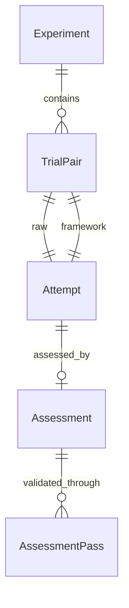

# Framework Benchmark

This contract governs matched work comparisons, independent assessment and truthful resource accounting.

## Contents

- [Related Documentation](#related-documentation)
- [1. Overview](#1-overview)
- [2. Glossary](#2-glossary)
- [3. User Stories & Acceptance Criteria](#3-user-stories--acceptance-criteria)
- [4. Business Rules](#4-business-rules)
- [5. Domain Model](#5-domain-model)
- [6. Process Flows & Interaction Surface](#6-process-flows--interaction-surface)
- [7. Permissions & Roles](#7-permissions--roles)
- [8. Test Specifications](#8-test-specifications)

## Related Documentation

| Type | Link | Relationship |
|---|---|---|
| Workflow execution | [Guided Workflow](README.GuidedWorkflow.md) | Owns the workflows used by the treatment |
| Review quality | [Review Quality](README.ReviewQuality.md) | Existing review standards; benchmark assessment remains symmetric between arms |
| Project context | [Project Context Intake](../ContextDelivery/README.ProjectContextIntake.md) | Owns project-setup discovery and validation |

## 1. Overview

A maintainer compares the same complex task with the complete framework and with raw implementation. The comparison can start from a new fictional project, an existing project that needs framework setup, or a consumer project with its own installed setup. It evaluates the resulting work, its checks and independent assessment, and the time and reported usage required to produce it. A framework loss, tie or inconclusive result is a valid outcome.

The comparison includes skills, hooks, workflow guidance, project configuration and reference documents as one treatment. Creating missing setup is part of the treatment's work and cost. Ordinary application documentation and the task brief remain available to both arms. The comparison does not attribute an improvement to an individual framework component and does not establish universal benefit from one task.

The original project is a source of frozen inputs only. Experiments neither alter it nor publish their results automatically. Uncommitted work is excluded when a committed project revision is selected. Missing execution capability leaves an explicitly incomplete report.

The default execution route uses an available local coding assistant and the maintainer's existing account. A separately provisioned contained runtime remains an optional choice. Local execution is for trusted tasks and code under the assistant's normal permissions. Disposable work separates source and experiment context; it does not contain hostile code. Results are retained before owned temporary work is removed.

## 2. Glossary

| Term | Meaning |
|---|---|
| Experiment | One frozen task, starting state, treatment, assessment contract and finite execution budget |
| Raw arm | Task execution without framework skills, hooks, instructions or framework-specific project setup |
| Framework arm | The same task with the installed framework and appropriate setup workflow and project context |
| Greenfield | A new project represented by a brief and an empty application baseline |
| Brownfield bootstrap | Existing application code whose framework configuration and reference documents must first be created |
| Configured consumer | An existing project using its own committed framework setup |
| Trial pair | One attempt from each arm with matched task inputs and resource limits |
| Holdout check | A frozen acceptance or regression check unavailable while the implementation is produced |
| Treatment fidelity | Observed successful loading of required setup and task skills, rather than a request or a claim in the final answer |
| Invalid attempt | An attempt whose environment, isolation or grading evidence cannot support a comparison |
| Failed attempt | Validly observed work that fails the task, times out or fails to engage the required treatment |
| Assessment | A separate anonymous review of the produced application against the same evidence rubric |
| Native execution | A fresh local assistant session using an existing account, without inheriting personal guidance or another attempt's conversation |
| Owned workspace | Disposable work created and recorded by the experiment, separate from the original project |
| Reusable project template | A pinned public source and an equally neutral application baseline, optionally paired with generic framework context prepared once before task work |
| Complexity qualification | A maintainer's pre-answer rationale that identifies interacting areas, consequential choices, realistic failure risks and supporting evidence; a declaration is not proof of difficulty |
| Validated finding | A distinct alleged defect independently confirmed against the artifact by a fresh assessor; agreement or a real citation alone is insufficient |

## 3. User Stories & Acceptance Criteria

### US-FBM-01: Benchmark the current consumer project

As a maintainer, I want to compare a complex task on my own project so that the measured effect includes the framework setup my project actually uses.

- **AC-FBM-01:** Given a configured consumer, when the maintainer prepares a comparison, then both arms share the same application baseline and brief, while only the framework arm receives its framework-specific project configuration, reference documents, instructions, skills and hooks; an invalid declared setup prevents a false configured comparison. BR-FBM-01/02.
- **AC-FBM-02:** Given an existing project without that setup, when the framework attempt starts, then it creates the project configuration and reference documents through project initialization and uses them during the task; that work remains inside measured treatment time and reported usage. BR-FBM-02/05.

### US-FBM-02: Benchmark a complete new project

As a maintainer, I want both arms to build from the same fictional brief so that I can compare the framework's greenfield route with raw creation.

- **AC-FBM-03:** Given an empty application baseline, when the comparison starts, then the framework attempt uses the greenfield initialization workflow and continues through the implementation needed by the brief; the raw attempt receives the same brief without pre-created framework setup. BR-FBM-01/02.

### US-FBM-03: Judge the produced work independently

As a maintainer, I want objective checks and a separate quality assessment so that convincing summaries and self-authored passing tests cannot substitute for correct work.

- **AC-FBM-04:** Given produced work, when it is graded, then frozen acceptance and regression outcomes remain separate from anonymous review scores for correctness, regression safety, edge cases, tests, design, maintainability, security and scope. Unsupported scores remain ungraded. BR-FBM-03/04/08.
- **AC-FBM-05:** Given a failed, timed-out or non-engaging attempt with valid runtime evidence, when results are summarized, then that failure stays in the paired denominator; infrastructure failures remain visible as invalid or incomplete evidence. BR-FBM-05/09.

### US-FBM-04: Inspect honest cost and uncertainty

As a maintainer, I want time, usage, cost and evidence limits so that I can judge whether an observed gain earns its overhead.

- **AC-FBM-06:** Given a completed or interrupted experiment, when the maintainer reads its report, then it distinguishes observed time, reported input/output/cache usage and cost, unknown measurements, evaluator overhead, task coverage and incomplete attempts. BR-FBM-05/06/07.
- **AC-FBM-07:** Given any result direction, when the report is interpreted, then raw wins, ties and framework wins are retained; repeated attempts on one task are not presented as independent evidence about all projects. BR-FBM-09.
- **AC-FBM-17:** Given several saved experiments, when the maintainer compares them, then each task counts once, different runtimes stay in separate groups, and a direction is stated only when enough non-tied tasks support it under the same test for either arm; otherwise the comparison reports insufficient evidence. BR-FBM-09/14.

### US-FBM-05: Run with an existing local account and recover the results

As a maintainer, I want to use an already available local assistant account so that I can benchmark my project without provisioning a separate execution service and still keep a clean project.

- **AC-FBM-08:** Given an available authenticated local assistant, when the maintainer prepares a comparison without choosing a contained runtime, then its exact installed version and requested solver and assessor identities are frozen before execution; unavailable login or an unresolved required identity blocks the run with a reason. BR-FBM-01/05/07/10.
- **AC-FBM-09:** Given any native attempt, when it starts, then it receives a fresh context with only the account access needed to run and its own declared arm inputs; personal guidance, personal hooks and prior conversations do not become undeclared treatment. BR-FBM-02/03/10.
- **AC-FBM-10:** Given completed or interrupted work, when temporary work is cleaned, then retained application/setup artifacts, observations and cleanup outcomes remain readable, while the original project and unrelated work remain intact. BR-FBM-03/06/11.

### US-FBM-06: Understand how each attempt reached its result

As a maintainer, I want a detailed independently described execution journey for each arm so that I can investigate where the framework helped, harmed or added overhead.

- **AC-FBM-11:** Given completed, failed or interrupted work, when the maintainer inspects its journey, then ordered observable actions, declared plans, implementation, tests, errors, recovery, context use and skill/workflow evidence remain inspectable with their coverage limits. A separate observer explains the recorded story using citations and distinguishes observed facts, inference and unknowns. BR-FBM-05/08/12.
- **AC-FBM-12:** Given a journey assessment, when it is compared with the end-product assessment, then the latter remains blind to the solver conversation and neither extra steps nor additional prose automatically imply better work. Observer time and reported usage are separate evaluation overhead. BR-FBM-05/08/09/12.

### US-FBM-07: Reuse qualified complex tasks and capable assessors

As a maintainer, I want realistic project baselines and equally capable independent assessment so that a comparison can expose consequential differences beyond small happy-path tasks.

- **AC-FBM-13:** Given a pinned public project, when the maintainer prepares a reusable template, then source and license provenance, the neutral application baseline, exclusions and portable archives remain inspectable; generic context preparation leaves application work unchanged. Configured comparisons disclose this separate setup investment, while bootstrap comparisons begin without donated setup. BR-FBM-02/03/05/11/13.
- **AC-FBM-14:** Given a qualified complex implementation, plan, decision or review task, when it is prepared, then its interacting areas, alternatives, failure risks and supporting evidence are frozen before either answer; the same required deliverables and admissible solution choices apply to both arms. A narrow example is not presented as representative complex evidence. BR-FBM-01/04/09/13.
- **AC-FBM-15:** Given either anonymous candidate, when the current assessment route runs, then equally equipped fresh assessors discover and independently validate claims, retaining confirmed, rejected, unresolved and newly introduced claims plus every stage's overhead. Missing role, skill, identity or integrity proof leaves it ungraded; reviewers cannot repair candidates or advise solvers. BR-FBM-05/07/08/10/13.
- **AC-FBM-16:** Given a proposed assessment instrument, when a maintainer tests known defective and healthy artifacts before answers, then both control results remain inspectable without supplying the expected verdict to assessors; unsupported calibration cannot be presented as proof that quality differences were measured. BR-FBM-04/08/09/13.

## 4. Business Rules

| Rule | Trigger and required outcome | Rejection / failure outcome |
|---|---|---|
| **BR-FBM-01 [HARD] Matched inputs** | Every trial pair uses the same brief, application baseline, requested solver revision, execution environment and limits. Treatment differences are declared and frozen. | Changed frozen inputs require a new experiment. |
| **BR-FBM-02 [HARD] Complete setup treatment** | Greenfield starts through greenfield initialization; brownfield bootstrap starts through project initialization; configured consumers use their committed project setup. Framework-specific setup, including generated root project instructions, is withheld from raw execution. Legitimate setup refreshes are recorded separately from immutable runtime changes. Every admitted setup owner agrees with the selected framework installation's native declaration, including fallback installations. | Conflicting setup-owner declarations reject preparation before execution. Missing configured setup rejects that mode; missing successful required skill-use evidence is a failed treatment outcome. Added runtime controls, changed bytes or removed runtime files invalidate the declared treatment; generated project setup remains a separate mutable output. Declared setup owners cannot overlap immutable framework controls. |
| **BR-FBM-03 [HARD] Isolated work** | Each attempt receives only its own frozen arm inputs in disposable work without original project history or remote access settings. The original checkout, other attempts, holdouts and evaluator records are not supplied to solvers. Candidate collection is bounded, preserves supported text exactly, and rejects escaping or unsupported artifacts. The selected runtime's containment limits are disclosed. | Unsafe collection or a broken supplied-input boundary cannot produce a valid comparison. Native trusted-code execution is not presented as containment against malicious code reaching outside its workspace. |
| **BR-FBM-04 [HARD] Independent outcome checks** | Acceptance and regression checks are frozen before either answer. Baseline outcomes must match the declared task; each grading attempt starts from pristine candidate work. Prematurely ended verification cannot count as passing work. All mandatory brief deliverables belong to the frozen acceptance contract. Running files without any completed test cases cannot satisfy required delivered tests. | Invalid calibration stops solver launches; failed checks cannot be overridden by a high review score. |
| **BR-FBM-05 [HARD] Truthful accounting** | Record actual elapsed work, observed runtime identity and reported usage when available. Retain failures and distinguish missing evidence from measured zero. Include setup inside treatment work and keep evaluator work separate. Requested and observed model identities remain distinct until observed evidence proves them. Subscription billing unavailable from the session remains unknown. | Missing measurements remain unknown; estimates and model-loop allowances cannot become actual billed charges or billing caps. Invalid or incomplete attempts cannot disappear from the report. |
| **BR-FBM-06 [HARD] Immutable attempts** | An experiment is prepared once, attempted once, checkpointed after stages and retained after interruption. Changed cases or repaired work start a new experiment. | Re-execution of an attempted run is refused; original evidence remains available. |
| **BR-FBM-07 [HARD] Finite execution** | Attempts, runtime, turns, captured output and collected artifacts have declared bounds. Additional runtime-enforced storage and resource quotas are distinguished from capture limits. Optional model-loop spending allowances disclose their actual support and coverage. | Invalid bounds fail before execution; exhaustion produces failure or incomplete evidence, never an automatic unbounded retry. Local execution cannot claim hard processor, memory or disk quotas that its runtime does not enforce. |
| **BR-FBM-08 [HARD] Evidence-backed assessment** | A separate session assesses an anonymous application artifact with the same rubric and no solver conversation or arm labels. Scores and findings cite real artifact locations. | Missing, malformed, reused or fabricated assessment evidence remains ungraded. |
| **BR-FBM-09 [HARD] Symmetric conclusions** | Reports compute differences from the recorded outcomes for both arms and identify task/runtime scope and reviewer limitations. | A framework loss or tie cannot be relabeled as a win; no universal superiority claim follows from one case. |
| **BR-FBM-10 [HARD] Account and context isolation** | Native execution reuses account access through a private temporary profile while withholding personal guidance, hooks and prior sessions. Raw receives no framework context; framework receives only its declared installation and setup. Solvers and assessors have fresh independent session identities. Successful required skill engagement is distinguished from completed workflow gates. | Unsupported login reuse, unresolved runtime identity or contaminated context blocks or invalidates the affected evidence. Private account material and private session homes never enter retained artifacts. |
| **BR-FBM-11 [HARD] Retain before owned cleanup** | Application/setup output and stage observations are retained before removing recorded experiment-owned workspaces. Cleanup records success or the exact remaining owned work. Original project content, unrelated work and retained results are outside the cleanup scope. | Unverified ownership or failed collection cannot authorize broad cleanup or a false cleanup-success claim. Interruption and cleanup failure remain visible in the partial report. |
| **BR-FBM-12 [HARD] Evidence-backed execution journeys** | For every attempt, retain an ordered bounded record of public actions and messages, context/skill receipts, failures and completion coverage. A fresh read-only observer describes task understanding, planning, context use, implementation, testing, review/recovery, workflow/skills and efficiency/limits, citing retained evidence and distinguishing observation from inference. Capture does not advise the solver; narrative synthesis follows execution. | Hidden reasoning and private account material are excluded. Missing, truncated, unsupported or interrupted evidence remains explicit. Missing, reused, fabricated or malformed observer evidence is ungraded; a story never overrides task checks or establishes causality. The outcome assessor never receives the execution journey. |
| **BR-FBM-13 [HARD] Qualified inputs and validated judgments** | Reusable public inputs retain exact revision, license paths, declared toolchain, observed baseline command, application identity, exclusion evidence and archive receipts. Neutralize upstream agent guidance equally before either arm. Prepare generic context in one fresh attempt without a future task or answer; verify unchanged application work and retain failed preparation costs. New comparisons use equally equipped independent discovery and claim-validation assessors, with required role/skill engagement and frozen reviewer guidance. Every earlier claim receives a confirmed, rejected or unresolved decision. Count confirmed distinct causes separately from unvalidated claims. | Changed template inputs reject reuse. Missing baseline or context proof prevents a configured template claim. New consequential findings receive a further fresh validation only within the declared cap; unresolved consequential claims or exhausted validation remain ungraded. Candidate/toolkit edits, reused sessions or missing engagement invalidate assessment. Legacy saved evidence keeps its declared older contract and cannot be relabeled as validated complex evidence. |

| **BR-FBM-14 [HARD] Task-level comparison** | Comparing several saved experiments counts each task once: repeats of the same frozen task are pooled, and experiments with different execution environments or requested models are never pooled. Each task's success and quality outcomes are framework win, raw win or tie; small quality gaps inside a declared tie band are ties. A direction is stated only when at least six tasks are non-tied and an exact two-sided sign test rejects no difference; the same test applies to either direction. The comparison also gives the paired mean quality difference with a 95% interval over tasks, and the same outcomes separately for single-skill and workflow treatments. | Fewer decisive tasks yield insufficient evidence whatever their direction. Invalid pairs stay excluded from outcomes and are counted per task; unknown usage and cost stay unknown. |

For all reusable templates, preparation may add only declared project context; it cannot alter application behavior or ordinary documentation. For all claimed validated findings, a separate fresh pass must confirm the retained cause; rejected, unresolved and new claims cannot silently count as confirmed defects. Complexity is judged from the task and repository, not file count, checklist length, work duration or a presumed framework advantage.

The supported campaign bounds are 1–20 repeated pairs, 1–500 solver turns, 1 second–1 hour per solver and 0.1 second–5 minutes per check. Optional supported per-loop allowances are positive and at most 100 USD; an in-flight request or work outside the reported loop can exceed them. Only the contained runtime promises its declared processor and memory quotas and 512 MiB writable workspace; native execution has no hard processor, memory or disk quota. Snapshots admit at most 12,000 regular files, 128 MiB total, 4 MiB per file and 32 levels. A collected application patch is at most 32 MiB. Solver observations are capped at 64 MiB; other captured output at 8 MiB. Capture limits are not a claim about total local resource consumption. Exceeded observed bounds never become successful work.

Each assessment uses eight equally weighted criteria scored from zero to four: absent/broken, major gaps, partial, sound with minor gaps, and strong evidenced outcome. The displayed assessment total is their mean multiplied by 25. A valid task success requires an observed completed solver, required treatment fidelity, valid independent grading and all frozen checks passing. The numeric assessment cannot turn a failed task into a success.

New assessment routes use at least two and at most three fresh sessions per candidate: discovery followed by validation, with the third reserved for independently checking new consequential claims. Each stage has the frozen assessor's ordinary permissions and finite work budget. Public assessment reports and diagnostic scratch are allowed; application and assessment guidance remain immutable. Plans and decisions are assessed for factual feasibility, alternatives, failure consequences and falsifiable verification, without requiring executable feature delivery. Review tasks are judged on evidenced claims and false-positive rejection. Known defective and healthy controls calibrate the instrument's limited scope; self-declared complexity, successful guidance loading and numeric scores cannot establish assessor accuracy or general framework benefit.

**Evidence:** [Source: operation/framework-benchmark/Run], [Source: rule/framework-benchmark/ProjectContext], [Source: constraint/framework-benchmark/FrozenInputs], [Source: operation/framework-benchmark/Compare]

## 5. Domain Model

| Concept | Business facts and ownership |
|---|---|
| Experiment | Owns the task brief, starting-state mode, frozen identities, resource limits, lifecycle, baseline calibration, pairs and report |
| TrialPair | Belongs to one experiment; owns its repeat number, execution order, both arm outcomes and comparison validity |
| Attempt | Belongs to one arm of a pair; owns produced work, observed session identity, fidelity, checks, measurements and assessment |
| Assessment | Belongs to one attempt; owns independent session identity, criterion scores, cited findings, validity and evaluator measurements |
| Execution journey | Belongs to one attempt; owns ordered public observations, capture coverage, retained evidence and an independently cited account of the work |
| Project template | Owns pinned source provenance, neutral baseline, optional generic configured context, separate setup investment and retained archive identities |
| Assessment pass | Belongs to an assessment; owns a fresh session, required review capability, claim decisions, retained report and resource observations |



**Evidence:** [Source: component/framework-benchmark/Experiment]

Experiment states are prepared, calibrating, running, complete, inconclusive and blocked. Complete means the planned experiment and required assessment evidence are available; it does not mean that both attempts passed or that the framework improved the work. Inconclusive preserves finished attempts with invalid comparison or assessment evidence. Blocked preserves partial progress and its reason. None of these states permits silently replaying an attempted experiment.

## 6. Process Flows & Interaction Surface

There is no graphical interface. Maintainers prepare, execute and read experiment reports through the framework's work interface. A report exposes status, starting-state treatment, source identity, attempt outcomes, check results, assessment evidence, measured resources and limitations.

| Story | Maintainer journey | Observable failure state |
|---|---|---|
| US-FBM-01 | Select committed consumer task → choose bootstrap or configured setup → inspect frozen comparison → execute → inspect both outcomes | Setup/configuration rejection or invalid comparison with a reason |
| US-FBM-02 | Select fictional brief → inspect empty baseline and greenfield route → execute → inspect actual delivered project and checks | Partial scaffold or incomplete implementation remains a failed task |
| US-FBM-03 | Inspect frozen acceptance and regression outcomes → inspect independent criterion scores and findings → compare both arms | Unsupported assessment is shown as ungraded |
| US-FBM-04 | Read resource measurements and coverage limits → inspect failures/invalid attempts → judge the scoped difference → compare several saved experiments task by task | Unknown measurements and interrupted stages remain explicit; too few decisive tasks reads as insufficient evidence |
| US-FBM-06 | Inspect retained actions → read the separate observer story and its citations → compare both arms against outcome checks and overhead | Missing or unsupported journey evidence stays visible; narrative claims cannot override task results |
| US-FBM-05 | Select an available account → inspect frozen local runtime and trust limits → execute paired work → read retained results and cleanup outcome | Unavailable login, unsupported credential reuse or unresolved runtime identity blocks execution; remaining owned cleanup is disclosed |
| US-FBM-06 | Read an attempt's public journey → inspect cited actions and coverage → compare with independent outcome evidence | Missing observations or unsupported narrative claims stay explicit |
| US-FBM-07 | Qualify a realistic task → prepare or reuse an unchanged project template → calibrate checks and assessors → freeze both arms → inspect discovery and validation evidence | Unqualified scope, changed inputs, failed preparation or invalid assessment remains incomplete evidence |

## 7. Permissions & Roles

| Actor | Allowed | Boundary |
|---|---|---|
| Maintainer | Select task, source revision, trusted runtime and finite budget; execute and inspect a campaign | Native tasks and code must be trusted; selecting inputs does not authorize original-project modification, production operations or publication |
| Solver | Produce the requested work inside its disposable workspace | Supplied inputs contain only its arm; the selected runtime's permissions govern access beyond that workspace |
| Check executor | Evaluate the frozen checks against a fresh copy of candidate work | Receives no provider credential from the maintainer's environment |
| Journey observer | Read the public execution record and describe its story with evidence and uncertainty | Cannot advise the solver, edit work, inspect hidden reasoning, or replace the anonymous outcome assessor |
| Independent assessor | Read anonymous candidate work, use the frozen review capability, run bounded checks and retain public reports | Cannot edit the candidate or toolkit, inherit solver context, see expected calibration verdicts or feed findings back to a solver |
| Report reader | Inspect recorded facts and limitations | A report is evidence, not permission to tune or publish the framework |

## 8. Test Specifications

Tested statuses record passing mechanical guards for the promises below. Native cases and changed cases marked Untested await reconciliation against implementation and observed checks. These statuses do not establish live model effectiveness or assessor calibration; lower-level path/process cases support these promises without becoming a second business registry.

### Core journeys

#### TC-FBM-001: Compare the same complex task in paired attempts [P1]
**Objective:** Give the maintainer a reproducible comparison of completed work.
**Business Intent / Invariant Guarded:** AC-FBM-04/05; both arms receive the same task and appear in the result.
**Preconditions:** A prepared task with calibrated checks and an available trusted runtime.
**Real-World Reachability:** A maintainer prepares a case, then starts it after reviewing its declared scope; no timing race is required.
**Demo Flow:** Given a prepared comparison, when the maintainer executes it, then each planned pair shows both outcomes, checks, separate assessment and timing.
**Expected Result:** The report distinguishes successful and failed work. Graphical UI/data display is not applicable; the report is the observable reader surface.
**Acceptance Criteria:** Matched inputs and fresh sessions are visible; neither arm is omitted.
**Test Data:** A discriminating task with two repeated pairs and a controlled positive and negative outcome.
**Edge Cases:** Both fail, both pass, one fails, or required treatment is not engaged.
**Evidence:** [Source: test/framework-benchmark/TC-FBM-001]
**Related Behaviors:** BR-FBM-01/04/05/08/09.
**CoveredBy:** .claude/scripts/tests/framework-benchmark.test.cjs::TC-FBM-001
**Status:** Tested

#### TC-FBM-002: Build a new fictional project through the greenfield route [P1]
**Objective:** Include complete new-project creation in the comparison.
**Business Intent / Invariant Guarded:** AC-FBM-03; greenfield work includes initialization and the requested implementation.
**Preconditions:** A concrete project brief and empty application baseline.
**Real-World Reachability:** The maintainer selects a fictional new-project case before launching either arm.
**Demo Flow:** Given the same empty starting state and brief, when the campaign is prepared and executed, then the framework arm starts through greenfield initialization while raw receives no framework setup, and task checks determine completion.
**Expected Result:** Empty baseline preparation is supported; a scaffold alone does not satisfy an unfinished brief. No graphical interface exists.
**Acceptance Criteria:** Required initialization use is observed; setup and build costs belong to the attempt.
**Test Data:** Empty application, working greenfield task, acceptance initially unmet.
**Edge Cases:** No output, scaffold-only work, or initialization never engaged.
**Evidence:** [Source: test/framework-benchmark/TC-FBM-002]
**Related Behaviors:** BR-FBM-01/02/05.
**CoveredBy:** .claude/scripts/tests/framework-benchmark.test.cjs::TC-FBM-002
**Status:** Tested

#### TC-FBM-003: Compare a configured consumer with its whole setup [P1]
**Objective:** Measure the actual consumer's framework context as part of the treatment.
**Business Intent / Invariant Guarded:** AC-FBM-01; configuration/reference documents benefit only the framework arm.
**Preconditions:** A committed application with valid setup and reference documents, including relocated owners when declared.
**Real-World Reachability:** The maintainer selects an existing consumer revision without changing its working checkout.
**Demo Flow:** Given that revision, when the maintainer prepares the configured comparison, then the report records the setup identity and exclusion boundary while both arms retain the same application baseline.
**Expected Result:** The framework receives committed setup; raw does not. Ordinary application documentation remains common. No graphical interface exists.
**Acceptance Criteria:** Missing or invalid setup prevents a false configured comparison.
**Test Data:** Both default and relocated configuration/reference owners.
**Edge Cases:** Uncommitted setup, missing reference documents, or invalid declared owner.
**Evidence:** [Source: test/framework-benchmark/TC-FBM-003]
**Related Behaviors:** BR-FBM-01/02/03.
**CoveredBy:** .claude/scripts/tests/framework-benchmark.test.cjs::TC-FBM-003
**Status:** Tested

#### TC-FBM-004: Count brownfield setup as part of framework work [P1]
**Objective:** Measure the cost and benefit of creating project context.
**Business Intent / Invariant Guarded:** AC-FBM-02; setup is neither free nor leaked to raw.
**Preconditions:** Existing application code and a bootstrap comparison.
**Real-World Reachability:** A maintainer selects an existing project that needs framework setup, then launches the comparison.
**Demo Flow:** Given existing code, when the framework attempt runs, then it creates and uses project configuration/reference documents through project initialization before the task workflow; raw starts from the same code without those artifacts.
**Expected Result:** The report includes initialization use and whole-attempt resource measurements. No graphical interface exists.
**Acceptance Criteria:** Skipped setup is a treatment-fidelity failure; its attempt remains visible.
**Test Data:** Existing application with no supplied framework context.
**Edge Cases:** Regeneration from an intentionally cleared setup; initialization fails or times out.
**Evidence:** [Source: test/framework-benchmark/TC-FBM-004]
**Related Behaviors:** BR-FBM-02/05.
**CoveredBy:** .claude/scripts/tests/framework-benchmark.test.cjs::TC-FBM-004
**Status:** Tested

#### TC-FBM-005: Benchmark through an existing local assistant account [P1]
**Objective:** Let the maintainer compare complex work using an already available local account.
**Business Intent / Invariant Guarded:** AC-FBM-08/09; account-based execution preserves the same declared experiment and independent review.
**Preconditions:** A trusted task, frozen checks and a supported local assistant with usable account access.
**Real-World Reachability:** The maintainer signs in through the assistant's own account flow, then prepares the benchmark after that flow completes.
**Demo Flow:** Given usable local account access, when the maintainer prepares and runs a comparison without selecting a contained runtime, then the report identifies the frozen local runtime, both arm outcomes and their independent assessments.
**Expected Result:** The comparison does not require a separately provisioned runtime or provider key. Missing login or unresolved runtime identity produces an explicit blocked report. The report is the reader surface; there is no graphical interface.
**Acceptance Criteria:** Both arms use the selected assistant and matched requested solver identity; installed version, requested and observed model identity, session identity and measurement gaps remain visible. Successful skill engagement does not itself prove workflow completion.
**Test Data:** Each supported local assistant with usable and unavailable account access; explicit and discovered runtime selection.
**Edge Cases:** Account status claims login but inference fails; model observation is absent; an unsupported credential mechanism; no authenticated assistant; an explicitly selected contained runtime remains usable.
**Evidence:** [Source: test/framework-benchmark/TC-FBM-005]
**Related Behaviors:** BR-FBM-01/02/05/07/08/10.
**CoveredBy:** .claude/scripts/tests/framework-benchmark-native.test.cjs::TC-FBM-005
**Status:** Untested

#### TC-FBM-006: Reuse a neutral public project and its separately prepared context [P1]
**Objective:** Let a maintainer reuse realistic project inputs without repeating generic setup or donating it to raw execution.
**Business Intent / Invariant Guarded:** AC-FBM-13; application work is common, and setup investment remains attributable.
**Preconditions:** A public source revision, retained license evidence, an available toolchain and a passing declared baseline.
**Real-World Reachability:** The maintainer selects a source, prepares generic project context once, and later selects a task; distinct actions occur after each preceding preparation result is available.
**Demo Flow:** Given that project, when the maintainer prepares and reuses the template in bootstrap and configured comparisons, then both comparisons share the neutral application while only the configured framework input receives the prepared context, and the report identifies its separate setup investment.
**Expected Result:** Source, exclusion and archive provenance is readable. Failed setup and its costs remain visible. There is no graphical interface; retained reports are the reader surface.
**Acceptance Criteria:** Ordinary docs and licenses survive; application changes, missing required setup engagement or a failed baseline cannot produce a verified configured template.
**Test Data:** A pinned project containing ordinary documentation and upstream agent guidance, plus successful and failed generic setup attempts.
**Edge Cases:** Changed raw or configured input, a second configuration attempt, relocated context, missing license, and setup that modifies application work.
**Evidence:** [Source: operation/framework-benchmark/Templates]
**Related Behaviors:** BR-FBM-02/03/05/11/13.
**CoveredBy:** .claude/scripts/tests/framework-benchmark-template.test.cjs::TC-FBM-006
**Status:** Untested

#### TC-FBM-007: Inspect discovery and independent claim validation for either arm [P1]
**Objective:** Make reviewer capability and the disposition of quality claims inspectable.
**Business Intent / Invariant Guarded:** AC-FBM-15; equal reviewers validate causes independently instead of counting every allegation as a defect.
**Preconditions:** Anonymous candidate work, frozen outcomes and the same equipped assessment route for both arms.
**Real-World Reachability:** After a solver ends, the assessor discovers claims; a separate fresh assessor receives those claims only after the first result is retained.
**Demo Flow:** Given either candidate, when the assessment finishes, then the maintainer can read each pass, required capability evidence, confirmed and rejected claims, unresolved gaps, criterion judgments and separate evaluator time and usage.
**Expected Result:** A false positive may be rejected and a real defect confirmed under the same bar. No graphical interface exists; public reports expose the result without hidden reasoning.
**Acceptance Criteria:** Reports are retained without changing candidate work; a new consequential claim requires another fresh validation within the cap or remains ungraded.
**Test Data:** Empty, healthy and defective candidates; discovery with no claims, duplicated manifestations, rejected claims and newly introduced claims.
**Edge Cases:** Missing skill or role evidence, an assessor that answers before loading its role and skills (the required loading is stated first and last in its instructions, and a premature answer stays ungraded), a role file read in several contiguous parts with the assistant's current line framing (complete) or with a gap or reversed parts (incomplete), reused session, unavailable assessor, changed candidate or toolkit, incomplete decisions, and unknown usage in any pass.
**Evidence:** [Source: operation/framework-benchmark/Assess]
**Related Behaviors:** BR-FBM-05/07/08/09/10/13.
**CoveredBy:** .claude/scripts/tests/framework-benchmark-native.test.cjs::TC-FBM-007; .claude/scripts/tests/framework-benchmark-evaluation.test.cjs::TC-FBM-007
**Status:** Untested

#### TC-FBM-008: Freeze a complex task appropriate to its deliverable [P1]
**Objective:** Let the maintainer compare consequential work and decisions beyond small implementation exercises.
**Business Intent / Invariant Guarded:** AC-FBM-14; qualification and deliverables are fixed before answers and do not favor a hidden solution.
**Preconditions:** A researched project or new-product idea with interacting concerns, alternatives, realistic failure risks and supporting evidence.
**Real-World Reachability:** The maintainer researches and qualifies the task before preparing the paired attempts.
**Demo Flow:** Given an implementation, plan, decision or review task, when the maintainer prepares it, then the report retains its declared qualification and selects the matching assessment meaning without requiring an unrequested implementation.
**Expected Result:** Small examples remain clearly scoped examples. Qualification is an author declaration until supported by baseline and pre-answer controls; no graphical interface exists.
**Acceptance Criteria:** Invalid qualification rejects preparation; raw and framework face the same brief, required deliverables and admitted alternatives.
**Test Data:** Tasks spanning at least three interacting areas, two consequential decisions and four realistic risks, with source evidence; each non-implementation deliverable kind.
**Edge Cases:** Checklist length without real interaction, missing evidence, duplicate declarations, legacy unvalidated assessment and narrow saturated tasks.
**Evidence:** [Source: rule/framework-benchmark/QualifiedAssessment]
**Related Behaviors:** BR-FBM-01/04/08/09/13.
**CoveredBy:** .claude/scripts/tests/framework-benchmark.test.cjs::TC-FBM-008; .claude/scripts/tests/framework-benchmark-evaluation.test.cjs::TC-FBM-008
**Status:** Untested

#### TC-FBM-009: Examine healthy and defective reviewer controls before answers [P1]
**Objective:** Establish the limited ability of the quality instrument to detect real issues and reject false alarms.
**Business Intent / Invariant Guarded:** AC-FBM-16; expected verdicts stay outside the assessor input and every control result is retained.
**Preconditions:** A prepared task and separate known defective and healthy artifacts, with expectations documented before candidate answers.
**Real-World Reachability:** The maintainer creates and checks both controls, then runs the frozen assessment route on each before starting solvers.
**Demo Flow:** Given those controls, when the maintainer assesses them, then retained judgments and validation decisions can be compared with withheld expectations, and failed or incomplete calibration remains visible.
**Expected Result:** Control overhead is separate from solver work. A disagreement is investigated, not silently relabeled. There is no graphical interface.
**Acceptance Criteria:** The assessor receives neither expected verdict nor solver journey; control runs do not mutate the prepared task or authorize replay of an attempted experiment.
**Test Data:** One reachable known defect, one otherwise matched healthy artifact and an unrelated plausible false-positive claim.
**Edge Cases:** Both controls receive high scores, both are flagged, role evidence is missing, an expected defect is missed, or a new unsupported allegation appears.
**Evidence:** [Source: operation/framework-benchmark/Assess]
**Related Behaviors:** BR-FBM-04/05/08/09/13.
**CoveredBy:** .claude/scripts/tests/framework-benchmark-evaluation.test.cjs::TC-FBM-009
**Status:** Untested

#### TC-FBM-010: Compare several tasks into one task-level verdict [P1]
**Objective:** Let the maintainer judge the framework across several tasks without overstating correlated or too-few results.
**Business Intent / Invariant Guarded:** AC-FBM-17; each task counts once, environments are never mixed, and both directions face the same test.
**Preconditions:** Several saved experiments exist, possibly including repeats of one task, invalid pairs or different execution environments.
**Real-World Reachability:** After running greenfield, bootstrap and configured experiments, or several tasks in one consumer project, the maintainer compares their saved results without another model session.
**Demo Flow:** Given saved experiments, when the maintainer compares them, then the comparison shows per-task success and quality for both arms, time and usage ratios, framework wins, raw wins, ties, the sign-test result and a verdict.
**Expected Result:** Repeats of one task form one row; another environment forms another group; fewer than six decisive tasks reads as insufficient evidence, even a clean five-task sweep. The comparison report is the reader surface; there is no graphical interface.
**Acceptance Criteria:** Five framework-favoring tasks remain insufficient evidence; six framework-favoring tasks and six raw-favoring tasks reach mirrored verdicts; three of each reach no detected difference; a quality gap inside the tie band is a tie; an invalid pair is counted but excluded; unknown usage and cost stay unknown; saved text cannot inject report structure; the paired interval matches the t-based formula and is absent below two graded tasks; single-skill and workflow treatments are summarized separately.
**Test Data:** Saved experiments with all-framework, all-raw, balanced and nearly equal outcomes; repeated tasks; two environments; an invalid pair; missing usage; hostile case identifiers.
**Edge Cases:** No saved experiments; a folder with unsaved or unrelated directories; both a run list and a campaign folder; output outside the project's temporary area.
**Evidence:** [Source: operation/framework-benchmark/Compare]
**Related Behaviors:** BR-FBM-05/09/14.
**CoveredBy:** .claude/scripts/tests/framework-benchmark.test.cjs::TC-FBM-010
**Status:** Untested

### Recovery outcomes

#### TC-FBM-051: Read an honest partial report after unavailable or interrupted work [P1]
**Objective:** Preserve useful results without claiming missing execution.
**Business Intent / Invariant Guarded:** AC-FBM-06; missing capability and partial progress remain visible.
**Preconditions:** A prepared run whose runtime is unavailable, or whose execution stops after a recorded stage.
**Real-World Reachability:** A maintainer starts a campaign while a dependency is unavailable or interrupts a long attempt.
**Demo Flow:** Given partial work, when the maintainer reads the report, then completed, invalid and uncompleted attempts remain distinct with the actual stopping reason.
**Expected Result:** No completion or framework-benefit claim replaces the missing evidence. No graphical interface exists.
**Acceptance Criteria:** Saved checkpoints remain readable and a duplicate execution is rejected.
**Test Data:** Missing runtime and an interruption before both arms finish.
**Edge Cases:** No model call started; one arm finished; check or assessor unavailable.
**Evidence:** [Source: test/framework-benchmark/TC-FBM-051]
**Related Behaviors:** BR-FBM-05/06/07.
**CoveredBy:** .claude/scripts/tests/framework-benchmark.test.cjs::TC-FBM-051
**Status:** Tested

### Invariant / Property

#### TC-FBM-071: Frozen comparisons cannot change their inputs [P0]
**Objective:** Prevent changed inputs from being called a matched experiment.
**Business Intent / Invariant Guarded:** For every prepared case, changed task, source, treatment, checks or runtime identity prevents execution as the same experiment.
**Preconditions:** A prepared comparison.
**Real-World Reachability:** A maintainer edits an input after preparation and tries to execute the prior run.
**Demo Flow:** Given a prepared comparison, when any frozen input changes, then the maintainer sees rejection and must prepare a new comparison.
**Expected Result:** Original evidence remains intact; graphical UI is not applicable.
**Acceptance Criteria:** No mismatched input set is summarized as paired evidence.
**Test Data:**

```yaml
inputDomain: 'every frozen input category'
invariant: 'all paired inputs retain their recorded identities'
boundaryCounterCase: 'one changed frozen byte rejects the run.'
```
**Edge Cases:** Prompt-only, check-only, runtime-only, setup-only and assessment-interpretation changes; unchanged file sets retain identity across enumeration orders, while changed paths or bytes remain detectable.
**Evidence:** [Source: test/framework-benchmark/TC-FBM-071]
**Related Behaviors:** BR-FBM-01.
**CoveredBy:** .claude/scripts/tests/framework-benchmark.test.cjs::TC-FBM-071; .claude/scripts/tests/framework-benchmark-native.test.cjs::TC-FBM-071
**Status:** Untested

#### TC-FBM-072: Every attempt preserves the original project and hidden checks [P0]
**Objective:** Keep experiments from altering or contaminating their source.
**Business Intent / Invariant Guarded:** For every supported source/artifact shape, supplied solver inputs contain only its own frozen arm and no holdouts; unsupported or escaping shapes are rejected.
**Preconditions:** An owned source revision, independent holdouts and a trusted task/code when native execution is selected.
**Real-World Reachability:** The maintainer prepares real source or receives unsafe output from an attempted implementation.
**Demo Flow:** Given the comparison, when an attempt runs or unsafe work is collected, then the original project stays unchanged and the report exposes collection rejection instead of accepting outside work.
**Expected Result:** The runner preserves the source and supplied-input boundary, and discloses the runtime's containment limits; graphical UI is not applicable.
**Acceptance Criteria:** The original checkout is never supplied as writable task work. Holdouts and evaluator material are withheld from solving. Native execution uses trusted code and normal runtime permissions; it is not claimed to contain malicious access beyond the workspace. The optional contained runtime preserves its stronger boundary.
**Test Data:**

```yaml
inputDomain: 'contained regular source/output artifacts within limits'
invariant: 'supplied task work and collected artifacts stay inside the attempt boundary'
boundaryCounterCase: 'an escaping or unsupported artifact is rejected.'
```
**Edge Cases:** Linked paths, special files, duplicate identities, oversized output, original source history and remote access settings, and different native/contained runtime guarantees.
**Evidence:** [Source: test/framework-benchmark/TC-FBM-072]
**Related Behaviors:** BR-FBM-03.
**CoveredBy:** .claude/scripts/tests/framework-benchmark.test.cjs::TC-FBM-072; .claude/scripts/tests/framework-benchmark-native.test.cjs::TC-FBM-072
**Status:** Untested

#### TC-FBM-073: Outcome direction and failure counts stay symmetric [P0]
**Objective:** Prevent selective reporting from manufacturing framework benefit.
**Business Intent / Invariant Guarded:** For every valid pair, swapping observed arm outcomes reverses the success difference; failures, timeouts and non-engagement stay counted.
**Preconditions:** Recorded valid attempts with known runtime identity.
**Real-World Reachability:** A maintainer reads a campaign where either arm can win, tie or fail.
**Demo Flow:** Given positive, neutral and negative task outcomes, when reports are produced, then each direction appears honestly with failed attempts retained.
**Expected Result:** Invalid/incomplete attempts remain separately visible; graphical UI is not applicable.
**Acceptance Criteria:** Raw wins cannot become framework wins through filtering or labels.
**Test Data:**

```yaml
inputDomain: 'both success states for each arm and valid failure/non-engagement variants'
invariant: 'reported paired differences equal the recorded outcomes'
boundaryCounterCase: 'missing runtime proof makes evidence invalid, not a favorable selected sample.'
```
**Edge Cases:** Both fail, no valid pair, only one arm finishes, unequal resource and quality observations, one-sided unknown values, and mixed wins, ties, losses and invalid pairs. Known task-budget exhaustion remains failed work; unavailable account/provider access or an unresolved failure cause remains invalid evidence.
**Evidence:** [Source: test/framework-benchmark/TC-FBM-073]
**Related Behaviors:** BR-FBM-05/09.
**CoveredBy:** .claude/scripts/tests/framework-benchmark.test.cjs::TC-FBM-073; .claude/scripts/tests/framework-benchmark-native.test.cjs::TC-FBM-073
**Status:** Untested

#### TC-FBM-074: Missing or unsupported usage never becomes measured zero [P1]
**Objective:** Keep cost decisions grounded in observed resources.
**Business Intent / Invariant Guarded:** For every missing, invalid or partial usage value, the report preserves unknown status and measurement coverage.
**Preconditions:** Attempts with complete or partial provider measurements.
**Real-World Reachability:** A runtime omits usage, returns an error or reports only some resource categories.
**Demo Flow:** Given those attempts, when the maintainer reads the report, then elapsed work is observed separately and missing token/cost values remain unknown.
**Expected Result:** Setup belongs to treatment; check/review overhead is distinct; graphical UI is not applicable.
**Acceptance Criteria:** No inferred billing accuracy or unmeasured savings are claimed.
**Test Data:**

```yaml
inputDomain: 'zero, non-negative observed values, missing values and invalid numeric values'
invariant: 'only observed valid values enter measured totals'
boundaryCounterCase: 'invalid or absent cost remains unknown.'
```
**Edge Cases:** Cache usage omitted, partial subagent accounting, an in-flight request exceeds a loop allowance, account-based usage without observed subscription charges, or requested model identity without an observed model identity. Neither an equivalent-price estimate nor a loop allowance becomes an actual billed charge.
**Evidence:** [Source: test/framework-benchmark/TC-FBM-074]
**Related Behaviors:** BR-FBM-05.
**CoveredBy:** .claude/scripts/tests/framework-benchmark.test.cjs::TC-FBM-074; .claude/scripts/tests/framework-benchmark-native.test.cjs::TC-FBM-074
**Status:** Untested

#### TC-FBM-075: Attempted runs are never silently replayed [P0]
**Objective:** Preserve the meaning of repeated trials and recovery records.
**Business Intent / Invariant Guarded:** For every attempted lifecycle state, a second execution is refused while the existing report remains readable.
**Preconditions:** A run has progressed beyond preparation, including blocked or inconclusive runs.
**Real-World Reachability:** A maintainer resumes a stopped session and accidentally repeats the same launch request.
**Demo Flow:** Given an attempted run, when execution is requested again, then it is refused and the maintainer can inspect prior work or prepare a fresh run.
**Expected Result:** Prior measurements and failures are preserved; graphical UI is not applicable.
**Acceptance Criteria:** Only a new experiment creates new attempts.
**Test Data:**

```yaml
inputDomain: 'every attempted run state'
invariant: 'each experiment is executed at most once'
boundaryCounterCase: 'a prepared run may start once, then is rejected on replay.'
```
**Transition Invariants:** Prepared may enter calibration; any attempted state is not a fresh prepared run.
**Edge Cases:** Missing runtime, interruption, partial pair and invalid assessor.
**Evidence:** [Source: test/framework-benchmark/TC-FBM-075]
**Related Behaviors:** BR-FBM-06.
**CoveredBy:** .claude/scripts/tests/framework-benchmark.test.cjs::TC-FBM-075
**Status:** Tested

#### TC-FBM-076: Setup stays in the complete framework treatment for every project mode [P0]
**Objective:** Compare the intended package without donating its context to raw.
**Business Intent / Invariant Guarded:** Across every supported starting state, framework-specific setup and the mode's initialization route belong only to the framework treatment.
**Preconditions:** A greenfield, bootstrap or configured-consumer case.
**Real-World Reachability:** The maintainer chooses the mode matching the selected project.
**Demo Flow:** Given each starting state, when its comparison is prepared, then the report shows the appropriate setup context and route while application inputs remain common.
**Expected Result:** Configuration/reference-document identities and use are recorded; graphical UI is not applicable.
**Acceptance Criteria:** Invalid configured context is rejected; missing required initialization is visible as non-engagement.
**Test Data:**

```yaml
inputDomain: 'all three modes with default/relocated context owners'
invariant: 'raw has no framework-specific setup'
boundaryCounterCase: 'configured mode with absent setup is rejected.'
```
**Edge Cases:** Relocated reference roots, stale local edits excluded, regeneration in bootstrap mode, fallback installation portability, conflicting setup-owner declarations, added native instruction controls, and a required workflow started through the framework's own workflow starter (engaged at its activation point, after setup in bootstrap mode, never reported as a skill load; a failed start, another workflow or an inconsistent order earns nothing).
**Evidence:** [Source: test/framework-benchmark/TC-FBM-076]
**Related Behaviors:** BR-FBM-02.
**CoveredBy:** .claude/scripts/tests/framework-benchmark.test.cjs::TC-FBM-076
**Status:** Tested

#### TC-FBM-077: Resource bounds reject unsafe or unbounded campaigns [P0]
**Objective:** Keep experiment cost and local work finite and visible.
**Business Intent / Invariant Guarded:** For every declared resource limit, unsupported values reject preparation and runtime exhaustion preserves an observed failure.
**Preconditions:** A case/runtime declaration or an executing attempt.
**Real-World Reachability:** A maintainer enters a limit outside the supported range or a task consumes its available work budget.
**Demo Flow:** Given invalid limits or exhausted work, when the campaign is prepared or run, then the maintainer sees a rejection/failure rather than an unbounded continuation.
**Expected Result:** Declared work/capture bounds, runtime-specific enforced quotas and any model-loop spending coverage are explicit; graphical UI is not applicable.
**Acceptance Criteria:** No automatic unlimited retry or fabricated successful result.
**Test Data:**

```yaml
inputDomain: 'declared limits at and within supported boundaries'
invariant: 'accepted declarations retain their stated bounds without inventing runtime enforcement'
boundaryCounterCase: 'values outside either boundary reject the campaign.'
```
**Edge Cases:** Missing executable, excessive output, storage exhaustion, long-running work, exact admitted boundaries and their next rejected values, unsupported declaration categories, native execution without hard resource quotas, and unsupported optional spending allowances.
**Evidence:** [Source: test/framework-benchmark/TC-FBM-077]
**Related Behaviors:** BR-FBM-07.
**CoveredBy:** .claude/scripts/tests/framework-benchmark.test.cjs::TC-FBM-077; .claude/scripts/tests/framework-benchmark-native.test.cjs::TC-FBM-077
**Status:** Untested

#### TC-FBM-078: Invalid calibration cannot authorize solver spending [P0]
**Objective:** Avoid comparing answers with broken or misleading checks.
**Business Intent / Invariant Guarded:** For every mismatch between declared and observed baseline behavior, solver launches stop before any task attempt.
**Preconditions:** Frozen acceptance/regression checks with declared baseline expectations.
**Real-World Reachability:** A maintainer prepares an incorrect check or the selected runtime cannot execute it faithfully.
**Demo Flow:** Given that case, when calibration runs, then the report records the mismatch and no solver work begins.
**Expected Result:** Failed acceptance expected at baseline is distinguished from a passing regression promise; graphical UI is not applicable.
**Acceptance Criteria:** Check failures cannot be overridden by assessment scores or an implementation summary.
**Test Data:**

```yaml
inputDomain: 'observed pass/fail/invalid results across declared baseline expectations'
invariant: 'only a completely calibrated baseline proceeds'
boundaryCounterCase: 'one mismatch or execution error blocks attempts.'
```
**Edge Cases:** Feature acceptance initially unmet, refactor acceptance already met, ordinary pass/fail baseline mismatches, missing check runtime, empty or skipped-only delivered tests (including empty directive reasons), and prematurely ended test execution or reporting. Native entry-dependent tests remain valid. A complete real test suite may also contain an empty file. A wrong order at the largest promised task size must fail even when its length is correct; healthy large and branching cases remain accepted. Ownership challenges must actually alter the returned copy while preserving the original work.
**Evidence:** [Source: test/framework-benchmark/TC-FBM-078]
**Related Behaviors:** BR-FBM-04.
**CoveredBy:** .claude/scripts/tests/framework-benchmark.test.cjs::TC-FBM-078; .claude/scripts/tests/framework-benchmark-native.test.cjs::TC-FBM-078
**Status:** Tested

#### TC-FBM-079: Independent scores require real, anonymous artifact evidence [P1]
**Objective:** Expose uncertainty in subjective quality judgments.
**Business Intent / Invariant Guarded:** For every assessment, scores require the complete rubric, an independent session and existing artifact evidence; invalid evidence remains ungraded.
**Preconditions:** Candidate work and frozen check outcomes.
**Real-World Reachability:** A separate assessor reviews an anonymous result after implementation.
**Demo Flow:** Given candidate work, when an assessment cites missing evidence, omits criteria or reuses a solver session, then the report shows an invalid assessment instead of a manufactured numeric score.
**Expected Result:** Valid scores remain a disclosed model judgment; graphical UI is not applicable.
**Acceptance Criteria:** Assessment cannot edit the candidate or see arm labels/solver conversation through its supplied inputs.
**Test Data:**

```yaml
inputDomain: 'valid criterion scores, missing/out-of-range scores, real/fabricated locations and fresh/reused sessions'
invariant: 'only complete supported assessments are scored'
boundaryCounterCase: 'one fabricated location remains ungraded.'
```
**Edge Cases:** Empty failed work, absent assessor, artifact style revealing its production process, each missing criterion, score endpoints, bounded findings, independently mismatched assessor identity or completion evidence, and evidence written as prose with the citation inside or followed by punctuation (an assistant that enforces answer formats is held to the same citation-first rule at submission; any other assistant's answer is rejected by the same rule afterwards), and a correctly identified cause cited with a line range past the end of its file (the whole assessment stays ungraded; assessors are told to cite only numbered views).
**Evidence:** [Source: test/framework-benchmark/TC-FBM-079]
**Related Behaviors:** BR-FBM-08.
**CoveredBy:** .claude/scripts/tests/framework-benchmark.test.cjs::TC-FBM-079; .claude/scripts/tests/framework-benchmark-native.test.cjs::TC-FBM-079
**Status:** Tested

#### TC-FBM-081: Retain results before removing only experiment-owned work [P0]
**Objective:** Give the maintainer a clean experiment exit without losing the comparison or changing unrelated work.
**Business Intent / Invariant Guarded:** AC-FBM-10; for every finished or interrupted stage, retained evidence survives cleanup and only verified experiment-owned work is eligible for removal.
**Preconditions:** A prepared experiment has created disposable work and may have produced application/setup output or partial observations.
**Real-World Reachability:** The maintainer starts a campaign, waits for completion or interrupts it, then reads the retained report and checks the original project.
**Demo Flow:** Given owned temporary work and unrelated local work, when the attempt finishes or is interrupted, then the maintainer can inspect retained output and stage observations, see cleanup success or exact remaining owned work, and continue using unchanged unrelated work.
**Expected Result:** Application/setup artifacts and completed observations remain available after cleanup. A cleanup failure is visible and cannot become a false clean result. The report is the reader surface; there is no graphical interface.
**Acceptance Criteria:** Collection precedes workspace removal; original project content, unrelated workspaces and saved reports are never cleanup targets. Unsupported ownership and failed collection retain explicit failure evidence.
**Test Data:**

```yaml
inputDomain: 'every created attempt/check/assessment workspace and completed or interrupted stage'
invariant: 'retained evidence survives cleanup and unrelated work is unchanged'
boundaryCounterCase: 'an unrecognized or substituted workspace path cannot authorize deletion.'
```
**Edge Cases:** Collection rejection, cleanup failure, process interruption, a missing owned workspace, a replaced ownership record, and an abrupt host death leaving recorded cleanup work.
**Evidence:** [Source: test/framework-benchmark/TC-FBM-081]
**Related Behaviors:** BR-FBM-03/06/11.
**CoveredBy:** .claude/scripts/tests/framework-benchmark-native.test.cjs::TC-FBM-081
**Status:** Untested

#### TC-FBM-082: Account reuse cannot add undeclared guidance or expose private sessions [P0]
**Objective:** Keep native comparisons fair and private while reusing local account access.
**Business Intent / Invariant Guarded:** AC-FBM-09; for every native attempt and assessment, account reuse adds no personal guidance, hooks, prior conversation or undeclared framework context to the comparison.
**Preconditions:** A local account and personal assistant setup exist, and both raw and framework work are prepared.
**Real-World Reachability:** A maintainer who normally uses personal guidance and hooks runs a benchmark after signing in, then inspects the declared comparison inputs and saved results.
**Demo Flow:** Given personal setup and account access, when both arms and independent assessments run, then the report records fresh distinct sessions and the declared context boundary; raw retains no framework setup, framework receives its frozen setup, and saved results contain no private account/session home.
**Expected Result:** Personal setup does not become a hidden treatment, and private account material is removed from temporary execution profiles. Unsupported context isolation is an explicit invalid or blocked outcome. The report is the reader surface; there is no graphical interface.
**Acceptance Criteria:** All supported native session roles use fresh context; successful skill-use receipts are checked using the selected assistant's actual evidence. A request or claimed completion cannot substitute for successful engagement, and engagement cannot prove every later workflow gate. Native workspace separation is not presented as hostile-code containment.
**Test Data:**

```yaml
inputDomain: 'all supported native assistants, session roles, project modes and raw/framework arms'
invariant: 'only declared arm context and required account access enter each fresh session'
boundaryCounterCase: 'personal guidance, inherited hooks or a reused session prevents a valid comparison.'
```
**Edge Cases:** Ancestor guidance, personal plugins, added local control files, incomplete protocol reads, platform-native literal readers and transport line-ending differences, failed skill reads, unsuccessful skill invocation, stale session identity, missing observed model metadata, recognized private account material in selected source, account/profile cleanup failure, skills built into the assistant itself that stay listed even with customizations disabled (raw must see none), and a stored login that would expire before the session ends (renewed by the maintainer's own assistant in its own store, never by giving the private profile a renewal credential; an unrenewed login blocks the session).
**Evidence:** [Source: test/framework-benchmark/TC-FBM-082]
**Related Behaviors:** BR-FBM-01/02/03/05/08/10.
**CoveredBy:** .claude/scripts/tests/framework-benchmark-native.test.cjs::TC-FBM-082
**Status:** Untested


#### TC-FBM-083: Inspect evidence-backed journeys without contaminating outcome assessment [P1]
**Objective:** Let the maintainer explain how each attempt reached its result without mistaking an agent's claims for observed work.
**Business Intent / Invariant Guarded:** AC-FBM-11/12, BR-FBM-12; for every attempt, retained public evidence and independently cited interpretation remain separate from blinded task quality and from hidden/private information.
**Preconditions:** A prepared comparison with public execution observations, including failed or partial work.
**Real-World Reachability:** A maintainer starts the comparison and, after the attempt finishes or is interrupted, opens the retained report; no artificial timing race is required.
**Demo Flow:** Given either arm's recorded work, when the maintainer reads its journey, then the report shows ordered visible actions, declared plans, tests, errors/recovery, context and skill/workflow evidence, a separate observer's cited account, explicit gaps and separate observer overhead. The end-product assessment remains independent of that record.
**Expected Result:** The maintainer can follow evidence behind the story and inspect incomplete or ungraded records. There is no graphical interface; retained reports are the reader surface. No hidden thought process is claimed.
**Acceptance Criteria:** A complete cited observer account is readable for supported observations; missing coverage, unsupported actions, truncation, reused identities or fabricated citations cannot become verified stories. Neither narration nor skill loading proves all workflow gates or task quality.
**Test Data:**

```yaml
inputDomain: 'every arm and supported public observation, completion, failure, interruption and missing-evidence variant'
invariant: 'journey claims remain traceable and do not alter independent outcome judgments'
boundaryCounterCase: 'one fabricated citation or reused observer session leaves the story ungraded'
```
**Edge Cases:** No public actions, malformed observations, hidden reasoning blocks, oversized output, missing helper-agent/hook evidence, observer outage, early termination, citation beyond retained evidence, and an artifact attempting to instruct the observer.
**Transition Invariants:** Captured evidence may be followed by independent interpretation; missing interpretation never deletes the captured evidence or rewrites the solver outcome.
**Evidence:** [Source: test/framework-benchmark/TC-FBM-083]
**Related Behaviors:** BR-FBM-03/04/05/08/09/10/11/12.
**CoveredBy:** .claude/scripts/tests/framework-benchmark-native.test.cjs::TC-FBM-083
**Status:** Untested

#### TC-FBM-084: Reusable context never changes the shared application [P0]
**Objective:** Preserve the common starting project when preparing reusable context.
**Business Intent / Invariant Guarded:** AC-FBM-13, BR-FBM-13; for all accepted templates, application work remains identical before and after generic context preparation.
**Preconditions:** A fetched neutral project and an available setup route.
**Real-World Reachability:** A maintainer prepares context; a setup agent may mistakenly change ordinary project work or the local template may later be edited.
**Demo Flow:** Given any supported template, when setup changes application work or reuse finds changed retained input, then the maintainer sees rejection and can inspect original source and failed setup evidence.
**Expected Result:** No changed application becomes an accepted common baseline. No graphical interface exists.
**Acceptance Criteria:** Source, ordinary docs and license contents are preserved across every admitted preparation; unsupported provenance cannot be called verified.
**Test Data:**

```yaml
inputDomain: 'every supported pinned public template and generic context preparation outcome'
invariant: 'for all admitted configured templates, application contents equal the retained neutral application'
boundaryCounterCase: 'one changed application byte, missing license or missing setup proof prevents verified configured reuse'
```
**Edge Cases:** No application files, changed exclusion evidence, configuration failure after measured work, unsupported paths, repeated setup, archive substitution and archive round-trip mismatch.
**Transition Invariants:** Fetched may enter configuration once; failed or configured input is not silently reset to a fresh attempt.
**Evidence:** [Source: operation/framework-benchmark/Templates]
**Related Behaviors:** BR-FBM-01/02/03/05/06/11/13.
**CoveredBy:** .claude/scripts/tests/framework-benchmark-template.test.cjs::TC-FBM-084
**Status:** Untested

#### TC-FBM-085: Only independently confirmed causes count as validated defects [P0]
**Objective:** Prevent unvalidated allegations and missing reviewer capability from manufacturing quality differences.
**Business Intent / Invariant Guarded:** AC-FBM-15; for all current assessments, every prior claim receives an explicit disposition and only independently confirmed retained causes count as validated findings.
**Preconditions:** A frozen equipped assessment route and one retained anonymous candidate.
**Real-World Reachability:** Reviewers can disagree, discover additional claims or lack required evidence during an ordinary campaign.
**Demo Flow:** Given any supported claim chain, when the independent validation is incomplete, unsupported, changes work or exceeds the cap, then the maintainer sees ungraded evidence and retained claims instead of fabricated confirmed counts.
**Expected Result:** Duplicate manifestations may become one cause; rejected, unresolved and new allegations remain distinct. No graphical interface exists.
**Acceptance Criteria:** Every required role/skill and fresh identity is evidenced; all passes and unknown measurements are retained, including failed stages.
**Test Data:**

```yaml
inputDomain: 'zero to fifty prior findings, every supported severity/disposition and two or three fresh bounded passes'
invariant: 'for all counted validated defects, a fresh assessor confirms retained artifact evidence for the deduplicated cause'
boundaryCounterCase: 'one missing decision, unsupported confirmation, consequential unresolved claim, reused identity or candidate edit prevents a valid final assessment'
```
**Edge Cases:** Discovery is empty, all claims rejected, multiple prior findings map to one cause, third-pass new claims, missing measurements, excessive report size and saved legacy evidence.
**Transition Invariants:** Discovery precedes independent validation; new consequential claims cannot become confirmed solely by being introduced in the final allowed pass.
**Evidence:** [Source: operation/framework-benchmark/Assess]
**Related Behaviors:** BR-FBM-05/07/08/09/10/13.
**CoveredBy:** .claude/scripts/tests/framework-benchmark-evaluation.test.cjs::TC-FBM-085
**Status:** Untested
