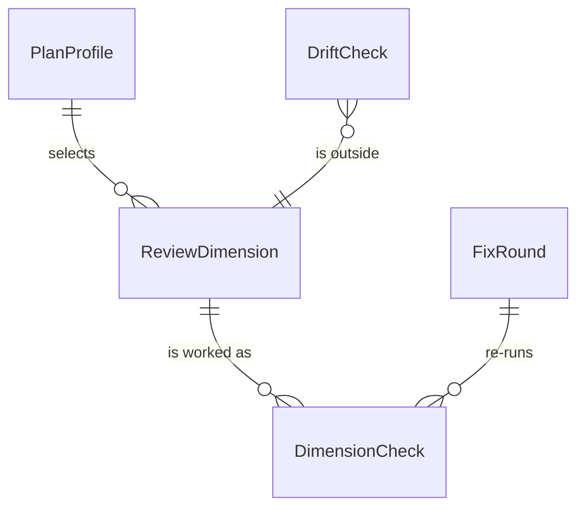

# Review Quality — Feature Spec

> **Tech-free Feature Spec.** One doc per module-level capability. Technical identifiers live only in frontmatter and the Section 8 hidden carriers.

## Sections

1. [Overview](#1-overview)
2. [Glossary](#2-glossary)
3. [User Stories & Acceptance Criteria](#3-user-stories--acceptance-criteria)
4. [Business Rules](#4-business-rules)
5. [Domain Model](#5-domain-model)
6. [Process Flows](#6-process-flows)
7. [Permissions & Roles](#7-permissions--roles)
8. [Test Specifications](#8-test-specifications)

---

## 1. Overview

When the assistant reviews a plan, a rationale or another written artifact, it checks a fixed set of review dimensions. One list owns them, and the reviewer works each applicable dimension as its own tracked check, closed with evidence it found. The review also checks things a planning conversation tends to miss: whether an outsider could follow the artifact, and whether any decision is still left to whoever builds it. A plan's review grows with the plan, so a small plan stays cheap. The reviewer decides whether a fresh helper agent is worth its cost; no rule forces one. Fixes made during a review stay proportionate to what was found. A specification audit can also report business rules the system no longer enforces, not only that a document is older than the code. After an answer the user will act on, the assistant asks once whether to test it by interview, review it adversarially, or leave it, because most users do not know when either would help.

## Large-Idea Decomposition

The decomposition lives in the frontmatter block `large_idea_decomposition`: four independently releasable slices (RVQ-S1 review dimensions and proportionate fixes, RVQ-S2 meaning-level audit, RVQ-S3 decision-interview stress pass, owned by the Workflow Routing spec, RVQ-S4 deeper-check offer after a consequential answer), with no data dependency between them.

---

## 2. Glossary

| Term                | Definition                                                                                                                | Context                                               |
| ------------------- | ------------------------------------------------------------------------------------------------------------------------- | ----------------------------------------------------- |
| Review dimension    | One angle a reviewer judges an artifact from, with its purpose and the question it answers                                | The shared list every rationale and plan review reads |
| Dimension check     | One tracked item per applicable dimension, closed with a verdict and the evidence behind it                               | Created by the reviewer before judging                |
| Applicable dimension | A dimension whose subject exists in the artifact under review; one that does not apply closes as not applicable with a one-line reason | Decides which checks a review creates |
| Tool evidence       | Something a lookup returned: a search that was run, a cited location, a named test                                        | Required to close a dimension check                   |
| Outsider read       | The dimension asking whether a reader with no access to the planning conversation can follow the artifact                 | Catches context that lives only in the conversation   |
| Decision readiness  | The dimension asking whether every product, public-contract, data or irreversible choice is settled or explicitly blocked | Local working detail stays with the builder           |
| Plan profile        | The size class a plan declares: light for small, low-risk work; full otherwise                                            | Sets how many dimensions a plan review runs           |
| Helper agent        | A separate assistant context a reviewer may start for part of a review                                                    | Its use is the reviewer's choice                      |
| Fix round           | One pass of validated fixes followed by a fresh review of the settled artifact                                            | Bounded by the shared round limit                     |
| Meaning-level drift | A business rule a specification states that the system no longer enforces, or enforces differently                        | Reported by the specification audit                   |
| Consequential answer | A recommendation, plan, design, solution or verdict the user will act on, with a material trade-off or an irreversible, cross-module, security, data or cost consequence | Decides whether a deeper check is offered |
| Deeper-check offer  | One question after a consequential answer: test it by decision interview, review it adversarially, or skip              | Asked once per subject                                |
| Advice question     | A question asking for the best way, an approach, a design or a recommendation                                             | Gets the same self-review as a verdict question       |

---

## 3. User Stories & Acceptance Criteria

### US-RVQ-01: Work every review angle as an evidence-closed check

**As a** developer asking for a review
**I want** the reviewer to judge each angle separately and show what it found
**So that** a review cannot pass by blending every angle into one general approval

**Acceptance Criteria:**

- **AC-RVQ-01** — **Given** a rationale review or a plan review **When** the reviewer prepares its checks **Then** both read the same single list of review dimensions, and no second list of dimensions exists elsewhere
- **AC-RVQ-02** — **Given** the dimension list **When** the reviewer starts **Then** it creates one tracked check per applicable dimension, closes each with its verdict and tool evidence before the next, and counts a check closed without evidence as unchecked
- **AC-RVQ-03** — **Given** the dimension list **When** a reader inspects it **Then** it includes outsider read, decision readiness, and a change-cost dimension that asks whether each change is needed, whether it is the smallest change at the root cause, and whether an existing part was searched for

### US-RVQ-02: Pay for review in proportion to the plan

**As a** developer with a small plan
**I want** its review to run only the dimensions that matter at that size
**So that** small work does not pay for a large review

**Acceptance Criteria:**

- **AC-RVQ-04** — **Given** a plan review **When** the plan declares the light profile **Then** it runs goal alignment, future change cost, decision readiness and test, specification and documentation sync; **When** it declares the full profile **Then** it runs every applicable dimension, including outsider read in any session; in both cases it also checks that discovery is bounded with a named way to settle each uncertainty and that the not-yet-specified list holds no product, contract or irreversible decision
- **AC-RVQ-05** — **Given** a plan is being validated or executed **When** its guidance loads **Then** no review dimension text loads with it
- **AC-RVQ-06** — **Given** a rationale review of a plan written by the planning procedure **When** its required sections are checked **Then** problem maps to the plan's outcome section, alternatives and rationale to its decisions, risk to its risks and ownership to its areas and owners, and the review output keeps its usual checklist

### US-RVQ-03: Leave fresh context to the reviewer

**As a** developer paying for the review's tokens
**I want** the reviewer to start a helper agent only when it judges the gain worth the cost
**So that** reviews are not forced into the most expensive form

**Acceptance Criteria:**

- **AC-RVQ-07** — **Given** any review or re-review **When** a fresh view is needed **Then** the reviewer re-reads the saved artifact rather than relying on memory, decides itself whether a helper agent is worth its cost, never reuses a helper agent from an earlier round when it does start one, and no review rule requires a helper agent

### US-RVQ-04: Keep fixes proportionate

**As a** developer whose artifact is being fixed during a review
**I want** each fix to be the smallest one that answers its finding
**So that** review rounds do not pile defensive machinery onto the work

**Acceptance Criteria:**

- **AC-RVQ-08** — **Given** a validated finding in a fix round **When** it is fixed **Then** the fix is made at the evidenced owner with the smallest change proportionate to the finding's severity, and every published copy of this rule matches its single owner

### US-RVQ-05: Catch rules the system stopped enforcing

**As a** framework maintainer auditing a specification
**I want** the audit to check stated business rules against what the system does
**So that** a rule the system silently stopped enforcing is found, not only a document that is older than the code

**Acceptance Criteria:**

- **AC-RVQ-09** — **Given** a specification audit with stale modules **When** the audit runs **Then** it checks each stated rule of those modules once per module or section, reports each divergence as missing or violated with its evidence, states how many rules it checked and how many diverge, changes no document, and the code-to-specification audit inherits the same pass without a second owner

### US-RVQ-06: Offer a deeper check when an answer matters

**As a** developer acting on the assistant's advice
**I want** to be asked, once, whether to test or review an answer before I act on it
**So that** I get the deeper check without having to know which skill to call or when

**Acceptance Criteria:**

- **AC-RVQ-10** — **Given** a question that asks for the best way, an approach, a design or a recommendation **When** the assistant answers **Then** it self-reviews the answer as it does a verdict: the constraints it assumed are named and at least one real alternative is weighed with the same evidence bar; build work that merely names a recommendation, a stated plan, a factual lookup, and an explicit call of either deeper check get no such review prompt
- **AC-RVQ-11** — **Given** a consequential answer outside a running workflow, in the main conversation **When** the answer ends **Then** the assistant asks one question with three options: test it by decision interview, review it adversarially, or skip; the interview is listed first when the answer rests on the user's preferences or constraints, the review first when it rests on evidence
- **AC-RVQ-12** — **Given** a lookup, a trivial answer, a routine edit, a running workflow, a skill that closes with its own question or next step, a helper agent, a user who already asked for either check on this answer, or a subject the user already skipped **When** the answer ends **Then** no offer is asked
- **AC-RVQ-13** — **Given** the decision interview, an ideation session or a standalone rationale review **When** its result leaves choices that rest on the user **Then** it points to the decision interview: the interview accepts an earlier answer as its subject and names the rationale review as its complement, ideation offers it on the recommended option, and a standalone rationale review may offer it with the material trade-offs; none offers it as a workflow step or helper agent
- **AC-RVQ-14** — **Given** a plan created standalone, with a user present **When** its self-review and validation chain end (or the chain exits) **Then** the assistant asks one question — execute now, deeper review first (up to three rounds), or stop — recommends one with its reason, and acts only on the answer; inside a workflow, when another skill runs plan creation, or when no user can be reached, no question is asked and the hand-back names the same three next steps

---

## 4. Business Rules

### Rule Catalog

| Rule ID   | Name                                         | Category       | Enforcement |
| --------- | -------------------------------------------- | -------------- | ----------- |
| BR-RVQ-01 | One owner for review dimensions              | Ownership      | [HARD]      |
| BR-RVQ-02 | Every dimension check closes with evidence   | Review conduct | [HARD]      |
| BR-RVQ-03 | Plan review scales with the plan profile     | Cost           | [HARD]      |
| BR-RVQ-04 | Review text loads only when a review runs    | Cost           | [HARD]      |
| BR-RVQ-05 | A helper agent is the reviewer's choice      | Cost           | [HARD]      |
| BR-RVQ-06 | Fixes are proportionate                      | Review conduct | [HARD]      |
| BR-RVQ-07 | Meaning-level drift is bounded and read-only | Audit          | [HARD]      |
| BR-RVQ-08 | Plan targets map required sections           | Review conduct | [HARD]      |
| BR-RVQ-09 | Advice questions get the answer self-review  | Answer review  | [HARD]      |
| BR-RVQ-10 | A consequential answer offers a deeper check | Answer review  | [HARD]      |
| BR-RVQ-11 | A standalone plan ends with one next-step question | Answer review | [HARD] |

### BR-RVQ-01: One owner for review dimensions [HARD]

**Statement:** The review dimensions exist in exactly one list. The rationale review and the plan review read that list. Neither keeps its own copy of the dimensions or a parallel list of angles.

```
IF a second list of review dimensions exists
  → REJECT: "Review dimensions have one owner; point to it instead of copying it"
```

### BR-RVQ-02: Every dimension check closes with evidence [HARD]

**Statement:** The reviewer creates one tracked check per applicable dimension and closes it with a verdict and tool evidence before starting the next. A check closed without evidence counts as unchecked. A dimension that does not apply closes as not applicable with a one-line reason. The list includes outsider read, decision readiness and a change-cost dimension covering necessity, smallest change and a search for an existing part.

### BR-RVQ-03: Plan review scales with the plan profile [HARD]

**Statement:** A light plan's review runs goal alignment, future change cost, decision readiness and test, specification and documentation sync. A full plan's review runs every applicable dimension, outsider read included in any session. A plan that declares no profile is reviewed as full. Both also check bounded discovery and that the not-yet-specified list parks no product, contract or irreversible decision.

| Plan profile | Dimensions run                                                             | Plan-only checks                             |
| ------------ | -------------------------------------------------------------------------- | -------------------------------------------- |
| light        | goal alignment, future change cost, decision readiness, test/spec/doc sync | bounded discovery; not-yet-specified hygiene |
| full         | every applicable dimension, outsider read in any session                   | bounded discovery; not-yet-specified hygiene |

### BR-RVQ-04: Review text loads only when a review runs [HARD]

**Statement:** Plan validation and plan execution load no review dimension text. The dimension list loads when a review reads it.

### BR-RVQ-05: A helper agent is the reviewer's choice [HARD]

**Statement:** No review rule requires a helper agent. A fresh view means re-reading the saved artifact; the reviewer decides whether a helper agent is worth its cost. A helper agent started for a round is never one reused from an earlier round. A short fresh read for outsider read is a comprehension check, not a review round: it is told who the reader is (someone with the repository open) and returns at most 10 items, most misleading first — what neither the page nor a file it names resolves, and statements on the page that contradict each other — so it carries none of the review-round briefing.

### BR-RVQ-06: Fixes are proportionate [HARD]

**Statement:** A validated finding is fixed at its evidenced owner with the smallest change proportionate to its severity. The rule has one owner; every published copy matches it.

### BR-RVQ-07: Meaning-level drift is bounded and read-only [HARD]

**Statement:** The specification audit checks stated rules only for modules that changed since the specification was last updated, one tracked check per module or section. It reports each divergence as missing or violated with its evidence, plus the count checked and the count divergent, and never changes a document. The code-to-specification audit inherits this pass.

### BR-RVQ-08: Plan targets map required sections [HARD]

**Statement:** When a rationale review targets a plan written by the planning procedure, its required sections map onto that plan's own sections instead of being demanded verbatim; the review output keeps its usual checklist.

### BR-RVQ-09: Advice questions get the answer self-review [HARD]

**Statement:** A question asking for the best way, an approach, a design or a recommendation gets the same anti-bias self-review as a verdict question, and the answer names the constraints it assumed and weighs at least one real alternative. Build work that only names a recommendation, a stated plan ("I suggest we …"), a factual lookup, and an explicit call of the decision interview or the rationale review are not advice questions.

### BR-RVQ-10: A consequential answer offers a deeper check [HARD]

**Statement:** After a consequential answer, the assistant asks one question with three options: test it by decision interview, review it adversarially, or skip. It never asks after a lookup, a trivial answer or a routine edit, inside a running workflow, at the end of a skill that already closes with its own question or next step, from a helper agent or headless run, when the user already asked for either check on that answer, or again on a subject the user skipped. The decision interview, an ideation session and a standalone rationale review point to the interview where their result leaves choices to the user; none does so as a workflow step or helper agent.

```
IF the answer is consequential AND no exemption holds
  → ASK once: interview · review · skip
IF an exemption holds
  → no offer
```

### BR-RVQ-11: A standalone plan ends with one next-step question [HARD]

**Statement:** A plan created standalone reviews itself once and is validated with the user; it then ends with one question: execute now, deeper review first, or stop. The recommendation follows the plan's state: execute when no finding stayed open and validation passed, a deeper review when a finding stayed open, validation was skipped, or a full-profile plan carries a one-way or cross-module decision. Plan creation never starts execution or a review on its own; the answer starts it. A workflow, a calling skill or a context with no user gets no question.

<!-- machine-only carrier — ignore when reading as BA/QA -->

> **Evidence:** `[Source: constraint/skills/review-dimensions]` · `[Source: constraint/skills/review-policy]` · `[Source: operation/skills/spec-audit]` · `[Source: constraint/skills/judgement-integrity]`

---

## 5. Domain Model

### Relationships (overview)



### Entity: ReviewDimension

| Property      | Type | Required | Constraints                | Business Meaning       |
| ------------- | ---- | -------- | -------------------------- | ---------------------- |
| name          | text | Yes      | unique in the one list     | The angle judged       |
| question      | text | Yes      | answerable PASS or FINDING | What the reviewer asks |
| evidence kind | text | Yes      | names a lookup result      | What closes the check  |

### Entity: DimensionCheck

| Property  | Type | Required | Constraints                           | Business Meaning              |
| --------- | ---- | -------- | ------------------------------------- | ----------------------------- |
| dimension | text | Yes      | one per applicable dimension          | Which angle this check covers |
| verdict   | enum | Yes      | PASS, FINDING or N/A with reason      | The result                    |
| evidence  | text | Yes      | tool evidence; absent means unchecked | Why the verdict holds         |

### Entity: PlanProfile

| Property | Type | Required | Constraints   | Business Meaning                         |
| -------- | ---- | -------- | ------------- | ---------------------------------------- |
| value    | enum | Yes      | light or full | Sets which dimensions a plan review runs |

### Entity: FixRound

| Property | Type   | Required | Constraints                     | Business Meaning    |
| -------- | ------ | -------- | ------------------------------- | ------------------- |
| number   | number | Yes      | within the shared round limit   | Which round this is |
| fixes    | text   | Yes      | each smallest and proportionate | What changed        |

### Entity: DriftCheck

| Property        | Type | Required | Constraints                    | Business Meaning             |
| --------------- | ---- | -------- | ------------------------------ | ---------------------------- |
| scope           | text | Yes      | one stale module or section    | What was checked             |
| status per rule | enum | Yes      | PASS, MISSING or VIOLATED      | Whether the rule still holds |
| totals          | text | Yes      | rules checked, rules divergent | Coverage of the audit        |

### Enum: DriftStatus

| Value    | Meaning                                         |
| -------- | ----------------------------------------------- |
| PASS     | The rule is enforced as stated                  |
| MISSING  | No enforcement of the stated rule was found     |
| VIOLATED | The system does the opposite of the stated rule |

### Domain Events (business occurrences)

| Occurrence        | When it happens                           | Who/what reacts (business outcome)         |
| ----------------- | ----------------------------------------- | ------------------------------------------ |
| Dimension checked | A reviewer closes a check with evidence   | The next check starts                      |
| Drift found       | An audit finds a missing or violated rule | The maintainer sees it in the audit report |
| Deeper check offered | A consequential answer ends outside a workflow | The user picks interview, review or skip |

---

## 6. Process Flows

No user interface: this capability changes how the assistant reviews and audits, not a screen. Interaction surface sections are skipped for that reason.

### Flow: Review an artifact

| Step | Actor     | Action                                                                                       | System Response                       | Next |
| ---- | --------- | -------------------------------------------------------------------------------------------- | ------------------------------------- | ---- |
| 1    | Developer | Asks for a rationale or plan review                                                          | Reviewer reads the one dimension list | 2    |
| 2    | Reviewer  | Selects applicable dimensions (by plan profile for a plan)                                   | One tracked check per dimension       | 3    |
| 3    | Reviewer  | Closes each check with verdict and tool evidence                                             | Findings recorded                     | 4    |
| 4    | Reviewer  | Validates findings; in a fix loop, makes the smallest proportionate fix                      | Settled artifact                      | 5    |
| 5    | Reviewer  | Re-reads the saved artifact for a fresh review; starts a helper agent only by its own choice | Verdict                               | —    |

### Flow: Audit a specification for meaning-level drift

| Step | Actor      | Action                                                  | System Response                                                       | Next |
| ---- | ---------- | ------------------------------------------------------- | --------------------------------------------------------------------- | ---- |
| 1    | Maintainer | Runs the specification audit                            | Stale modules found from change history                               | 2    |
| 2    | Reviewer   | Checks each stated rule of each stale module or section | PASS, MISSING or VIOLATED with evidence                               | 3    |
| 3    | Reviewer   | Writes the audit report                                 | Divergences listed with "N checked, M divergent"; no document changed | —    |

### Flow: Offer a deeper check on an answer

| Step | Actor     | Action                                                        | System Response                                             | Next |
| ---- | --------- | ------------------------------------------------------------- | ----------------------------------------------------------- | ---- |
| 1    | Developer | Asks for advice, a plan, a design or a verdict                 | The assistant self-reviews its draft answer                 | 2    |
| 2    | Assistant | Sends the answer; checks whether it is consequential and exempt | Consequential and not exempt: one question with three options | 3    |
| 3    | Developer | Picks interview, review or skip                                | The picked check runs; skip leaves the answer as it is     | —    |

---

## 7. Permissions & Roles

This capability enforces no permission boundary of its own. Anyone may ask for a review; the reviewing assistant runs it; changing the dimension list, the round rule or the audit guidance follows the repository’s normal write access and review.

| Role | Asks for review | Runs review | Changes the guidance |
| --- | :---: | :---: | :---: |
| Developer | yes | no | through normal repository access |
| Reviewing assistant | no | yes | no |
| Framework maintainer | yes | no | through normal repository access |

---

## 8. Test Specifications

### Test Summary

| Priority  | Count | Automated | Manual |
| --------- | ----- | --------- | ------ |
| P0        | 3      | 3         | 0      |
| P1        | 7      | 7         | 0      |
| P2        | 1      | 1         | 0      |
| **Total** | **11** | **11**    | **0**  |

Every rule in §4 is `[HARD]`, so each case below states its property over a whole input domain and pairs it with a boundary counter-case.

### TC-RVQ-001: One list owns the review dimensions [P0]

**Objective:** Keep the dimensions in one place so the next angle is a one-row change.

**Business Intent / Invariant Guarded:** BR-RVQ-01 / AC-RVQ-01 — for every review guidance a reviewer reads, the dimensions come from the one list.

**Preconditions:** The framework's review guidance as shipped.

**Real-World Reachability:** Every rationale or plan review a developer asks for: the reviewer opens its guidance before the first pass.

**Demo Flow:** A maintainer opens the rationale review and the plan review guidance and follows each to its dimensions.

```gherkin
Given every review guidance that names review dimensions
When a maintainer follows each one to its dimensions
Then each points to the same single dimension list with a read-before-review instruction
And no guidance holds its own dimension table or a parallel angle list
```

**Expected Result:**

| Dimension               | Expectation                                                |
| ----------------------- | ---------------------------------------------------------- |
| **UI**                  | Not applicable — the observable surface is review guidance |
| **System behavior**     | Both reviews read one list                                 |
| **Business data state** | Exactly one dimension list exists                          |
| **Data shown on UI**    | The list's rows, seen through either review                |

**Acceptance Criteria:**

- ✅ The rationale review and the plan review each point to the one list.
- ❌ A second dimension table anywhere in the review guidance fails the case.

**Test Data:** The rationale review guidance, the plan review guidance and the dimension list.

**Edge Cases (boundary counter-case):** One dimension's name used in a sentence of another rule is not a copy; a second table with the dimension rows is.

<!-- machine-only carrier — ignore when reading as BA/QA -->

> **Evidence:** `[Source: constraint/skills/review-dimensions]`
> **Related Behaviors:** `constraint/skills/review-dimensions`
> **CoveredBy:** `.claude/hooks/tests/suites/review-quality.test.cjs::TC-RVQ-001` · **Status:** Tested

### TC-RVQ-002: Every dimension check closes with tool evidence [P0]

**Objective:** Stop a review from passing on one general approval.

**Business Intent / Invariant Guarded:** BR-RVQ-02 / AC-RVQ-02, AC-RVQ-03 — for every applicable dimension, the check closes only with evidence.

**Preconditions:** The dimension list.

**Real-World Reachability:** Every review run: the reviewer builds its checks from the list before it judges anything.

**Demo Flow:** A developer asks for a review and reads the review report.

```gherkin
Given the dimension list
When a reviewer starts any review
Then it creates one tracked check per applicable dimension
And closes each with a verdict and tool evidence before the next
And a check closed without evidence counts as unchecked
And a dimension that does not apply closes as not applicable with a one-line reason
And the list contains outsider read and decision readiness
And its change-cost dimension asks about necessity, the smallest change and a search for an existing part
```

**Expected Result:**

| Dimension               | Expectation                                                |
| ----------------------- | ---------------------------------------------------------- |
| **UI**                  | Not applicable — the observable surface is review guidance |
| **System behavior**     | One check per applicable dimension, each with evidence     |
| **Business data state** | The list holds the evidence rule and the three angles      |
| **Data shown on UI**    | A review report with a verdict and evidence per dimension  |

**Acceptance Criteria:**

- ✅ The evidence rule, the not-applicable rule and the three angles are in the list.
- ❌ A rule allowing a check to close without evidence fails the case.

**Test Data:** The dimension list.

**Edge Cases (boundary counter-case):** A dimension with no subject in the artifact is closed not applicable with its reason, not silently skipped.

<!-- machine-only carrier — ignore when reading as BA/QA -->

> **Evidence:** `[Source: constraint/skills/review-dimensions]`
> **Related Behaviors:** `constraint/skills/review-dimensions`
> **CoveredBy:** `.claude/hooks/tests/suites/review-quality.test.cjs::TC-RVQ-002` · **Status:** Tested

### TC-RVQ-003: Plan review scales with the plan profile [P1]

**Objective:** Keep small plans cheap without losing plan-only checks.

**Business Intent / Invariant Guarded:** BR-RVQ-03 / AC-RVQ-04 — for every plan profile, the review runs exactly its stated dimension set plus the plan-only checks.

**Preconditions:** The plan review guidance.

**Real-World Reachability:** A developer asks for a plan review after the planning procedure saved a plan, with a declared profile or none.

**Demo Flow:** A developer runs a plan review on a light plan and on a full plan.

```gherkin
Given a plan review
When the plan is light
Then it runs goal alignment, future change cost, decision readiness and test, spec and doc sync
When the plan is full
Then it runs every applicable dimension including outsider read in any session
When the plan declares no profile
Then it is reviewed as full
And every profile also checks bounded discovery and the not-yet-specified list
And plan creation's own review pass applies the same profile scaling and records each dimension's verdict
```

**Expected Result:**

| Dimension               | Expectation                                                |
| ----------------------- | ---------------------------------------------------------- |
| **UI**                  | Not applicable — the observable surface is review guidance |
| **System behavior**     | Dimension set chosen by profile                            |
| **Business data state** | Not applicable — no data changes                           |
| **Data shown on UI**    | The review report lists the profile's dimensions           |

**Acceptance Criteria:**

- ✅ Light, full and undeclared profiles each name their set; the plan-only line is present.
- ❌ Outsider read limited to the drafting session fails the case.

**Test Data:** The plan review guidance.

**Edge Cases (boundary counter-case):** A light plan still gets the two plan-only checks; outsider read runs on a full plan reviewed in a later session.

<!-- machine-only carrier — ignore when reading as BA/QA -->

> **Evidence:** `[Source: constraint/skills/plan-mode-review]`
> **Related Behaviors:** `constraint/skills/plan-mode-review`
> **CoveredBy:** `.claude/hooks/tests/suites/review-quality.test.cjs::TC-RVQ-003` · **Status:** Tested

### TC-RVQ-004: Validation and execution load no review text [P1]

**Objective:** Spend review tokens only when a review runs.

**Business Intent / Invariant Guarded:** BR-RVQ-04 / AC-RVQ-05 — for every guidance plan validation or execution loads, no dimension text loads.

**Preconditions:** The plan's validation and execution guidance and the gate checklist they read.

**Real-World Reachability:** A developer validates or executes a saved plan; only that mode's guidance loads.

**Demo Flow:** A maintainer inspects what a validation or an execution reads.

```gherkin
Given every guidance plan validation and plan execution read
When it is inspected
Then it carries no review dimension rows
And no pointer that loads the dimension list
```

**Expected Result:**

| Dimension               | Expectation                                                |
| ----------------------- | ---------------------------------------------------------- |
| **UI**                  | Not applicable — the observable surface is loaded guidance |
| **System behavior**     | Validation and execution load no review text               |
| **Business data state** | Not applicable — no data changes                           |
| **Data shown on UI**    | Not applicable — nothing new is shown                      |

**Acceptance Criteria:**

- ✅ None of those loads contains the dimension list or a pointer to it.
- ❌ Dimension rows in the shared gate checklist fail the case.

**Test Data:** The validation, execution and gate checklist guidance.

**Edge Cases (boundary counter-case):** The plan review guidance does point to the list; that is the one plan load allowed to.

<!-- machine-only carrier — ignore when reading as BA/QA -->

> **Evidence:** `[Source: constraint/skills/plan-mode-review]`
> **Related Behaviors:** `constraint/skills/plan-mode-review`
> **CoveredBy:** `.claude/hooks/tests/suites/review-quality.test.cjs::TC-RVQ-004` · **Status:** Tested

### TC-RVQ-005: No review rule forces a helper agent [P0]

**Objective:** Leave the expensive form of review to the reviewer's judgement.

**Business Intent / Invariant Guarded:** BR-RVQ-05 / AC-RVQ-07 — for every review rule in scope, a helper agent is optional.

**Preconditions:** The task review, artifact review and round-structure guidance.

**Real-World Reachability:** Any review or re-review in any review skill, at the moment the reviewer decides how to get a fresh view.

**Demo Flow:** A maintainer reads the review rules that used to require a fresh helper agent.

```gherkin
Given every review rule that used to require a fresh helper agent
When it is read
Then a fresh view means re-reading the saved artifact
And the reviewer chooses whether to start a helper agent
And a helper agent started for a round is never reused from an earlier round
And no sentence requires a new helper agent for every round or every re-review
And a short fresh read for outsider read is a comprehension check, so it carries no review-round briefing
And that read is told who the reader is and returns at most 10 items: unresolved terms and contradictions on the page
```

**Expected Result:**

| Dimension               | Expectation                                                |
| ----------------------- | ---------------------------------------------------------- |
| **UI**                  | Not applicable — the observable surface is review guidance |
| **System behavior**     | Reviews may stay in one context                            |
| **Business data state** | Not applicable — no data changes                           |
| **Data shown on UI**    | Not applicable — nothing new is shown                      |

**Acceptance Criteria:**

- ✅ Each rule states the choice and the no-reuse limit.
- ❌ Any remaining "every round spawns a new helper agent" or "restart with a fresh zero-memory reviewer" sentence fails the case.

**Test Data:** The task review checklist, the artifact review mode and the round-structure guide.

**Edge Cases (boundary counter-case):** The prompt template a reviewer uses when it does choose a helper agent remains; only the requirement to start one is removed.

<!-- machine-only carrier — ignore when reading as BA/QA -->

> **Evidence:** `[Source: constraint/skills/sub-agent-selection]`
> **Related Behaviors:** `constraint/skills/sub-agent-selection`
> **CoveredBy:** `.claude/hooks/tests/suites/review-quality.test.cjs::TC-RVQ-005` · **Status:** Tested

### TC-RVQ-006: Fixes are proportionate, and every copy matches the owner [P1]

**Objective:** Prevent defensive bloat at the moment of fixing.

**Business Intent / Invariant Guarded:** BR-RVQ-06 / AC-RVQ-08 — for every copy of the review-round rule, fixes are smallest and proportionate.

**Preconditions:** The review-round rule's owner and its published copy.

**Real-World Reachability:** Any fix round of any review loop, after its findings are validated and before the fix is made.

**Demo Flow:** A maintainer reads the round rule in its owner and in its published copy.

```gherkin
Given every copy of the review-round rule
When it describes fixing validated findings
Then it requires the smallest fix proportionate to the finding's severity at the evidenced owner
And every published copy is identical to its single owner
```

**Expected Result:**

| Dimension               | Expectation                                                |
| ----------------------- | ---------------------------------------------------------- |
| **UI**                  | Not applicable — the observable surface is review guidance |
| **System behavior**     | Fix rounds make proportionate fixes                        |
| **Business data state** | Owner and copies agree                                     |
| **Data shown on UI**    | Not applicable — nothing new is shown                      |

**Acceptance Criteria:**

- ✅ The proportionate-fix wording is in the owner and every copy.
- ❌ A copy that differs from the owner fails the case.

**Test Data:** The rule owner and its published copy.

**Edge Cases (boundary counter-case):** The wording keeps "at the evidenced owner"; proportionality never moves a fix away from its owner.

<!-- machine-only carrier — ignore when reading as BA/QA -->

> **Evidence:** `[Source: constraint/skills/review-policy]`
> **Related Behaviors:** `constraint/skills/review-policy`
> **CoveredBy:** `.claude/hooks/tests/suites/review-quality.test.cjs::TC-RVQ-006` · **Status:** Tested

### TC-RVQ-007: Specification audit reports meaning-level drift, bounded and read-only [P1]

**Objective:** Find rules the system stopped enforcing without unbounded cost.

**Business Intent / Invariant Guarded:** BR-RVQ-07 / AC-RVQ-09 — for every stale module, every stated rule is checked once and reported; nothing is edited.

**Preconditions:** The specification audit guidance and the code-to-specification audit route.

**Real-World Reachability:** A maintainer runs the specification audit after code changed since the specification's last update.

**Demo Flow:** A maintainer runs a specification audit after code changed and reads the audit report.

```gherkin
Given a specification audit with stale modules
When the audit runs its meaning-level pass
Then it checks stated rules once per stale module or section
And reports each divergence as missing or violated with evidence
And states how many rules it checked and how many diverge
And changes no document
And the code-to-specification audit reaches this pass through the specification audit
```

**Expected Result:**

| Dimension               | Expectation                                                 |
| ----------------------- | ----------------------------------------------------------- |
| **UI**                  | Not applicable — the observable surface is the audit report |
| **System behavior**     | Bounded, read-only pass                                     |
| **Business data state** | Specifications unchanged by the audit                       |
| **Data shown on UI**    | Divergences plus "N checked, M divergent"                   |

**Acceptance Criteria:**

- ✅ The pass, its statuses, its totals and its read-only rule are stated.
- ❌ A pass that runs over unchanged modules, or a second owner of the pass, fails the case.

**Test Data:** The specification audit guidance and the code-to-specification audit route.

**Edge Cases (boundary counter-case):** When no module changed since the last update, the pass checks nothing and reports zero checked.

<!-- machine-only carrier — ignore when reading as BA/QA -->

> **Evidence:** `[Source: operation/skills/spec-audit]`
> **Related Behaviors:** `operation/skills/spec-audit`
> **CoveredBy:** `.claude/hooks/tests/suites/review-quality.test.cjs::TC-RVQ-007` · **Status:** Tested

### TC-RVQ-008: A plan target maps the rationale review's required sections [P2]

**Objective:** Let the rationale review judge a plan by the plan's own structure.

**Business Intent / Invariant Guarded:** BR-RVQ-08 / AC-RVQ-06 — for a plan from the planning procedure, every required section maps to a plan section.

**Preconditions:** The rationale review guidance.

**Real-World Reachability:** A developer asks for a rationale review of a plan the planning procedure wrote.

**Demo Flow:** A developer asks for a rationale review of a saved plan.

```gherkin
Given a rationale review of a plan written by the planning procedure
When it checks required sections
Then problem maps to the outcome section, alternatives and rationale to decisions, risk to risks and ownership to areas and owners
And the review output checklist keeps all its rows
```

**Expected Result:**

| Dimension               | Expectation                                                |
| ----------------------- | ---------------------------------------------------------- |
| **UI**                  | Not applicable — the observable surface is review guidance |
| **System behavior**     | Plan sections satisfy the required sections                |
| **Business data state** | Not applicable — no data changes                           |
| **Data shown on UI**    | The usual review checklist                                 |

**Acceptance Criteria:**

- ✅ The mapping sentence is present and the output checklist rows are unchanged.
- ❌ Demanding a separate "Alternatives Considered" section from such a plan fails the case.

**Test Data:** The rationale review guidance.

**Edge Cases (boundary counter-case):** A plan not written by the planning procedure keeps the generic required sections.

<!-- machine-only carrier — ignore when reading as BA/QA -->

> **Evidence:** `[Source: constraint/skills/why-review-full-mode]`
> **Related Behaviors:** `constraint/skills/why-review-full-mode`
> **CoveredBy:** `.claude/hooks/tests/suites/review-quality.test.cjs::TC-RVQ-008` · **Status:** Tested

### TC-RVQ-009: A consequential answer offers a deeper check, once and only where it can be answered [P1]

**Objective:** Make the decision interview and the rationale review reachable at the moment they help, without interrupting other work.

**Business Intent / Invariant Guarded:** BR-RVQ-10 / AC-RVQ-11, AC-RVQ-12, AC-RVQ-13 — for every consequential answer outside the exemptions, exactly one offer with three options; for every exemption, none.

**Preconditions:** The answer self-review rule and the guidance of the decision interview, ideation and rationale review.

**Real-World Reachability:** A developer asks for advice in the main conversation, outside any workflow, and is about to act on the answer.

**Demo Flow:** A developer asks how to structure multi-tenant access, receives a recommendation, and is asked whether to test it by interview, review it, or skip.

```gherkin
Given a consequential answer in the main conversation, outside a running workflow
When the answer ends
Then one question offers: test it by decision interview, review it adversarially, or skip
And the decision interview accepts an earlier answer as its subject and names the rationale review as its complement
And ideation and a standalone rationale review point to the interview where choices rest on the user
```

**Expected Result:**

| Dimension               | Expectation                                                       |
| ----------------------- | ----------------------------------------------------------------- |
| **UI**                  | One question with three options at the end of the answer         |
| **System behavior**     | The picked check runs; skip leaves the answer unchanged           |
| **Business data state** | Not applicable — no data changes                                  |
| **Data shown on UI**    | The three options, the recommended one first                      |

**Acceptance Criteria:**

- ✅ The offer rule, its three options and its exemptions are stated; the three pointing skills carry their offer and its boundary.
- ❌ An offer after a lookup, inside a running workflow, from a helper agent, or again after a skip fails the case.

**Test Data:** The answer self-review rule and the three skills' guidance.

**Edge Cases (boundary counter-case):** An ideation session or a rationale review run as a workflow step makes no offer; the workflow's next steps own the move.

<!-- machine-only carrier — ignore when reading as BA/QA -->

> **Evidence:** `[Source: constraint/skills/judgement-integrity]`
> **Related Behaviors:** `constraint/skills/judgement-integrity`
> **CoveredBy:** `.claude/hooks/tests/suites/review-quality.test.cjs::TC-RVQ-009`; `.claude/hooks/tests/suites/judgement-integrity-route.test.cjs::TC-JIR-013` · **Status:** Tested

### TC-RVQ-010: Advice questions get the answer self-review; build work does not [P1]

**Objective:** Give recommendations the same anti-bias check verdicts get, without prompting it on build work.

**Business Intent / Invariant Guarded:** BR-RVQ-09 / AC-RVQ-10 — for every advice question the self-review applies; for every build request that only names a recommendation, it does not.

**Preconditions:** The answer self-review prompt check.

**Real-World Reachability:** Every user prompt in a session; advice asks, build requests, stated plans and lookups arrive in any order.

**Demo Flow:** A developer asks for the best way to cache tokens, then later asks to implement the suggested fix.

```gherkin
Given a question asking for the best way, an approach, a design or a recommendation
When the question arrives
Then the answer self-review applies, naming assumed constraints and weighing a real alternative
And a request to implement, apply or follow a recommendation gets no review prompt
And a stated plan ("I suggest we …") or a factual lookup ("what tool runs the tests?") gets no review prompt
And an explicit call of the decision interview or the rationale review gets no review prompt
```

**Expected Result:**

| Dimension               | Expectation                                                       |
| ----------------------- | ----------------------------------------------------------------- |
| **UI**                  | Not applicable — the observable surface is the assistant's answer |
| **System behavior**     | Advice questions are self-reviewed; build work is not prompted    |
| **Business data state** | Not applicable — no data changes                                  |
| **Data shown on UI**    | The answer's assumed constraints and the alternative it weighed   |

**Acceptance Criteria:**

- ✅ Each advice phrasing in the test set is recognized as advice.
- ❌ A build request that names a recommendation being prompted fails the case.

**Test Data:** Twelve advice phrasings, and twelve build, stated-plan, lookup or explicit-call phrasings.

**Edge Cases (boundary counter-case):** "Apply what you recommend in the plan" is build work and gets no prompt.

<!-- machine-only carrier — ignore when reading as BA/QA -->

> **Evidence:** `[Source: constraint/skills/judgement-integrity]`
> **Related Behaviors:** `constraint/skills/judgement-integrity`
> **CoveredBy:** `.claude/hooks/tests/suites/judgement-integrity-route.test.cjs::TC-JIR-012` · **Status:** Tested

---

### TC-RVQ-011: A standalone plan ends with one next-step question [P1]

**Objective:** Make the deeper review and execution reachable at the moment a plan is ready, without starting either unasked.

**Business Intent / Invariant Guarded:** BR-RVQ-11 / AC-RVQ-14 — for every standalone plan with a user present, exactly one closing question with three options; for every workflow, calling skill or unreachable user, none.

**Preconditions:** The planning procedure's guidance.

**Real-World Reachability:** A developer asks for a plan directly, answers the validation interview, and decides what happens next in the same session.

**Demo Flow:** Ask for a plan standalone, answer the validation interview, and see the closing question; pick deeper review and see the plan review start.

```gherkin
Given a plan created standalone with a user present
When its self-review and validation chain end, or the chain exits
Then one question offers: execute now, deeper review first, or stop
And one option is recommended with its reason
And only the answer starts execution or review
And a workflow, a calling skill or a context with no user gets no question
```

**Expected Result:**

| Dimension               | Expectation                                                    |
| ----------------------- | -------------------------------------------------------------- |
| **UI**                  | One closing question with three options                        |
| **System behavior**     | The picked next step starts as its own run; stop ends the run  |
| **Business data state** | Not applicable — no data changes                               |
| **Data shown on UI**    | The three options, the recommended one first                   |

**Acceptance Criteria:**

- ✅ The closing question, its three options, its recommendation rule and its exemptions are stated.
- ❌ Plan creation starting execution or a review without an answer, or asking inside a workflow, fails the case.

**Test Data:** The planning procedure's guidance.

**Edge Cases (boundary counter-case):** The validation chain exits (setting off or declined): the closing question is still asked, with a deeper review recommended.

<!-- machine-only carrier — ignore when reading as BA/QA -->

> **Evidence:** `[Source: constraint/skills/plan]`
> **Related Behaviors:** `constraint/skills/plan`
> **CoveredBy:** `.claude/hooks/tests/suites/review-quality.test.cjs::TC-RVQ-011` · **Status:** Tested

---
