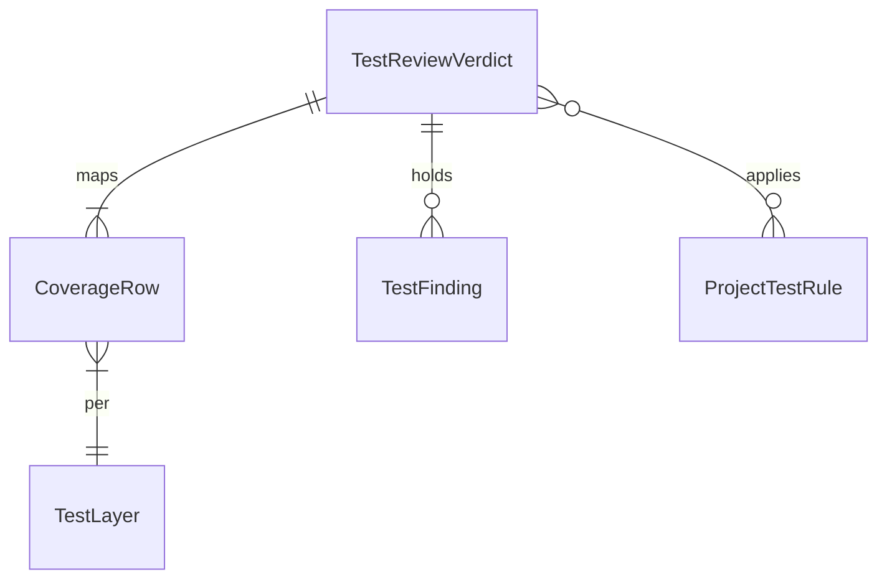

# Test Review — Feature Spec

> **Tech-free Feature Spec.** One doc per module-level capability. Technical identifiers live only in frontmatter and the Section 8 hidden carriers.

## Sections

1. [Overview](#1-overview)
2. [Glossary](#2-glossary)
3. [User Stories & Acceptance Criteria](#3-user-stories--acceptance-criteria)
4. [Business Rules](#4-business-rules)
5. [Domain Model](#5-domain-model)
6. [Process Flows](#6-process-flows)
7. [Permissions & Roles](#7-permissions--roles)
8. [Test Specifications](#8-test-specifications)

---

## 1. Overview

Every time the assistant reviews a change — a focused diff, a risky change set, a whole branch before it is marked ready, a pull request or a single commit — it also reviews the tests of that change. One test review owns that job. It maps each changed behavior to the tests that cover it at every test layer the project uses (unit, integration, end-to-end, performance and seed data), judges whether those tests would fail when the behavior breaks, flags patterns that make tests flaky, and checks that the specification, the tests and the code still agree. Each layer is judged by its own review owner; the test review decides which layers a change needs and merges their findings. A pull request records the test review's verdict and the specification sync result, so a reviewer can see that untested or weakly tested behavior did not slip through. A new project gets the same review wired into its quality harness from its first foundation, and a project can add its own test rules on top without changing the framework.

Large-idea decomposition: not applicable. The capability has one outcome — every review path reviews the tests of the change — and ships as one slice.

---

## 2. Glossary

| Term               | Definition                                                                                                                                                                                        | Context                                                                 |
| ------------------ | ------------------------------------------------------------------------------------------------------------------------------------------------------------------------------------------------- | ----------------------------------------------------------------------- |
| Test review        | The review of a change's tests: coverage of each changed behavior at each applicable layer, and the quality of the covering tests                                                                 | Owned by one review; every review entry point reaches it                |
| Test layer         | One kind of test the project uses: unit, integration, end-to-end, performance or seed data                                                                                                        | A layer is applicable only with evidence of its runner or configuration |
| Layer review owner | The review that judges one layer in depth; the test review judges unit tests itself                                                                                                               | Each layer has exactly one owner                                        |
| Review entry point | A review the developer starts: changes review, the multi-reviewer review workflow, the final branch review, the pull-request route or the commit review                                           | Each must reach the test review                                         |
| Coverage row       | One changed behavior mapped to its covering test at each applicable layer, or to a named gap                                                                                                      | The unit of the coverage matrix                                         |
| Test gap           | A changed behavior with no test that asserts its outcome at a layer that applies                                                                                                                  | Always named with an owner                                              |
| Weak test          | A test that would still pass if the behavior it claims to guard were broken                                                                                                                       | Found by naming the break the test should catch                         |
| Flaky pattern      | A test construct whose result can change between runs without a code change: uncontrolled time, randomness, network or ordering, a fixed sleep, shared mutable state, a retry around an assertion | A finding, never fixed by retrying or skipping                          |
| Specification sync | The three-way check that the specification, the tests and the code agree for the changed behavior                                                                                                 | Drift is classified and routed to its owner                             |
| Project test rule  | A rule a project adds on top of the framework's test review for its own repository                                                                                                                | Additive only                                                           |

---

## 3. User Stories & Acceptance Criteria

### US-TRV-01: Every review of a change checks its tests

**As a** developer asking for any review of a change
**I want** the review to check the tests of that change every time
**So that** untested changed behavior cannot merge because a reviewer forgot a test check

**Acceptance Criteria:**

- **AC-TRV-01** — **Given** any review entry point **When** it reviews a change **Then** it runs the test review on the whole target — the commit review, the lightweight path, applies the test review's coverage and flaky-pattern checks at commit scale instead — and none of the entry points keeps its own list of which test layers to check
- **AC-TRV-02** — **Given** a review pass whose target holds no code, test, specification or test-configuration change **When** the test review runs **Then** it records not applicable with the inspected paths instead of being skipped silently
- **AC-TRV-03** — **Given** a review that hands its test duty to a calling workflow **When** that workflow runs **Then** the workflow runs the test review as a step that can never be skipped

### US-TRV-02: Each test layer is judged by its own owner

**As a** developer whose change touches several kinds of tests
**I want** each kind judged by the review that knows it best
**So that** a unit test, an end-to-end journey and a load test are each held to the right bar

**Acceptance Criteria:**

- **AC-TRV-04** — **Given** the five test layers **When** the test review routes a change **Then** unit tests are judged by the test review itself and integration, end-to-end, performance and seed-data tests by their own review modes, each of which exists
- **AC-TRV-05** — **Given** a layer the project does not use **When** the test review runs **Then** that layer records not applicable with the evidence, never a pass

### US-TRV-03: Tests are judged for quality, not only presence

**As a** maintainer
**I want** the review to judge whether each test would catch a real break and runs the same way every time
**So that** a green suite means the behavior is protected, not only executed

**Acceptance Criteria:**

- **AC-TRV-06** — **Given** a changed behavior **When** the test review maps it **Then** each applicable layer either has a test that asserts the behavior's outcome or a named test gap with an owner, and a bug fix has a regression test
- **AC-TRV-07** — **Given** a covering test **When** the test review judges it **Then** it names the intent the test guards and the break it would catch, and a test that would survive that break is a weak test
- **AC-TRV-08** — **Given** a test with a flaky pattern **When** the test review judges it **Then** the pattern is a finding whose fix removes the cause — blocking in a new or changed test or in the only proof of a changed behavior, an observation with an owner in other existing tests — and a retry, skip, widened timeout or weakened assertion is never an accepted fix
- **AC-TRV-09** — **Given** the test review **When** it runs inside a review **Then** it judges tests statically and leaves running them to the later verification step, with one owner of test execution per review mode

### US-TRV-04: Specification, tests and code stay in sync for every pull request

**As a** reviewer of a pull request
**I want** the pull request to state whether its specification, tests and code agree
**So that** behavior that drifted from its specification is caught before merge

**Acceptance Criteria:**

- **AC-TRV-10** — **Given** a change to behavior **When** the test review runs **Then** it checks the specification, the tests and the code against each other and classifies each disagreement
- **AC-TRV-11** — **Given** a pull request the assistant opens or updates **When** it writes the description **Then** the description records the test review's verdict per layer with any gaps and the specification sync result

### US-TRV-05: A new project starts with the test review in its harness

**As a** team starting a new project with the framework
**I want** the test review wired into the project's quality harness from the first foundation
**So that** the first change already gets the same test bar as every later one

**Acceptance Criteria:**

- **AC-TRV-12** — **Given** the new-project route and the harness setup **When** they set up the project's checks **Then** they record the test review as the per-change test check, and the foundation's own tests pass it

### US-TRV-06: A project adds its own test rules

**As a** maintainer of a project
**I want** to add my project's test rules on top of the framework's test review
**So that** the review enforces my conventions without forking the framework

**Acceptance Criteria:**

- **AC-TRV-13** — **Given** a project rule set registered for the test review **When** the test review runs **Then** it applies those rules in addition to its own, and removing them returns the default behavior
- **AC-TRV-14** — **Given** the assistant choosing a skill for a question about test coverage or test quality **When** the routing reminder is delivered **Then** it names the test review

---

## 4. Business Rules

### Rule Catalog

| Rule ID   | Name                                                          | Category       | Enforcement |
| --------- | ------------------------------------------------------------- | -------------- | ----------- |
| BR-TRV-01 | One owner decides which test layers a change needs            | Ownership      | [HARD]      |
| BR-TRV-02 | Every review pass of a change runs the test review            | Review conduct | [HARD]      |
| BR-TRV-03 | Every test layer has a review owner                           | Ownership      | [HARD]      |
| BR-TRV-04 | Coverage is mapped per changed behavior and per layer         | Coverage       | [HARD]      |
| BR-TRV-05 | A test counts only if it would fail when its intent breaks    | Quality        | [HARD]      |
| BR-TRV-06 | Flaky patterns are findings fixed at their cause              | Quality        | [HARD]      |
| BR-TRV-07 | Test review is static; one owner runs the tests               | Review conduct | [HARD]      |
| BR-TRV-08 | Every pull request records test review and specification sync | Traceability   | [HARD]      |
| BR-TRV-09 | New projects wire the test review into their harness          | Setup          | [HARD]      |
| BR-TRV-10 | Project test rules add, never replace                         | Extension      | [HARD]      |
| BR-TRV-11 | The routing reminder names the test review                    | Routing        | [HARD]      |

### BR-TRV-01: One owner decides which test layers a change needs [HARD]

**Statement:** The test review alone decides which test layers a change needs and which owner judges each. Every review entry point reaches it and none keeps its own per-layer routing. The commit review, whose instructions must stay small, applies the test review's coverage and flaky-pattern checks at commit scale; the change and pull-request reviews of the same work run the full test review.

```
IF a review entry point routes test layers itself instead of reaching the test review
  → REJECT: "Test layer routing has one owner; call the test review"
```

### BR-TRV-02: Every review pass of a change runs the test review [HARD]

**Statement:** Every review pass runs the test review on its whole target, including passes with no findings. A pass with no code, test, specification or test-configuration change records not applicable with the inspected paths. A review may hand the duty only to a named calling step that runs it, and that step is never skippable.

### BR-TRV-03: Every test layer has a review owner [HARD]

**Statement:** Unit tests are judged by the test review itself; integration, end-to-end, performance and seed-data tests by their own review modes. A layer applies only with evidence of its runner or configuration; otherwise it records not applicable with that evidence.

### BR-TRV-04: Coverage is mapped per changed behavior and per layer [HARD]

**Statement:** Each changed behavior maps, at each applicable layer, to a test that asserts its outcome, or to a named test gap with its reason and owner. A bug fix has a regression test that fails without the fix. Line coverage is a diagnostic, never the measure.

### BR-TRV-05: A test counts only if it would fail when its intent breaks [HARD]

**Statement:** A covering test names the intent or invariant it guards and asserts an outcome it owns. The review names the break the test should catch; a test that would survive it is a weak test. Assertion-free, duplicate or padding tests do not count.

### BR-TRV-06: Flaky patterns are findings fixed at their cause [HARD]

**Statement:** Uncontrolled time, randomness, network or ordering, a fixed sleep used for readiness, shared mutable state across tests, and a retry around an assertion are findings. Their fix removes the cause; a retry, skip, widened timeout or weakened assertion is never an accepted fix. A flaky pattern blocks the review when it sits in a new or changed test, or in an unchanged test that is the only proof of a changed behavior; in any other existing test it is reported as an observation with an owner.

### BR-TRV-07: Test review is static; one owner runs the tests [HARD]

**Statement:** The test review judges tests by reading them. Running the suites belongs to the later verification step; in a review that has no later verification step, exactly one step runs them.

### BR-TRV-08: Every pull request records test review and specification sync [HARD]

**Statement:** For a behavior change the test review triangulates the specification, the tests and the code and classifies each disagreement. The pull request description records the test review's verdict per layer with its gaps, and the specification sync result.

### BR-TRV-09: New projects wire the test review into their harness [HARD]

**Statement:** The new-project route and the harness setup record the test review as the per-change test check of the project's quality harness. The foundation's own tests pass the test review before the first slice is handed off.

### BR-TRV-10: Project test rules add, never replace [HARD]

**Statement:** A project can register its own test rules for the test review. They add to the framework's rules; removing every project rule returns the test review to its documented behavior.

### BR-TRV-11: The routing reminder names the test review [HARD]

**Statement:** The quality-skill routing the assistant receives names the test review as the route for test coverage and test quality, beside the test runner and the per-layer test skills.

---

## 5. Domain Model

### Relationships (overview)



### Entity: TestLayer

A kind of test the project uses: unit, integration, end-to-end, performance or seed data. Has an applicability (applicable with evidence, or not applicable with evidence) and exactly one review owner.

### Entity: CoverageRow

One changed behavior, with its covering test at each applicable layer or a test gap naming its reason and owner.

### Entity: TestFinding

A finding about the tests: test gap, weak test, flaky pattern, isolation fault, specification drift or project-rule breach, with a severity, a location and the break or cause it names.

### Entity: TestReviewVerdict

The outcome of one test review pass: the coverage matrix, the findings per layer, the specification sync result and an overall verdict.

### Entity: ProjectTestRule

A rule a project registers for the test review in its own documentation plane. Additive only.

---

## 6. Process Flows

No user interface: this capability changes what the assistant checks during a review, not a screen. Interaction surface sections are skipped for that reason.

### Flow: Review the tests of a change

| Step | Actor     | Action                                                                                      | System Response                                                            | Next |
| ---- | --------- | ------------------------------------------------------------------------------------------- | -------------------------------------------------------------------------- | ---- |
| 1    | Assistant | A review entry point reviews a change                                                       | It runs the test review on the whole target                                | 2    |
| 2    | Assistant | Classifies changed files and applicable layers                                              | Not applicable recorded with evidence for absent layers                    | 3    |
| 3    | Assistant | Maps each changed behavior to its tests per layer                                           | Coverage matrix with named gaps                                            | 4    |
| 4    | Assistant | Routes each applicable layer to its owner                                                   | Per-layer findings                                                         | 5    |
| 5    | Assistant | Judges quality and flaky patterns across layers, triangulates specification, tests and code | Findings and specification sync result                                     | 6    |
| 6    | Assistant | Returns the verdict to the review that called it                                            | The review validates and fixes findings; verification runs the tests later | —    |

### Flow: Open a pull request

| Step | Actor     | Action                                | System Response                                                                | Next |
| ---- | --------- | ------------------------------------- | ------------------------------------------------------------------------------ | ---- |
| 1    | Assistant | Runs the required whole-branch review | The review runs the test review                                                | 2    |
| 2    | Assistant | Writes the pull request description   | It records the test review verdict per layer and the specification sync result | —    |

---

## 7. Permissions & Roles

This capability enforces no permission boundary of its own; it decides what a review checks.

| Role       |  Runs a test review  |     Adds project test rules      |             Accepts a named test gap             |
| ---------- | :------------------: | :------------------------------: | :----------------------------------------------: |
| Maintainer |         yes          |               yes                |                       yes                        |
| Developer  |         yes          | through normal repository access |               yes, with its owner                |
| Assistant  | on every review pass |          proposes only           | never on its own; it names the gap and its owner |

---

## 8. Test Specifications

### Test Summary

| Priority  | Count  | Automated | Manual |
| --------- | ------ | --------- | ------ |
| P0        | 5      | 5         | 0      |
| P1        | 6      | 6         | 0      |
| **Total** | **11** | **11**    | **0**  |

Every rule in §4 is `[HARD]`, so each case below carries a property block under its Test Data: the input domain, the invariant that holds across it and the boundary counter-case. The Invariant / Property section indexes them by rule.

### Ownership and Routing Tests

#### TC-TRV-001: One test review owns layer routing for every review entry point [P0]

**Objective:** Keep the per-layer test routing in one place, so a new layer is one change.

**Business Intent / Invariant Guarded:** BR-TRV-01 / AC-TRV-01 — for every review entry point, test layers are routed by the test review and nowhere else.

**Preconditions:** The framework's review guidance as shipped.

**Real-World Reachability:** Every review a developer starts: changes review, the review workflow, the final branch review, a pull request or a commit review.

**Demo Flow:** A maintainer opens each review entry point and follows its test duty.

```gherkin
Given every review entry point
When a maintainer follows each one's test duty
Then each reaches the test review
And no entry point routes a test layer to its owner itself
```

**Expected Result:**

| Dimension               | Expectation                                                |
| ----------------------- | ---------------------------------------------------------- |
| **UI**                  | Not applicable — the observable surface is review guidance |
| **System behavior**     | Each entry point calls the test review                     |
| **Business data state** | One routing table exists, in the test review               |
| **Data shown on UI**    | Not applicable                                             |

**Acceptance Criteria:**

- ✅ Each entry point names the test review; the commit review names it as the source of its commit-scale checks.
- ❌ An entry point that dispatches an integration, performance or end-to-end review itself fails the case.

**Test Data:** The five review entry points and the test review.

```yaml
inputDomain: 'every review entry point that reviews a change: changes review, the review workflow, the final branch review, the pull-request route and the commit review'
invariant: 'for ALL entry points the test duty reaches the test review, and only the test review holds the layer routing table'
boundaryCounterCase: 'an entry point that names a layer owner only as an example inside the test review route is not a second routing table'
```

**Edge Cases (boundary counter-case):** Mentioning a layer review by name while describing the test review's route is allowed; dispatching it directly is not.

<!-- machine-only carrier — ignore when reading as BA/QA -->

> **Evidence:** `[Source: constraint/skills/test-review]`
> **Related Behaviors:** `constraint/skills/changes-review`, `constraint/skills/pr-review`, `constraint/skills/pull-request`, `constraint/skills/commit-review`
> **CoveredBy:** `.claude/hooks/tests/suites/test-review-gate.test.cjs::TC-TRV-001` · **Status:** Tested

#### TC-TRV-002: Every review pass runs the test review, and a deferred duty lands on a gate step [P0]

**Objective:** Make the test review impossible to forget or skip by deferral.

**Business Intent / Invariant Guarded:** BR-TRV-02 / AC-TRV-02, AC-TRV-03 — every review pass runs the test review or hands it to a named step that cannot be skipped.

**Preconditions:** The changes review and the review workflow as shipped.

**Real-World Reachability:** A changes review run alone, and the same review run as the first step of the review workflow with its test duty deferred.

**Demo Flow:** A maintainer reads the changes review's test duty and the review workflow's steps in every mode.

```gherkin
Given the changes review and the review workflow in each of its modes
When a maintainer follows the test duty
Then the changes review calls the test review on every pass, recording not applicable for a pass with nothing testable
And when the duty is deferred, the workflow runs the test review as a gate step in every mode
```

**Expected Result:**

| Dimension               | Expectation                                      |
| ----------------------- | ------------------------------------------------ |
| **UI**                  | Not applicable                                   |
| **System behavior**     | The test review runs on every pass               |
| **Business data state** | The workflow's test step is a gate in every mode |
| **Data shown on UI**    | Not applicable                                   |

**Acceptance Criteria:**

- ✅ The workflow's test step runs the test review and is a gate in every mode.
- ❌ A mode in which the test step is optional, or runs only the integration review, fails the case.

**Test Data:** The changes review guidance and the review workflow definition with its modes.

```yaml
inputDomain: 'every mode of the review workflow and the standalone changes review'
invariant: 'for ALL modes the test review runs as a gate, and the standalone review calls it on every pass'
boundaryCounterCase: 'a documentation-only pass still calls the test review, which records not applicable with the inspected paths'
```

**Edge Cases (boundary counter-case):** A pass with no testable change is recorded, not skipped.

<!-- machine-only carrier — ignore when reading as BA/QA -->

> **Evidence:** `[Source: constraint/skills/changes-review]`
> **Related Behaviors:** `constraint/workflows/workflow-review-changes`
> **CoveredBy:** `.claude/hooks/tests/suites/test-review-gate.test.cjs::TC-TRV-002` · **Status:** Tested

#### TC-TRV-003: Every test layer has an existing review owner [P0]

**Objective:** Hold each kind of test to the bar that fits it.

**Business Intent / Invariant Guarded:** BR-TRV-03 / AC-TRV-04, AC-TRV-05 — for every layer, the routed owner exists and has a static review mode.

**Preconditions:** The test review's routing table and the layer skills as shipped.

**Real-World Reachability:** A change that touches unit, integration, end-to-end, performance and seed-data tests at once.

**Demo Flow:** A maintainer follows each routing row to its owner's review mode.

```gherkin
Given the test review's routing table
When a maintainer follows each layer's row
Then unit tests are judged by the test review's own unit gates
And integration, end-to-end, performance and seed-data rows each lead to an existing review mode of their owner
And a layer without evidence of a runner records not applicable, never a pass
```

**Expected Result:**

| Dimension               | Expectation                     |
| ----------------------- | ------------------------------- |
| **UI**                  | Not applicable                  |
| **System behavior**     | Five rows, five existing owners |
| **Business data state** | Each owner's review mode exists |
| **Data shown on UI**    | Not applicable                  |

**Acceptance Criteria:**

- ✅ Every row resolves to an existing review mode.
- ❌ A row whose owner has no review mode fails the case.

**Test Data:** The routing table and the owners' review-mode guidance.

```yaml
inputDomain: 'the five test layers: unit, integration, end-to-end, performance, seed data'
invariant: 'for ALL layers exactly one owner judges it, and that owner has a static review mode'
boundaryCounterCase: 'the unit row points to the test review itself, which counts as its owner'
```

**Edge Cases (boundary counter-case):** The unit layer has no separate skill; the test review's own unit gates are its owner.

<!-- machine-only carrier — ignore when reading as BA/QA -->

> **Evidence:** `[Source: constraint/skills/test-review]`
> **Related Behaviors:** `constraint/skills/e2e-test`, `constraint/skills/integration-test`, `constraint/skills/performance-test`, `constraint/skills/seed-test-data`
> **CoveredBy:** `.claude/hooks/tests/suites/test-review-gate.test.cjs::TC-TRV-003` · **Status:** Tested

### Quality Tests

#### TC-TRV-004: Coverage is mapped per changed behavior and per layer [P0]

**Objective:** Make every untested changed behavior visible with an owner.

**Business Intent / Invariant Guarded:** BR-TRV-04 / AC-TRV-06 — every changed behavior has, at each applicable layer, a covering test or a named gap.

**Preconditions:** The test review guidance and the shared test review gate.

**Real-World Reachability:** A feature change whose error path has no test.

**Demo Flow:** A maintainer reads the coverage matrix the test review must produce.

```gherkin
Given a change with several changed behaviors
When the test review maps coverage
Then each behavior has a row with its covering test per applicable layer or a named test gap with reason and owner
And a bug fix row names its regression test
And line coverage appears only as a diagnostic
```

**Expected Result:**

| Dimension               | Expectation                                      |
| ----------------------- | ------------------------------------------------ |
| **UI**                  | Not applicable                                   |
| **System behavior**     | A coverage matrix per changed behavior and layer |
| **Business data state** | Every gap has an owner                           |
| **Data shown on UI**    | Not applicable                                   |

**Acceptance Criteria:**

- ✅ The matrix shape and the regression-test rule are stated.
- ❌ A gate that accepts a line-coverage percentage as proof fails the case.

**Test Data:** The test review guidance and the shared gate.

```yaml
inputDomain: 'any change: feature, bug fix, refactor, configuration or test-only'
invariant: 'for ALL changed behaviors and ALL applicable layers, a covering test or a named gap with owner exists'
boundaryCounterCase: 'a behavior better proven at a lower layer may name that layer as its owner instead of a gap'
```

**Edge Cases (boundary counter-case):** A behavior owned by a cheaper layer is not a gap at the more expensive one.

<!-- machine-only carrier — ignore when reading as BA/QA -->

> **Evidence:** `[Source: constraint/skills/test-review-gate]`
> **Related Behaviors:** `constraint/skills/test-review`
> **CoveredBy:** `.claude/hooks/tests/suites/test-review-gate.test.cjs::TC-TRV-004` · **Status:** Tested

#### TC-TRV-005: A test counts only when it would catch the break it guards [P1]

**Objective:** Keep green suites meaningful.

**Business Intent / Invariant Guarded:** BR-TRV-05 / AC-TRV-07 — every covering test names its intent and the break it catches; one that survives it is a weak test.

**Preconditions:** The unit gates and the shared gate.

**Real-World Reachability:** A unit test that only checks a result is not empty.

**Demo Flow:** A maintainer reads the unit gates' assertion rules.

```gherkin
Given a covering test
When the test review judges it
Then it names the intent and the break the test should catch
And a test that would survive that break is reported as a weak test
And assertion-free or duplicate tests do not count as coverage
```

**Expected Result:**

| Dimension               | Expectation             |
| ----------------------- | ----------------------- |
| **UI**                  | Not applicable          |
| **System behavior**     | Weak tests are findings |
| **Business data state** | Not applicable          |
| **Data shown on UI**    | Not applicable          |

**Acceptance Criteria:**

- ✅ The assertion-value rule names the break.
- ❌ A gate that accepts a test only because it executes the changed line fails the case.

**Test Data:** The unit gates.

```yaml
inputDomain: 'every covering test at every applicable layer'
invariant: 'for ALL covering tests, the named break would turn the test red'
boundaryCounterCase: 'a harness or glue file with no assertion is not a test and needs no named break'
```

**Edge Cases (boundary counter-case):** Fixture glue without assertions is exempt.

<!-- machine-only carrier — ignore when reading as BA/QA -->

> **Evidence:** `[Source: constraint/test-review/unit-test-review]`
> **Related Behaviors:** `constraint/skills/test-review-gate`
> **CoveredBy:** `.claude/hooks/tests/suites/test-review-gate.test.cjs::TC-TRV-005` · **Status:** Tested

#### TC-TRV-006: Flaky patterns are findings fixed at their cause [P0]

**Objective:** Stop flaky tests from merging, and stop them from being "fixed" by masking.

**Business Intent / Invariant Guarded:** BR-TRV-06 / AC-TRV-08 — every listed flaky pattern is a finding, and masking fixes are refused.

**Preconditions:** The test review's flakiness guidance.

**Real-World Reachability:** A test that waits a fixed second for a background job.

**Demo Flow:** A maintainer reads the flaky-pattern catalogue.

```gherkin
Given the flaky-pattern catalogue
When the test review meets a fixed sleep, uncontrolled time, randomness, network or ordering, shared mutable state or a retry around an assertion
Then it reports a finding whose fix removes the cause
And the finding blocks in a new or changed test or in the only proof of a changed behavior, and is an observation with an owner in other existing tests
And a retry, skip, widened timeout or weakened assertion is refused as a fix
```

**Expected Result:**

| Dimension               | Expectation                                        |
| ----------------------- | -------------------------------------------------- |
| **UI**                  | Not applicable                                     |
| **System behavior**     | Each pattern has a detection and a cause-level fix |
| **Business data state** | Not applicable                                     |
| **Data shown on UI**    | Not applicable                                     |

**Acceptance Criteria:**

- ✅ The catalogue names each pattern with its cause-level fix and the refused masks.
- ❌ A catalogue that offers a retry or a longer timeout as the fix fails the case.

**Test Data:** The flaky-pattern catalogue.

```yaml
inputDomain: 'uncontrolled time, randomness, network, ordering, fixed readiness sleeps, shared mutable state, retries around assertions'
invariant: 'for ALL patterns, the accepted fix removes the cause and never masks it'
boundaryCounterCase: 'a fixed delay that models a real actor pause, labelled as such, is not a readiness sleep'
```

**Edge Cases (boundary counter-case):** A labelled real-world pause is allowed; a sleep standing in for readiness is not.

<!-- machine-only carrier — ignore when reading as BA/QA -->

> **Evidence:** `[Source: constraint/test-review/flaky-test-patterns]`
> **Related Behaviors:** `constraint/skills/test-review-gate`
> **CoveredBy:** `.claude/hooks/tests/suites/test-review-gate.test.cjs::TC-TRV-006` · **Status:** Tested

#### TC-TRV-007: Test review is static, with one owner of test execution per review mode [P1]

**Objective:** Keep tests run once, last, on the settled change.

**Business Intent / Invariant Guarded:** BR-TRV-07 / AC-TRV-09 — the test review runs no suite itself; each review mode has exactly one execution owner.

**Preconditions:** The review workflow definition and the test review guidance.

**Real-World Reachability:** A review run alone, which must still prove its tests once.

**Demo Flow:** A maintainer counts the steps that run tests in each review mode.

```gherkin
Given each mode of the review workflow
When a maintainer counts the steps that run tests
Then exactly one step runs them in each mode
And the test review is static unless its caller hands it the prove-tests duty in report-only mode
```

**Expected Result:**

| Dimension               | Expectation                  |
| ----------------------- | ---------------------------- |
| **UI**                  | Not applicable               |
| **System behavior**     | One execution owner per mode |
| **Business data state** | Not applicable               |
| **Data shown on UI**    | Not applicable               |

**Acceptance Criteria:**

- ✅ One execution owner per mode.
- ❌ Two steps that both run the suites in one mode fail the case.

**Test Data:** The review workflow's modes.

```yaml
inputDomain: 'every mode of the review workflow'
invariant: 'for ALL modes exactly one step runs the tests'
boundaryCounterCase: 'in report-only mode the test review step is that one owner: the integration owner proves its layer and the test runner the other applicable layers, or the test runner alone when no integration layer applies'
```

**Edge Cases (boundary counter-case):** Report-only mode has no later verification step, so its test review step owns the single run — through the integration owner when that layer applies and the test runner for the other applicable layers, or the test runner alone when the project has no integration layer.

<!-- machine-only carrier — ignore when reading as BA/QA -->

> **Evidence:** `[Source: constraint/workflows/workflow-review-changes]`
> **Related Behaviors:** `constraint/skills/test-review`
> **CoveredBy:** `.claude/hooks/tests/suites/test-review-gate.test.cjs::TC-TRV-007` · **Status:** Tested

### Pull Request and Setup Tests

#### TC-TRV-008: A pull request records the test review and the specification sync [P0]

**Objective:** Let a reviewer see that the change's tests and specification were checked.

**Business Intent / Invariant Guarded:** BR-TRV-08 / AC-TRV-10, AC-TRV-11 — every pull-request description records the per-layer test verdict and the specification sync result.

**Preconditions:** The pull-request route and the final branch review as shipped.

**Real-World Reachability:** Every pull request the assistant opens or updates.

**Demo Flow:** A maintainer reads what the pull-request description must hold.

```gherkin
Given the pull-request route
When it writes the description
Then the description holds a test review line with the verdict per layer and any gaps
And a specification sync line with the triangulation result
And the final branch review reports test review and specification drift as findings
```

**Expected Result:**

| Dimension               | Expectation                                |
| ----------------------- | ------------------------------------------ |
| **UI**                  | Not applicable                             |
| **System behavior**     | Both lines are required in the description |
| **Business data state** | Not applicable                             |
| **Data shown on UI**    | The two lines in the pull request          |

**Acceptance Criteria:**

- ✅ Both lines are named as required content.
- ❌ A description rule without the specification sync line fails the case.

**Test Data:** The pull-request route and the final branch review.

```yaml
inputDomain: 'every pull request the assistant opens or updates'
invariant: 'for ALL such pull requests the description records the test review verdict and the specification sync result'
boundaryCounterCase: 'a pull request with no behavior change records specification sync as not applicable with its reason'
```

**Edge Cases (boundary counter-case):** No behavior change still records the line, as not applicable.

<!-- machine-only carrier — ignore when reading as BA/QA -->

> **Evidence:** `[Source: constraint/skills/pull-request]`
> **Related Behaviors:** `constraint/skills/pr-review`
> **CoveredBy:** `.claude/hooks/tests/suites/test-review-gate.test.cjs::TC-TRV-008` · **Status:** Tested

#### TC-TRV-009: New projects wire the test review into their harness [P1]

**Objective:** Give a new project the same test bar from its first change.

**Business Intent / Invariant Guarded:** BR-TRV-09 / AC-TRV-12 — the new-project route and the harness setup record the test review as the per-change test check.

**Preconditions:** The new-project workflow and the harness setup as shipped.

**Real-World Reachability:** A team starting a new project with the framework.

**Demo Flow:** A maintainer reads the harness setup's review sensors and the new-project quality bars.

```gherkin
Given the harness setup and the new-project route
When they set up the project's checks
Then the test review is listed as the per-change test check, in the harness inventory too
And the new-project route requires the foundation's tests to pass it before hand-off
```

**Expected Result:**

| Dimension               | Expectation                         |
| ----------------------- | ----------------------------------- |
| **UI**                  | Not applicable                      |
| **System behavior**     | The test review is a harness sensor |
| **Business data state** | Not applicable                      |
| **Data shown on UI**    | Not applicable                      |

**Acceptance Criteria:**

- ✅ Both the harness setup and the new-project route name the test review.
- ❌ A harness setup whose review sensors omit it fails the case.

**Test Data:** The harness setup and the new-project workflow guidance.

```yaml
inputDomain: 'every project set up through the harness setup or the new-project route'
invariant: 'for ALL such setups the test review is the per-change test check'
boundaryCounterCase: 'a project without a test layer still records the test review, which reports each layer not applicable'
```

**Edge Cases (boundary counter-case):** No test layer yet is recorded, not skipped.

<!-- machine-only carrier — ignore when reading as BA/QA -->

> **Evidence:** `[Source: constraint/skills/harness-setup]`
> **Related Behaviors:** `constraint/skills/workflow-greenfield-init`
> **CoveredBy:** `.claude/hooks/tests/suites/test-review-gate.test.cjs::TC-TRV-009` · **Status:** Tested

#### TC-TRV-010: Project test rules add to the test review [P1]

**Objective:** Let a project enforce its own test conventions without forking.

**Business Intent / Invariant Guarded:** BR-TRV-10 / AC-TRV-13 — a registered project rule set for the test review is additive.

**Preconditions:** This repository's project rule registry.

**Real-World Reachability:** A maintainer adds the repository's own test conventions.

**Demo Flow:** A maintainer opens the registry row for the test review and its rule body.

```gherkin
Given the project rule registry
When a maintainer reads the row targeting the test review
Then the row and its body exist with matching description
And the body adds rules without waiving any framework gate
```

**Expected Result:**

| Dimension               | Expectation                               |
| ----------------------- | ----------------------------------------- |
| **UI**                  | Not applicable                            |
| **System behavior**     | The test review applies the project rules |
| **Business data state** | Registry row and body agree               |
| **Data shown on UI**    | Not applicable                            |

**Acceptance Criteria:**

- ✅ Row and body exist and match.
- ❌ A body that tells the review to skip a framework rule fails the case.

**Test Data:** The registry and the rule body.

```yaml
inputDomain: 'every project rule set registered for the test review'
invariant: 'for ALL such rule sets the rules only add constraints'
boundaryCounterCase: 'a rule that names a framework gate to strengthen it is additive, not a waiver'
```

**Edge Cases (boundary counter-case):** Strengthening a framework rule is additive.

<!-- machine-only carrier — ignore when reading as BA/QA -->

> **Evidence:** `[Source: constraint/project/test-review-framework-tests]`
> **Related Behaviors:** `constraint/skills/project-skill-protocol`
> **CoveredBy:** `.claude/hooks/tests/suites/test-review-gate.test.cjs::TC-TRV-010` · **Status:** Tested

#### TC-TRV-011: The routing reminder and the test skills point to the test review [P1]

**Objective:** Make the test review the obvious route for test coverage and quality.

**Business Intent / Invariant Guarded:** BR-TRV-11 / AC-TRV-14 — the delivered routing names the test review, and the test review links every test skill.

**Preconditions:** The shared routing protocol and the test review's skill map.

**Real-World Reachability:** A developer asks whether a change's tests are good enough.

**Demo Flow:** A maintainer reads the routing reminder and the test review's skill map.

```gherkin
Given the quality-skill routing and its reminder
When a maintainer reads the tests route
Then it names the test review for test coverage and quality
And the test review's skill map links every test-related skill, each link resolving to an existing skill
```

**Expected Result:**

| Dimension               | Expectation                     |
| ----------------------- | ------------------------------- |
| **UI**                  | Not applicable                  |
| **System behavior**     | The route names the test review |
| **Business data state** | Every skill-map link resolves   |
| **Data shown on UI**    | Not applicable                  |

**Acceptance Criteria:**

- ✅ Routing names it; every map link resolves.
- ❌ A map link to a missing skill fails the case.

**Test Data:** The routing protocol, its reminder and the skill map.

```yaml
inputDomain: 'the routing protocol, its reminder, and every row of the skill map'
invariant: 'for ALL rows the linked skill exists, and both routing texts name the test review'
boundaryCounterCase: 'an agent named in the map resolves to an agent definition, not a skill'
```

**Edge Cases (boundary counter-case):** Agent rows resolve to agent definitions.

<!-- machine-only carrier — ignore when reading as BA/QA -->

> **Evidence:** `[Source: constraint/skills/quality-skill-routing]`
> **Related Behaviors:** `constraint/skills/test-review`
> **CoveredBy:** `.claude/hooks/tests/suites/test-review-gate.test.cjs::TC-TRV-011` · **Status:** Tested

### Invariant / Property Tests

Every rule in §4 is `[HARD]`. Each case above carries its property block under its Test Data; this index names the case that guards each rule.

| Rule      | Guarded by |
| --------- | ---------- |
| BR-TRV-01 | TC-TRV-001 |
| BR-TRV-02 | TC-TRV-002 |
| BR-TRV-03 | TC-TRV-003 |
| BR-TRV-04 | TC-TRV-004 |
| BR-TRV-05 | TC-TRV-005 |
| BR-TRV-06 | TC-TRV-006 |
| BR-TRV-07 | TC-TRV-007 |
| BR-TRV-08 | TC-TRV-008 |
| BR-TRV-09 | TC-TRV-009 |
| BR-TRV-10 | TC-TRV-010 |
| BR-TRV-11 | TC-TRV-011 |

---
