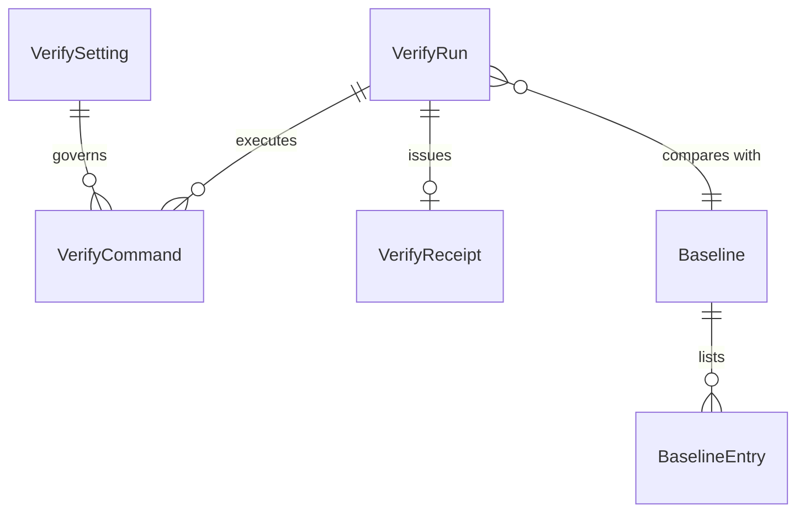

# Verify Receipt — Feature Spec

> **Tech-free Feature Spec.** One doc per module-level capability. Technical identifiers live only in frontmatter and the Section 8 hidden carriers.

## Sections

1. [Overview](#1-overview)
2. [Glossary](#2-glossary)
3. [User Stories & Acceptance Criteria](#3-user-stories--acceptance-criteria)
4. [Business Rules](#4-business-rules)
5. [Domain Model](#5-domain-model)
6. [Process Flows](#6-process-flows)
7. [Permissions & Roles](#7-permissions--roles)
8. [Test Specifications](#8-test-specifications)

---

## 1. Overview

A project declares the commands that check its code: a linter, a type check, the tests that cover a change, or one command that checks everything. Before a commit, the assistant runs them on the exact content the commit will hold and keeps a short-lived record of the result: the verify receipt. The commit gate reads that record.

1. A command the project has not declared, cannot start, or that runs past its time limit is reported as not proven. It never counts as passing.
2. An existing project usually starts with failures. A committed baseline lists the failures that were already there, so only new ones are reported, and the list only ever shrinks.
3. The project's verify setting decides what the gate does with a missing or failing receipt. `warn` (the default) tells the assistant what is unproven and how to fix it, and lets the commit proceed. `enforce` refuses the commit until the run passes or a reason for skipping it is recorded. `off` turns the check off for a project that proves its merges another way.

The receipt answers "did lint, types and tests pass on this tree?" with evidence instead of a claim. A reviewer, a pull request and the readiness check can rely on it.

---

## 2. Glossary

| Term           | Definition                                                                                                                                                 | Context                                           |
| -------------- | ---------------------------------------------------------------------------------------------------------------------------------------------------------- | ------------------------------------------------- |
| Verify command | One declared command that checks the code: one that checks everything, or a lint, type-check, change-scoped test or build command                          | Declared in the project settings                  |
| Not applicable | A verify command the project declares it does not have, for example a type check in an untyped project                                                     | Counts neither as missing nor as failing          |
| Verify run     | One execution of the declared commands against the working content, each within its time limit                                                             | Produces the results                              |
| Verify receipt | A short-lived record of one run's verdict, bound to the exact content it checked                                                                           | Read by the commit gate; expires within hours     |
| Verdict        | `PASS`, `FAIL` (a new failure), `INCOMPLETE` (something not proven), `UNAVAILABLE` (nothing could run) or `SKIPPED` (a recorded reason)                    | The receipt's outcome                             |
| Baseline       | The committed list of failures that already existed, per command, with the command it was taken for                                                        | Separates known failures from new ones            |
| Baseline entry | One known failure: a named rule in a file, a named test, a diagnostic code in a file, or the whole command's failing output when nothing finer can be read | Removed when it starts passing                    |
| Prune          | The deliberate step that removes baseline entries a run saw passing                                                                                        | Run before the review of a commit or pull request |
| Proven         | A command whose current text has a baseline record                                                                                                         | The durable signal that verification was set up   |
| Verify setting | `off`, `warn` (default) or `enforce`                                                                                                                       | Chosen by the team                                |

---

## 3. User Stories & Acceptance Criteria

### US-VRC-01: Know whether the code checks passed on what is committed

**As a** developer who asks the assistant to commit
**I want** the assistant to run the project's checks on exactly what the commit holds
**So that** "tests pass" is a recorded fact, not a claim

**Acceptance Criteria:**

- **AC-VRC-01** — **Given** declared verify commands **When** a run finishes **Then** the receipt records each command's outcome and one verdict, bound to the exact content checked
- **AC-VRC-02** — **Given** a command that is not declared, holds no command, cannot start or overruns its time limit **When** the run finishes **Then** that command is reported as not proven and the verdict is never `PASS`
- **AC-VRC-03** — **Given** a run whose commands changed the content while they ran **When** it finishes **Then** no receipt is issued and the run does not report success, because nobody checked the changed content

### US-VRC-02: Adopt verification in a project that already has failures

**As a** maintainer of an existing project
**I want** today's failures recorded once and only new failures reported
**So that** adding verification does not turn every commit red and the debt still shrinks

**Acceptance Criteria:**

- **AC-VRC-04** — **Given** a baseline **When** a run fails only on failures it lists **Then** the verdict is `PASS` and those failures are counted as known
- **AC-VRC-05** — **Given** a baseline **When** a run shows a failure it does not list **Then** the verdict is `FAIL` and only the new failure is reported
- **AC-VRC-06** — **Given** a baseline entry that now passes **When** a run finishes **Then** it is reported as removable and the run writes nothing; a prune removes it; if it fails again later it is new
- **AC-VRC-07** — **Given** a command already proven for the same text **When** someone asks to take the baseline again **Then** it is refused unless they explicitly ask to replace it

### US-VRC-03: Choose how strictly commits are gated

**As a** team lead
**I want** to choose whether missing proof warns, blocks or is ignored
**So that** the gate fits how the team already proves its merges

**Acceptance Criteria:**

- **AC-VRC-08** — **Given** the default setting **When** a reviewed commit has no passing receipt **Then** the commit proceeds and the assistant is told what is unproven, which failures are new, why it matters and how to fix it
- **AC-VRC-09** — **Given** `enforce` **When** a reviewed commit has no passing receipt **Then** the commit is refused; a `PASS` receipt or a recorded skip with a reason lets it through
- **AC-VRC-10** — **Given** `off` **When** any commit is made **Then** the verify check does not run
- **AC-VRC-11** — **Given** an invalid setting **When** a commit is made **Then** the gate reads it as `enforce` and names the field
- **AC-VRC-12** — **Given** any setting **When** a commit has no review **Then** it is still refused for the missing review; a verify receipt never stands in for a review

### US-VRC-04: Keep verification on every committing route

**As a** developer
**I want** the commit and pull-request routes to run verification and keep the baseline current
**So that** proof is fresh and the ratchet moves without anyone remembering it

**Acceptance Criteria:**

- **AC-VRC-13** — **Given** the commit or pull-request route **When** it prepares a commit **Then** it runs or reuses the verify receipt for the exact content, fixes new failures at their cause, and prunes now-passing entries before the review
- **AC-VRC-14** — **Given** a fix, a test run or a workflow close **When** verification is declared **Then** it reports the verdict and the removable entries, and does not prune

---

## 4. Business Rules

### Rule Catalog

| Rule ID   | Name                                                      | Category      | Enforcement |
| --------- | --------------------------------------------------------- | ------------- | ----------- |
| BR-VRC-01 | Missing is never passing                                  | Proof         | [HARD]      |
| BR-VRC-02 | Only new failures fail                                    | Proof         | [HARD]      |
| BR-VRC-03 | The baseline only shrinks, and only on purpose            | Ratchet       | [HARD]      |
| BR-VRC-04 | One command wins; otherwise the fast set                  | Configuration | [HARD]      |
| BR-VRC-05 | A receipt names the exact content it checked              | Integrity     | [HARD]      |
| BR-VRC-06 | Records hold no secrets and stay small                    | Privacy       | [HARD]      |
| BR-VRC-07 | The default warns and teaches                             | Gate          | [HARD]      |
| BR-VRC-08 | Enforce refuses; a skip needs a reason                    | Gate          | [HARD]      |
| BR-VRC-09 | Off turns the check off                                   | Gate          | [HARD]      |
| BR-VRC-10 | Invalid settings fail closed; old settings still validate | Configuration | [HARD]      |
| BR-VRC-11 | Verification never replaces review                        | Gate          | [HARD]      |
| BR-VRC-12 | The runner works on its own                               | Operability   | [HARD]      |
| BR-VRC-13 | Committing routes verify and prune before review          | Workflow      | [HARD]      |

### BR-VRC-01: Missing is never passing [HARD]

**Statement:** A command that is not declared, holds no command, cannot start or overruns its time limit is not proven. A run with any such command is `INCOMPLETE`; a run where nothing could run is `UNAVAILABLE`. Only a command declared not applicable is left out.

```
IF a planned command is missing, invalid, unrunnable or timed out
  → the verdict is INCOMPLETE (or UNAVAILABLE when nothing ran), never PASS
```

### BR-VRC-02: Only new failures fail [HARD]

**Statement:** A failure the baseline lists for the same command is known. A failure beyond what it lists is new. A failure is identified by what failed, not by where on a line it printed, so moving code does not make a known failure new. A second occurrence of a known failure is new. A combined command reports the failures of every report format it prints, and a different failing exit code is new. When the output cannot be read finer, the whole command's failing output is compared strictly, so any change, an improvement included, reads as new until it is taken again on purpose. Output beyond the capture limit is never known. Known limit: an extra failure that a command reports in no readable form, while it keeps the same exit code and its readable failures stay known, is not seen.

### BR-VRC-03: The baseline only shrinks, and only on purpose [HARD]

**Statement:** A run never writes the baseline. Entries are removed only by a prune of what a run saw passing. Taking the baseline again for a command it already proves is refused unless replacement is explicitly asked for. An entry recorded for a different command text, or a baseline taken by an earlier way of naming failures, is stale and reads as no baseline, with the reason reported.

### BR-VRC-04: One command wins; otherwise the fast set [HARD]

**Statement:** When a project declares one command that checks everything, only that command runs. Otherwise the lint, type-check and change-scoped test commands run, and the build runs only when the project opts in. Each command has its own time limit, which the project may change. A command that overruns it is stopped with everything it started, and stopping the runner stops the commands it started. Processes a command leaves running after it exits are stopped where the runner can still reach them, and the report says so when any were left; a process that left its group, or any left behind by a finished command on Windows, may keep running. No such process can hold the run open.

### BR-VRC-05: A receipt names the exact content it checked [HARD]

**Statement:** A receipt is bound to the same identity a review receipt uses: the repository, its storage, the base content and the checked content. Content that differs in any way has no receipt. The prune is the one change after a run that re-issues the receipt, for the pruned content only, and only after proving that the baseline was the only thing that changed; otherwise the write is undone. A receipt expires within hours.

### BR-VRC-06: Records hold no secrets and stay small [HARD]

**Statement:** Receipts, run results and the baseline hold command names, outcomes, counts and failure names only, never command output or environment values. A value that looks like a secret (a secret-named environment value, URL credentials, a bearer token) is removed where a failure name is read, so no later record, report or committed baseline can carry it, even inside a test name. Full output goes only to private, size-capped logs that are removed after a day. A receipt stays within the same size limit as a review receipt; long failure lists are trimmed, counts are kept. Concurrent writers never leave a half-written record.

### BR-VRC-07: The default warns and teaches [HARD]

**Statement:** Under `warn`, a reviewed commit with no passing receipt proceeds. The assistant receives what is unproven, the new failures only, why it matters and the fix. With no verify command declared at all, `warn` says nothing; setting up verification is the readiness check's job.

### BR-VRC-08: Enforce refuses; a skip needs a reason [HARD]

**Statement:** Under `enforce`, a commit with no `PASS` or `SKIPPED` receipt for its exact content is refused, including when no command is declared. A skip is recorded only with a reason of ten to five hundred characters, covers only the content it was recorded for, and is refused when a run on that content found new failures. A fault in the verify check itself refuses the commit under `enforce`.

### BR-VRC-09: Off turns the check off [HARD]

**Statement:** Under `off`, the verify check does not run. The review gate is unaffected.

### BR-VRC-10: Invalid settings fail closed; old settings still validate [HARD]

**Statement:** An invalid verify setting, build opt-in or time limit fails validation by name, and the gate reads it as `enforce`. A project setting that held a non-command value under a name the verify commands now use still validates, with a warning, and the runner reports that command as invalid.

### BR-VRC-11: Verification never replaces review [HARD]

**Statement:** The verify check runs only after the review check allows the commit. A passing receipt never lets an unreviewed commit through.

### BR-VRC-12: The runner works on its own [HARD]

**Statement:** The runner can be asked for its plan, to run, to check the current content, to record a skip, to prune and to take the baseline, without any other part of the assistant. Its results are machine-readable with exit codes that say whether the content is proven; a run whose commands changed the content reports that, never a success.

### BR-VRC-13: Committing routes verify and prune before review [HARD]

**Statement:** The commit and pull-request routes run or reuse the receipt for the exact content, fix new failures at their cause, prune now-passing entries and include the pruned baseline before their review. Their size-based test skip never skips the runner. Fixes, test runs and workflow closes report the verdict and removable entries and do not prune. A high-risk change also gets one reviewer who sees only the change, the rules and file paths, never the author's reasoning.

---

## 5. Domain Model

### Relationships (overview)



### Entity: VerifyCommand

| Property   | Type     | Required | Constraints                                              | Business Meaning |
| ---------- | -------- | -------- | -------------------------------------------------------- | ---------------- |
| key        | enum     | Yes      | everything, lint, type check, change-scoped tests, build | Which check      |
| command    | text     | No       | absent = missing; "none" = not applicable                | What runs        |
| time limit | duration | Yes      | default per key; project may change it                   | When it stops    |

### Entity: VerifyRun

| Property            | Type | Required    | Constraints                                                                        | Business Meaning     |
| ------------------- | ---- | ----------- | ---------------------------------------------------------------------------------- | -------------------- |
| per-command outcome | enum | Yes         | passed, failed, baselined, timed out, unrunnable, missing, invalid, not applicable | What happened        |
| new failures        | list | When failed | named failures beyond the baseline                                                 | What to fix          |
| removable entries   | list | No          | baseline entries now passing                                                       | What a prune removes |

### Entity: VerifyReceipt

| Property         | Type | Required     | Constraints                                   | Business Meaning   |
| ---------------- | ---- | ------------ | --------------------------------------------- | ------------------ |
| content identity | text | Yes          | repository, storage, base and checked content | What was checked   |
| verdict          | enum | Yes          | PASS, FAIL, INCOMPLETE, UNAVAILABLE, SKIPPED  | The answer         |
| expiry           | time | Yes          | within hours of issue                         | Proof goes stale   |
| skip reason      | text | When skipped | 10–500 characters                             | Why it was not run |

### Entity: Baseline and BaselineEntry

| Property       | Type | Required | Constraints                                           | Business Meaning             |
| -------------- | ---- | -------- | ----------------------------------------------------- | ---------------------------- |
| command record | text | Yes      | the command text it was taken for                     | Proof the command was set up |
| entries        | list | Yes      | named failures with counts, or one whole-output entry | Known failures               |

### Domain Events (business occurrences)

| Event          | When                                        | Effect                                            |
| -------------- | ------------------------------------------- | ------------------------------------------------- |
| Run finished   | All planned commands ended                  | A receipt is issued unless the content changed    |
| Baseline taken | A maintainer freezes today's failures       | Later runs report only new failures               |
| Entries pruned | A prune removes now-passing entries         | The receipt is re-issued for the pruned content   |
| Skip recorded  | Verification cannot run in this environment | The content has a `SKIPPED` receipt with a reason |

---

## 6. Process Flows

No user interface: this capability changes what the assistant checks before a commit, not a screen. Interaction surface sections are skipped for that reason.

### Flow: Commit with verification

| Step | Actor     | Action                                               | System Response                             | Next |
| ---- | --------- | ---------------------------------------------------- | ------------------------------------------- | ---- |
| 1    | Assistant | Stages exactly what the commit will hold             | Content fixed                               | 2    |
| 2    | Assistant | Reuses a current `PASS` receipt or runs the commands | Verdict, new failures, removable entries    | 3    |
| 3    | Assistant | Fixes each new failure at its cause and runs again   | Verdict `PASS`                              | 4    |
| 4    | Assistant | Prunes removable entries and stages the baseline     | Receipt re-issued for the pruned content    | 5    |
| 5    | Assistant | Runs the review and commits                          | Gate: silent, warning or refusal by setting | —    |

### Flow: Adopt verification in an existing project

| Step | Actor      | Action                                                 | System Response                        | Next |
| ---- | ---------- | ------------------------------------------------------ | -------------------------------------- | ---- |
| 1    | Maintainer | Declares the commands, from the project's own evidence | Plan lists them                        | 2    |
| 2    | Maintainer | Agrees to freeze today's failures                      | Baseline written; receipt issued       | 3    |
| 3    | Maintainer | Commits the baseline                                   | Later commits report only new failures | —    |

---

## 7. Permissions & Roles

This capability enforces no permission boundary of its own. It is a bounded speedbump against forgetting, not a security boundary: anyone with write access to the receipt store could forge a record.

| Role                   |  Declares commands and setting   | Takes or replaces the baseline  |               Records a skip               |                Prunes                 |
| ---------------------- | :------------------------------: | :-----------------------------: | :----------------------------------------: | :-----------------------------------: |
| Team lead / maintainer |               yes                |               yes               |                    yes                     |                  yes                  |
| Developer              | through normal repository access | with the maintainer's agreement |             yes, with a reason             |       yes, on the commit route        |
| Assistant              |          proposes only           |        only with consent        | only for an environment that cannot run it | on the commit and pull-request routes |

---

## 8. Test Specifications

### Test Summary

| Priority  | Count  | Automated | Manual |
| --------- | ------ | --------- | ------ |
| P0        | 8      | 8         | 0      |
| P1        | 5      | 5         | 0      |
| **Total** | **13** | **13**    | **0**  |

Every rule in §4 is `[HARD]`, so each case carries a property block under its Test Data: the input domain, the invariant that holds across it and the boundary counter-case. The suite builds its own throwaway repositories with small stand-in tools, so it runs the same on Windows, macOS and Linux.

### Runner Tests

#### TC-VRC-001: A missing or unusable command never counts as passing [P0]

**Objective:** Stop a project with no tests, or a broken tool, from reading as verified.

**Business Intent / Invariant Guarded:** BR-VRC-01 / AC-VRC-02.

**Preconditions:** A repository with some verify commands declared, some absent, one invalid, one that cannot start and one that runs too long.

**Real-World Reachability:** Most projects declare only some commands at first; tools go missing on new machines; large test suites overrun.

```gherkin
Given lint passes and the type check and tests are not declared
When the runner runs
Then the verdict is INCOMPLETE and each unproven command is named
And with no command at all the verdict is UNAVAILABLE
And a command that cannot start or overruns its limit is never passing
And only a command declared not applicable is left out of the verdict
```

**Expected Result:**

| Dimension               | Expectation                                               |
| ----------------------- | --------------------------------------------------------- |
| **UI**                  | Not applicable — the observable surface is the run report |
| **System behavior**     | Verdict INCOMPLETE or UNAVAILABLE, never PASS             |
| **Business data state** | Receipt records each unproven command                     |
| **Data shown on UI**    | Not applicable                                            |

**Acceptance Criteria:**

- ✅ Missing, invalid, unrunnable and timed-out commands are each named with the fix.
- ❌ Any of them counted as passing fails the case.

**Test Data:** Stand-in tools that pass, sleep past a one-second limit, or do not exist.

```yaml
inputDomain: 'any plan whose commands are each passed, missing, invalid, unrunnable, timed out or not applicable'
invariant: 'for ALL such plans the verdict is PASS only when every command is passed, known-failing or not applicable'
boundaryCounterCase: 'a plan of only not-applicable and passing commands is PASS; one missing command makes it INCOMPLETE'
```

**Edge Cases (boundary counter-case):** A command declared not applicable is not missing.

<!-- machine-only carrier — ignore when reading as BA/QA -->

> **Evidence:** `[Source: rule/hooks/verify-missing-never-passes]`
> **Related Behaviors:** `operation/hooks/verify-run`
> **CoveredBy:** `.claude/hooks/tests/suites/verify-receipt.test.cjs::TC-VRC-001`, `::TC-VRC-004`, `::TC-VRC-005`, `::TC-VRC-024` · **Status:** Tested

#### TC-VRC-002: Only failures beyond the baseline fail the run [P0]

**Objective:** Let an existing project adopt verification without permanent red.

**Business Intent / Invariant Guarded:** BR-VRC-02 / AC-VRC-04, AC-VRC-05.

**Preconditions:** A baseline with one lint failure and one failing test.

**Real-World Reachability:** Every brownfield project that adopts verification.

```gherkin
Given a baseline listing one lint rule and one failing test
When the same failures occur
Then the verdict is PASS and they are counted as known
When a new rule and a new test fail
Then the verdict is FAIL and only the new two are reported
And moving the failing code to another line keeps it known
And a second occurrence of a known rule in the same file is new
And a combined command's type error next to a known test failure is new
And a different failing exit code is new
And unreadable output is compared as a whole, so a changed failure is new
And output beyond the capture limit is never known
```

**Expected Result:**

| Dimension               | Expectation                                |
| ----------------------- | ------------------------------------------ |
| **UI**                  | Not applicable                             |
| **System behavior**     | Known failures pass; new ones fail by name |
| **Business data state** | Baseline unchanged by the run              |
| **Data shown on UI**    | Not applicable                             |

**Acceptance Criteria:**

- ✅ Lint reports, test reports and compiler diagnostics are named by what failed.
- ❌ A known failure reported as new, or a new one hidden, fails the case.

**Test Data:** Lint report, test report and diagnostic samples; an unreadable failing output.

```yaml
inputDomain: 'any failing output in a supported report format, or unreadable output'
invariant: 'for ALL such outputs a failure is known exactly when the baseline lists it for the same command at that count or more'
boundaryCounterCase: 'a second occurrence of a known rule in the same file is new; a line move of a known one is not'
```

**Edge Cases (boundary counter-case):** Warnings, skipped and to-do tests are not failures.

<!-- machine-only carrier — ignore when reading as BA/QA -->

> **Evidence:** `[Source: rule/hooks/verify-new-failures-only]`
> **Related Behaviors:** `operation/hooks/verify-output-parsing`
> **CoveredBy:** `.claude/hooks/tests/suites/verify-receipt.test.cjs::TC-VRC-002`, `::TC-VRC-008`, `::TC-VRC-009`, `::TC-VRC-021` · **Status:** Tested

#### TC-VRC-003: The baseline only shrinks, and only on purpose [P0]

**Objective:** Keep the debt list honest: no silent growth, no stale entries.

**Business Intent / Invariant Guarded:** BR-VRC-03 / AC-VRC-06, AC-VRC-07.

**Preconditions:** A baseline with two entries; one is then fixed.

**Real-World Reachability:** Every fix of an old failure; every attempt to re-freeze a red project.

```gherkin
Given a baseline entry that now passes
When the runner runs
Then it reports the entry as removable and writes nothing
When a prune runs
Then the entry is removed and the receipt is re-issued for the pruned content
When the fixed failure comes back
Then it is reported as new
And taking the baseline again for an already proven command is refused unless replacement is asked for
And an entry taken for a different command text, or by an earlier way of naming failures, reads as no baseline with its reason
And a prune during which another file changed is undone and issues no receipt
```

**Expected Result:**

| Dimension               | Expectation                                               |
| ----------------------- | --------------------------------------------------------- |
| **UI**                  | Not applicable                                            |
| **System behavior**     | Read-only runs; deliberate prunes                         |
| **Business data state** | Baseline count never grows except by explicit replacement |
| **Data shown on UI**    | Not applicable                                            |

**Acceptance Criteria:**

- ✅ The run report states the remaining entries and how many a prune would remove.
- ❌ A run that edits the baseline fails the case.

**Test Data:** A two-entry baseline and the same tool with one entry fixed.

```yaml
inputDomain: 'any sequence of runs, prunes and baseline requests'
invariant: 'for ALL such sequences the entry count only drops, except on an explicit replacement or a changed command'
boundaryCounterCase: 'a repeated baseline request with no replacement asked changes nothing'
```

**Edge Cases (boundary counter-case):** A prune without a matching run removes nothing.

<!-- machine-only carrier — ignore when reading as BA/QA -->

> **Evidence:** `[Source: rule/hooks/verify-baseline-ratchet]`
> **Related Behaviors:** `operation/hooks/verify-prune`
> **CoveredBy:** `.claude/hooks/tests/suites/verify-receipt.test.cjs::TC-VRC-003`, `::TC-VRC-012`, `::TC-VRC-026` · **Status:** Tested

#### TC-VRC-006: One command wins; otherwise the fast set [P1]

**Objective:** Keep the run bounded and predictable on any project size.

**Business Intent / Invariant Guarded:** BR-VRC-04.

**Preconditions:** Projects with and without a single everything command, with and without a build opt-in.

**Real-World Reachability:** Large monorepos declare one bounded command; small projects declare the fast set.

```gherkin
Given a single everything command
When the runner plans
Then only that command is planned
Given no everything command
Then lint, type check and change-scoped tests are planned, and the build only with the opt-in
And a command over its limit, or one that leaves a process holding its output, is stopped near its limit
And stopping the runner stops the command it started
```

**Expected Result:**

| Dimension               | Expectation                 |
| ----------------------- | --------------------------- |
| **UI**                  | Not applicable              |
| **System behavior**     | Plan follows the precedence |
| **Business data state** | None written                |
| **Data shown on UI**    | Not applicable              |

**Acceptance Criteria:**

- ✅ The opted-in build runs.
- ❌ A build that runs without the opt-in fails the case.

**Test Data:** Three project settings.

```yaml
inputDomain: 'any combination of declared commands and the build opt-in'
invariant: 'for ALL such combinations the everything command, when declared, is the only one planned'
boundaryCounterCase: 'an everything command declared not applicable falls back to the fast set'
```

**Edge Cases (boundary counter-case):** A declared build without the opt-in is not planned.

<!-- machine-only carrier — ignore when reading as BA/QA -->

> **Evidence:** `[Source: rule/hooks/verify-runner-precedence]`
> **CoveredBy:** `.claude/hooks/tests/suites/verify-receipt.test.cjs::TC-VRC-006` · **Status:** Tested

#### TC-VRC-007: A receipt names the exact content it checked [P0]

**Objective:** Make a receipt worthless for any content it did not check.

**Business Intent / Invariant Guarded:** BR-VRC-05 / AC-VRC-01, AC-VRC-03.

**Preconditions:** A run, then an edit; a run whose command writes a tracked file.

**Real-World Reachability:** An edit after verification is the common way stale proof reaches a commit.

```gherkin
Given a run whose command changed the content while it ran
Then no receipt is issued
Given a passing run and then an edit
When the commit is checked
Then no receipt matches the new content
And a skip covers only the content it was recorded for
```

**Expected Result:**

| Dimension               | Expectation                          |
| ----------------------- | ------------------------------------ |
| **UI**                  | Not applicable                       |
| **System behavior**     | Receipts match by exact content only |
| **Business data state** | No receipt for changed content       |
| **Data shown on UI**    | Not applicable                       |

**Acceptance Criteria:**

- ✅ The prune is the only post-run change that re-issues the receipt.
- ❌ A receipt matching edited content fails the case.

**Test Data:** A tool that writes a tracked file; an edit after a run.

```yaml
inputDomain: 'any content differing from the checked content in any file'
invariant: 'for ALL such content no receipt matches'
boundaryCounterCase: 'content identical to the checked content matches, whether staged or not'
```

**Edge Cases (boundary counter-case):** Ignored build output does not change the content.

<!-- machine-only carrier — ignore when reading as BA/QA -->

> **Evidence:** `[Source: rule/hooks/verify-receipt-binding]`
> **CoveredBy:** `.claude/hooks/tests/suites/verify-receipt.test.cjs::TC-VRC-007`, `::TC-VRC-013`, `::TC-VRC-026` · **Status:** Tested

#### TC-VRC-010: Records hold no secrets and stay small [P0]

**Objective:** Keep receipts and the baseline safe to keep and to commit.

**Business Intent / Invariant Guarded:** BR-VRC-06.

**Preconditions:** A failing command that prints a secret-looking environment value; a run with hundreds of failures; three concurrent baseline writers.

**Real-World Reachability:** Test output often echoes tokens; brownfield runs have long failure lists; two sessions can share a checkout.

```gherkin
Given a failing command that prints a secret value from the environment
When the run finishes or the baseline is taken
Then neither the receipt, the run results, the report nor the committed baseline contain the value or URL credentials
And a run with four hundred failures still fits the receipt limit with its counts intact
And three writers racing on the baseline leave one whole, valid file
```

**Expected Result:**

| Dimension               | Expectation                             |
| ----------------------- | --------------------------------------- |
| **UI**                  | Not applicable                          |
| **System behavior**     | Redaction; trimmed lists; atomic writes |
| **Business data state** | No secret, no torn file                 |
| **Data shown on UI**    | Not applicable                          |

**Acceptance Criteria:**

- ✅ Counts survive trimming.
- ❌ A secret in any record fails the case.

**Test Data:** A token-like value; a 400-failure report.

```yaml
inputDomain: 'any run output and any number of concurrent writers'
invariant: 'for ALL such runs records hold no secret-looking environment value and every write is whole'
boundaryCounterCase: 'a failure list longer than the limit is trimmed, not dropped from the counts'
```

**Edge Cases (boundary counter-case):** Diagnostics without a code are named by a short hash, never their text.

<!-- machine-only carrier — ignore when reading as BA/QA -->

> **Evidence:** `[Source: constraint/hooks/verify-records-redacted]`
> **CoveredBy:** `.claude/hooks/tests/suites/verify-receipt.test.cjs::TC-VRC-010`, `::TC-VRC-011` · **Status:** Tested

#### TC-VRC-014: The runner works on its own [P1]

**Objective:** Let any route, script or person ask the runner directly.

**Business Intent / Invariant Guarded:** BR-VRC-12.

**Preconditions:** A repository with declared commands.

**Real-World Reachability:** The pull-request route, a readiness check and a person at a terminal all call it.

```gherkin
Given declared commands
When the plan, run and check requests are made directly
Then each returns machine-readable results
And the exit code says proven, not proven, or error
And a run whose commands changed the content reports it and never exits as a success
And the plan names commands by key, never by their text
```

**Expected Result:**

| Dimension               | Expectation                         |
| ----------------------- | ----------------------------------- |
| **UI**                  | Not applicable                      |
| **System behavior**     | Standalone requests with exit codes |
| **Business data state** | Receipt only from run               |
| **Data shown on UI**    | Not applicable                      |

**Acceptance Criteria:**

- ✅ An unknown option is an error.
- ❌ A failing run reported with a success exit code fails the case.

**Test Data:** Stand-in lint and test tools.

```yaml
inputDomain: 'any standalone request'
invariant: 'for ALL such requests the exit code is success only for a proven or completed result'
boundaryCounterCase: 'a failing run exits not-proven, an unknown option exits error'
```

**Edge Cases (boundary counter-case):** None beyond the counter-case.

<!-- machine-only carrier — ignore when reading as BA/QA -->

> **Evidence:** `[Source: operation/hooks/verify-receipt-cli]`
> **CoveredBy:** `.claude/hooks/tests/suites/verify-receipt.test.cjs::TC-VRC-014` · **Status:** Tested

### Gate Tests

#### TC-VRC-020: The default warns and teaches [P0]

**Objective:** Tell the assistant what is unproven without stopping work.

**Business Intent / Invariant Guarded:** BR-VRC-07 / AC-VRC-08.

**Preconditions:** A reviewed commit; declared commands; no receipt, then a failing receipt with one known and one new failure.

**Real-World Reachability:** Every commit in a project on the default setting.

```gherkin
Given the default setting and a reviewed commit with no receipt
When the commit is attempted
Then it proceeds and the assistant is told the receipt is missing, why it matters and the command to run
Given a failing receipt with one known and one new failure
Then only the new failure is named
Given a passing receipt
Then nothing is said
```

**Expected Result:**

| Dimension               | Expectation                  |
| ----------------------- | ---------------------------- |
| **UI**                  | Not applicable               |
| **System behavior**     | Commit allowed with guidance |
| **Business data state** | None                         |
| **Data shown on UI**    | Not applicable               |

**Acceptance Criteria:**

- ✅ The guidance names the fix and why it matters.
- ❌ A known failure in the guidance, or a refusal, fails the case.

**Test Data:** Stand-in lint tool and baseline.

```yaml
inputDomain: 'any reviewed commit under the default setting'
invariant: 'for ALL such commits the commit proceeds; guidance appears exactly when no passing receipt matches and a command is declared'
boundaryCounterCase: 'with no command declared the default says nothing'
```

**Edge Cases (boundary counter-case):** The guidance reaches the assistant as context, not as an error.

<!-- machine-only carrier — ignore when reading as BA/QA -->

> **Evidence:** `[Source: rule/hooks/verify-gate-warn]`
> **CoveredBy:** `.claude/hooks/tests/suites/verify-receipt.test.cjs::TC-VRC-020`, `::TC-VRC-021`, `::TC-VRC-028` · **Status:** Tested

#### TC-VRC-022: Enforce refuses; a skip needs a reason [P0]

**Objective:** Give teams that want it a hard proof gate with a recorded escape.

**Business Intent / Invariant Guarded:** BR-VRC-08 / AC-VRC-09.

**Preconditions:** `enforce`; a reviewed commit; no receipt, a failing receipt, a skip with a reason, a passing receipt.

**Real-World Reachability:** Teams without CI that want local proof before every commit.

```gherkin
Given enforce and a reviewed commit with no receipt or a failing receipt
When the commit is attempted
Then it is refused with the new failures and the recorded escape named
Given a skip recorded with a reason, or a passing receipt
Then the commit proceeds
And a skip reason shorter than ten characters is refused
And a skip over a run that found new failures is refused
And a fault in the check itself refuses the commit under enforce and only loses the advisory under warn
```

**Expected Result:**

| Dimension               | Expectation                                   |
| ----------------------- | --------------------------------------------- |
| **UI**                  | Not applicable                                |
| **System behavior**     | Refusal until proven or skipped with a reason |
| **Business data state** | Skip recorded with its reason                 |
| **Data shown on UI**    | Not applicable                                |

**Acceptance Criteria:**

- ✅ Enforce with no declared command refuses, naming the missing commands.
- ❌ A refused commit without the escape named fails the case.

**Test Data:** Stand-in test tool; a maintenance reason.

```yaml
inputDomain: 'any reviewed commit under enforce'
invariant: 'for ALL such commits the commit proceeds only with a PASS or SKIPPED receipt for its exact content'
boundaryCounterCase: 'a skip recorded for other content does not let this commit through'
```

**Edge Cases (boundary counter-case):** The real gate process refuses with its blocking exit, not only in-process.

<!-- machine-only carrier — ignore when reading as BA/QA -->

> **Evidence:** `[Source: rule/hooks/verify-gate-enforce]`
> **CoveredBy:** `.claude/hooks/tests/suites/verify-receipt.test.cjs::TC-VRC-022`, `::TC-VRC-024`, `::TC-VRC-028` · **Status:** Tested

#### TC-VRC-023: Off turns the check off [P1]

**Objective:** Let a project with its own merge proof opt out.

**Business Intent / Invariant Guarded:** BR-VRC-09 / AC-VRC-10.

**Preconditions:** `off`; a failing receipt.

**Real-World Reachability:** Projects with required CI checks or their own local receipts.

```gherkin
Given off and a reviewed commit with a failing receipt
When the commit is attempted
Then it proceeds with no verify guidance
```

**Expected Result:**

| Dimension               | Expectation     |
| ----------------------- | --------------- |
| **UI**                  | Not applicable  |
| **System behavior**     | No verify check |
| **Business data state** | None            |
| **Data shown on UI**    | Not applicable  |

**Acceptance Criteria:**

- ✅ Silent.
- ❌ Any verify output fails the case.

**Test Data:** Stand-in failing test tool.

```yaml
inputDomain: 'any reviewed commit under off'
invariant: 'for ALL such commits the verify check adds nothing'
boundaryCounterCase: 'an unreviewed commit is still refused by the review check'
```

**Edge Cases (boundary counter-case):** See the counter-case.

<!-- machine-only carrier — ignore when reading as BA/QA -->

> **Evidence:** `[Source: rule/hooks/verify-gate-off]`
> **CoveredBy:** `.claude/hooks/tests/suites/verify-receipt.test.cjs::TC-VRC-023` · **Status:** Tested

#### TC-VRC-025: Invalid settings fail closed; old settings still validate [P1]

**Objective:** A typo never turns a team's gate off, and an update never breaks a project that validated before.

**Business Intent / Invariant Guarded:** BR-VRC-10 / AC-VRC-11.

**Preconditions:** An invalid setting value; invalid time limits; a project that held a nested value under a now-reserved command name.

**Real-World Reachability:** Hand-edited project settings; projects updating from an older framework.

```gherkin
Given an invalid verify setting
When a reviewed commit is attempted
Then it is refused as enforce and the field is named
And validation names each invalid setting, limit or unknown command key
And a nested value under a reserved command name validates with a warning
```

**Expected Result:**

| Dimension               | Expectation                                      |
| ----------------------- | ------------------------------------------------ |
| **UI**                  | Not applicable                                   |
| **System behavior**     | Fail closed at the gate; fail soft at the runner |
| **Business data state** | None                                             |
| **Data shown on UI**    | Not applicable                                   |

**Acceptance Criteria:**

- ✅ An unreadable settings file reads as the default with no commands.
- ❌ An invalid value read as off fails the case.

**Test Data:** Invalid values; an old nested command map.

```yaml
inputDomain: 'any project settings file'
invariant: 'for ALL readable settings an invalid verify value is enforce at the gate and an error in validation'
boundaryCounterCase: 'an older settings file with a nested value under a reserved name stays valid'
```

**Edge Cases (boundary counter-case):** A per-file lint command without its file placeholder warns.

<!-- machine-only carrier — ignore when reading as BA/QA -->

> **Evidence:** `[Source: schema/hooks/verify-settings]`
> **CoveredBy:** `.claude/hooks/tests/suites/verify-receipt.test.cjs::TC-VRC-025`, `::TC-VRC-030`, `::TC-VRC-031` · **Status:** Tested

#### TC-VRC-027: Verification never replaces review [P0]

**Objective:** Keep the review gate's contract unchanged.

**Business Intent / Invariant Guarded:** BR-VRC-11 / AC-VRC-12.

**Preconditions:** A passing verify receipt; no review receipt.

**Real-World Reachability:** An assistant that ran the tests and wants to skip the review.

```gherkin
Given a passing verify receipt and no review
When the commit is attempted
Then it is refused for the missing review
```

**Expected Result:**

| Dimension               | Expectation              |
| ----------------------- | ------------------------ |
| **UI**                  | Not applicable           |
| **System behavior**     | Review refusal unchanged |
| **Business data state** | None                     |
| **Data shown on UI**    | Not applicable           |

**Acceptance Criteria:**

- ✅ The review refusal message is unchanged.
- ❌ An unreviewed commit let through fails the case.

**Test Data:** Stand-in passing tool.

```yaml
inputDomain: 'any commit with any verify receipt'
invariant: 'for ALL such commits the review check decides first and alone whether review is satisfied'
boundaryCounterCase: 'a passing receipt with a review skip receipt still needs the skip to be valid'
```

**Edge Cases (boundary counter-case):** The existing review-gate cases stay green.

<!-- machine-only carrier — ignore when reading as BA/QA -->

> **Evidence:** `[Source: rule/hooks/verify-never-replaces-review]`
> **CoveredBy:** `.claude/hooks/tests/suites/verify-receipt.test.cjs::TC-VRC-027`, `.claude/hooks/tests/suites/review-commit-gate.test.cjs` · **Status:** Tested

### Route Tests

#### TC-VRC-040: Committing routes verify and prune before review [P1]

**Objective:** Make proof and the ratchet part of every commit without anyone remembering them.

**Business Intent / Invariant Guarded:** BR-VRC-13 / AC-VRC-13, AC-VRC-14.

**Preconditions:** The shipped commit, pull-request, fix, test, workflow-close, review and implementation guidance.

**Real-World Reachability:** Every commit and pull request an assistant makes.

```gherkin
Given the commit and pull-request guidance
Then they run or reuse the receipt, fix new failures at their cause, prune and stage the baseline before review
And the pull-request size skip never skips the runner, and the pull request cites the receipt
And fixes, test runs and workflow closes report removable entries and never prune
And a high-risk change gets a reviewer who sees only the change, the rules and file paths
```

**Expected Result:**

| Dimension               | Expectation                                         |
| ----------------------- | --------------------------------------------------- |
| **UI**                  | Not applicable — the observable surface is guidance |
| **System behavior**     | Guidance routes through the runner                  |
| **Business data state** | None                                                |
| **Data shown on UI**    | Not applicable                                      |

**Acceptance Criteria:**

- ✅ Each route names the runner and its prune or report-only role.
- ❌ A route that prunes outside commit or pull request fails the case.

**Test Data:** The shipped guidance; two behavior evaluation cases (a high-risk review and a commit with a new failure and a removable entry).

```yaml
inputDomain: 'every route that commits, fixes, tests, closes or reviews'
invariant: 'for ALL such routes only commit and pull request prune, and all of them read the receipt when commands are declared'
boundaryCounterCase: 'a project with no declared command skips the runner on every route'
```

**Edge Cases (boundary counter-case):** A partial commit that leaves other work out cannot carry a receipt; the guidance says to set that work aside or record why.

<!-- machine-only carrier — ignore when reading as BA/QA -->

> **Evidence:** `[Source: requirement/skills/verify-on-commit-routes]`
> **CoveredBy:** `.claude/hooks/tests/suites/verify-receipt.test.cjs::TC-VRC-040`, `::TC-VRC-041`, `::TC-VRC-042` · **Status:** Tested

### Invariant / Property Tests

Every rule in §4 is `[HARD]`. Each case above carries its property block under its Test Data; this index names the case that guards each rule.

| Rule      | Guarded by |
| --------- | ---------- |
| BR-VRC-01 | TC-VRC-001 |
| BR-VRC-02 | TC-VRC-002 |
| BR-VRC-03 | TC-VRC-003 |
| BR-VRC-04 | TC-VRC-006 |
| BR-VRC-05 | TC-VRC-007 |
| BR-VRC-06 | TC-VRC-010 |
| BR-VRC-07 | TC-VRC-020 |
| BR-VRC-08 | TC-VRC-022 |
| BR-VRC-09 | TC-VRC-023 |
| BR-VRC-10 | TC-VRC-025 |
| BR-VRC-11 | TC-VRC-027 |
| BR-VRC-12 | TC-VRC-014 |
| BR-VRC-13 | TC-VRC-040 |

---
